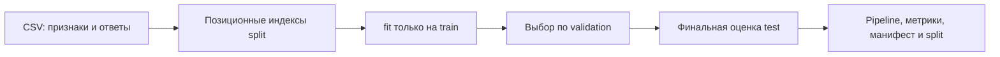

# 01. ML и оценка моделей

[Программа](../../README.md) · [Практика](practice.md) · [Подсказки](hints.md)

Практика, реализации и все тесты находятся в одном [housing.ipynb](housing.ipynb). Проверки выполняются ячейками notebook; общие команды курса этот модуль пропускают. Зависимости устанавливаются первой ячейкой, результат сохраняется последней прямо в `work/artifacts/`.

## Цель и вход

Построить корректный эксперимент регрессии и объяснить, почему его качество можно ожидать на новых данных. Нужны Python, массивы и таблицы из модуля 00. Основной датасет — California Housing: восемь числовых признаков и медианная стоимость жилья в районе. Target измерен в сотнях тысяч долларов; это исторические данные, а не современная оценка рынка.

После [табличного анализа](../00-python/tasks/03-tabular-analysis/README.md) у тебя есть `work/housing.csv` и понимание его схемы. Теперь нужно получить файл, который сервис сможет загрузить для прогноза. Запустить `fit` недостаточно: нужно проверить пользу относительно простого ответа, сохранить подготовку признаков и объяснить происхождение метрик. Одинаково выглядящий HTTP-ответ с числом может скрывать хорошую модель, константу или ошибку порядка столбцов.

CSV создаёт готовая команда `python -m housing.data --output work/housing.csv`. Она сохраняет восемь признаков из `housing.features.FEATURES`, target `MedHouseVal` и рядом контрольную сумму `work/housing.sha256`. Повторная загрузка по занятому пути завершается отказом, чтобы не затереть вход. Полные данные нужны для проверки качества; тесты упражнений используют маленькие локальные таблицы и не скачивают housing.

## От строки района к прогнозу

Одна строка описывает район, а не отдельный дом. `MedInc` — медианный доход, `HouseAge` — медианный возраст домов, `AveRooms`/`AveBedrms` — средние количества комнат/спален, `Population` — население, `AveOccup` — средняя заселённость, `Latitude`/`Longitude` — координаты. `MedHouseVal` — медианная стоимость жилья в том же районе. Подробные единицы источника можно посмотреть в документации датасета; единица прогнозируемого target здесь фиксирована как `100000 USD`.

**Обучение** (`fit`) подбирает параметры по примерам с известным ответом. **Инференс** (`predict`) применяет уже подобранные параметры к признакам. Для новой строки сервису нельзя требовать `MedHouseVal`: именно его и нужно предсказать. Порядок признаков закреплён в `FEATURES`, потому что восемь чисел без их значения не определяют правильный вход модели.

Работа состоит из цепочки:



Индексы сохраняют связь с исходной строкой CSV. После двух этапов перемешивания номера внутри полученного массива не являются исходными идентификаторами. Для позиционных индексов нужен `.iloc`; `.loc` обращается к меткам и совпадает с ним только у определённого индекса.

## Что делает MLOps-инженер в ML-эксперименте

Необязательно изобретать алгоритм, но нужно понимать, что обучается, что сохраняется и что проверяется перед выпуском. Различай параметры, вычисленные из данных, и гиперпараметры, заданные до обучения. Модель — часть системы: ошибка в preprocessing способна ухудшить результат сильнее смены алгоритма.

Supervised learning использует известный target; классификация предсказывает категорию, регрессия — число. Embedding-модель кодирует объект в вектор; её качество нельзя оценить одной MAE. В этом модуле изучается регрессия, а поисковые метрики появятся в модуле 13.

## Разбиение и утечка

Данные делятся на train, validation и test. Train нужен для обучения, validation — для выбора алгоритма и гиперпараметров, test — для финального сравнения уже выбранного кандидата. Если после каждого взгляда на test менять параметры, test фактически становится validation.

Для учебного baseline зафиксируй seed 42 и доли 60/20/20: сначала отдели test 20%, затем из оставшихся 80% выдели validation 25%. Сохрани идентификаторы строк. Не рассчитывай scaler или imputer на полной таблице: это передаёт информацию из будущей оценки в обучение.

Случайный split не универсален. В данных по пользователям одна сущность в train и test создаёт слишком оптимистичную оценку. Для временного прогноза нужно обучаться на прошлом. У California Housing есть пространственная структура, поэтому random split даёт ограниченную оценку переноса на новые регионы. В дополнительном опыте сравни его с разделением по географии и объясни разницу.

## Baseline и метрики

До сложной модели обучи `DummyRegressor(strategy="mean")`. Он показывает, достаточно ли полезна текущая реализация хотя бы относительно постоянного ответа.

Для ошибок `e_i = y_i - prediction_i` MAE — среднее `abs(e_i)`, RMSE — квадратный корень среднего `e_i²`. Обе метрики выражены в единицах target, но RMSE сильнее штрафует большие промахи. На ошибках 0 и 2 MAE равна 1, RMSE — примерно 1,414. Если умножить результат housing на 100000, получишь доллары исторического датасета.

Среднее качество скрывает группы: модель может быть приемлемой в целом и слабой для дорогого жилья. Покажи метрики минимум по квартилям target и числу наблюдений. Не сравнивай метрики двух моделей на разных test-наборах.

Для классификации аналогичные вопросы решаются через precision/recall, confusion matrix, PR-AUC и калибровку. Accuracy на редком положительном классе может быть высокой у бесполезной модели. Выбор метрики начинается с стоимости ошибки, а не с красивого числа.

## Pipeline и модели

Pipeline объединяет preprocessing и estimator, чтобы одинаковая трансформация применялась при fit и predict. Пример на игрушечных данных:

```python
from sklearn.pipeline import make_pipeline
from sklearn.preprocessing import StandardScaler
from sklearn.linear_model import Ridge

pipe = make_pipeline(StandardScaler(), Ridge(alpha=1.0))
pipe.fit([[1.0], [2.0], [3.0]], [2.0, 4.0, 6.0])
print(pipe.predict([[4.0]]))
```

В основной практике выбери линейную модель и небольшой ансамбль деревьев. Масштабирование важно для многих линейных и дистанционных методов, но обычно не является обязательным для деревьев. Проведи небольшой заранее заданный поиск параметров на validation. Увеличение глубины дерева снижает train error, но может увеличить validation error: это один из признаков переобучения.

В этом примере `StandardScaler` запоминает среднее и масштаб только трёх обучающих строк. Для значений `[1, 2, 3]` среднее равно 2; следующий вызов `predict([[4]])` использует уже сохранённое преобразование. `Ridge(alpha=1.0)` — линейная регрессия со штрафом за большие коэффициенты. `alpha` выбирают до `fit`; коэффициенты находятся во время обучения. Пример возвращает прогноз примерно `[7.0]`: регуляризация сдвигает его относительно продолжения точной линии `y=2x`, которое дало бы 8. Проверка состоит в конечном числе и повторяемом прогнозе после сохранения Pipeline, а не в ожидании, что любой алгоритм точно продолжит три точки.

**Preprocessing**, или подготовка признаков, включает преобразования вроде масштабирования и заполнения пропусков. `Pipeline.fit` обучает преобразования на train и передаёт результат estimator — объекту, который учится предсказывать. `Pipeline.predict` применяет те же преобразования к новым строкам. Это похоже на один Go-компонент с внутренним порядком стадий: вызывающий код передаёт сырой корректный вход, а не обязан помнить, какой scaler использовать. Граница аналогии: scaler содержит обученное состояние, поэтому его нельзя восстановить только по исходному коду функции.

Случайный лес (`RandomForestRegressor`) объединяет прогнозы нескольких деревьев решений. Число деревьев и ограничение глубины влияют на время, память и качество. Маленький ансамбль подходит для CPU-практики; не требуется использовать все ядра. `random_state=seed` задаёт воспроизводимый источник случайности алгоритму, а не автоматически всем функциям программы. Для сравнения Ridge и леса нужны один CSV и один split; иначе одновременно меняются модель и вопрос, на котором её оценивают.

## Разобранный baseline и выбор кандидата

Пусть только две train-строки имеют ответы `[1, 3]`. `DummyRegressor(strategy="mean")` запоминает среднее `(1+3)/2=2` и возвращает 2 независимо от признаков. Для validation-ответа `[100]` MAE равна 98. Для test `[20, 40]` ошибки 18 и 38, MAE равна 28. Если baseline внезапно стал предсказывать среднее всей таблицы, в `fit` попали validation/test. Это можно обнаружить маленьким тестом с резко отличающимися ответами, не обучая весь housing.

Следующая таблица иллюстрирует выбор; числа условные:

| Конфигурация | Validation MAE | Test MAE после выбора |
|---|---|---|
| Dummy | 0.90 | Не используется для настройки |
| Ridge, вариант A | 0.60 | Не используется для настройки |
| Лес, вариант B | 0.50 | 0.54 |

По validation выбирается B. После выбора сравнивается его test MAE с test MAE baseline на тех же строках. Контракт практики требует `candidate.test.mae <= 0.9 * baseline.test.mae`: улучшение хотя бы на 10% относительно простого ответа. Если baseline test MAE равна 0.80, граница равна 0.72; 0.54 проходит. Это учебный критерий выпуска, а не обещание полезности модели для любого реального продукта. Дополнительный перебор по уже увиденному test нарушает независимость финальной оценки.

## Что сохраняет программа обучения

Реализуемый `train` находится в [ML-notebook](housing.ipynb). `python -m housing.train` — адаптер к той же функции, а не готовое скрытое решение. После реализации команда с `--data`, `--output`, `--seed` создаёт четыре файла:

| Артефакт | Содержимое | Кто использует дальше |
|---|---|---|
| `model.joblib` | Bundle: `schema_version=1`, Pipeline, `features=FEATURES`, непустая `model_version` | API модуля 03 |
| `metrics.json` | `baseline`/`candidate`, внутри `validation`/`test`, внутри `mae`/`rmse` | Сравнение запусков и проверка качества |
| `manifest.json` | Seed, SHA-256 данных, версии, параметры, порядок признаков, split | Восстановление модуля 02 |
| `split.json` | Исходные позиционные индексы train/validation/test | Повтор оценки на тех же строках |

**Bundle** — комплект объекта модели с метаданными его входного контракта. **Сериализация** сохраняет Python-объект в файл; joblib восстанавливает его для последующего `predict`. Загружай только собственные доверенные файлы: этот формат способен выполнять код при чтении. Model version — твой идентификатор модели; он отличается от номера версии библиотеки sklearn.

В notebook обучение готовит комплект во временной папке и загружает его в память для анализа. Последняя ячейка сохраняет четыре файла прямо в `work/artifacts/`, откуда их читает API. Сохранение не улучшает модель и не реализует `train`. При повторном обучении через CLI результат записывается в переданный `--output`, отдельно от активной модели. Точный контракт приведён в [описании housing](../../labs/housing/README.md#артефакты).

## Анализ групп и неверные успехи

**Квартиль** — одна из четырёх групп по возрастанию target. Для ответов `[0,1,2,3,4,5,6,7]` и постоянного прогноза 0 первая группа `[0,1]` имеет MAE=0.5, последняя `[6,7]` — 6.5. Общая MAE=3.5 скрывает это различие. Рядом с ошибкой нужна `count`: оценка на двух строках менее устойчива, чем на тысячах. Повторяющиеся границы могут уменьшить число групп `qcut`; одинаковые ответы в контракте обрабатываются одной группой.

Географическое разделение по `Latitude` проверяет другой сценарий: обучение ниже границы и оценку на районах выше неё. Если random split хорош, а geographic split плох, это может означать слабый перенос на новые регионы. Это не доказательство ошибки расчёта, пока не проверены индексы, одинаковые метрики и отсутствие утечки. Такая проверка ближе к бизнес-вопросу о будущем входе, чем механическое улучшение одного числа.

| Симптом | Возможная причина | Различающая проверка |
|---|---|---|
| Почти нулевая ошибка на всех выборках | Target попал в признаки | Сравнить вход `fit/predict` с `FEATURES` |
| Хороший train, слабый validation | Переобучение или иной состав данных | Сравнить размеры, распределения и глубину модели |
| После загрузки прогноз другой | Сохранён только estimator, потерян scaler | Сохранить и загрузить весь Pipeline на одном batch |
| Повтор с seed дал другой результат | Изменились CSV, split, параметры или среда | Сначала сравнить SHA-256 и индексы, потом версии |

Намеренный опыт со scaler, обученным до split, показывает нарушение границы даже тогда, когда метрика почти не изменилась. Утечка определяется доступом к информации, а не обязательным размером улучшения. Его артефакт нельзя экспортировать как корректную модель.

## Ограничения воспроизводимости

Один seed не фиксирует версии библиотек, количество потоков, данные и floating-point поведение оборудования. Сохраняй среду, параметры, split и хеш данных. Близкие, но не побитово одинаковые результаты на разных платформах требуют проверки допуска, а не автоматического вывода об ошибке.

Веса модели без порядка признаков и preprocessing недостаточны для сервиса. Контракт артефакта следующего модуля включает весь Pipeline и метаданные.

## Материалы

- [California Housing](https://scikit-learn.org/stable/datasets/real_world.html#california-housing-dataset) — описание признаков, единицы target и происхождение данных.
- [Common pitfalls](https://scikit-learn.org/stable/common_pitfalls.html) — inconsistent preprocessing, data leakage, random state.
- [Model evaluation](https://scikit-learn.org/stable/modules/model_evaluation.html) — regression metrics и ограничения сравнения.
- [FSDL course](https://fullstackdeeplearning.com/course/2022/) — лекции о lifecycle, testing и deployment; использовать концепции, не копировать старые команды установки.
