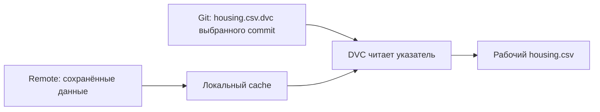

# 02. Восстановить данные и повторить обучение

[Программа](../../README.md) · [Задания](#задания) · [Подготовка](#подготовка-к-заданиям)

## Какую проблему решаем

Коллега запускает твою команду обучения, но получает другую ошибку модели. У обоих есть файл `housing.csv` и одинаковый seed. Этого недостаточно: мог измениться сам CSV, порядок строк, настройки, исходники или зависимости. Нужно восстановить условия первого запуска и проверить результат по частям.

Вход этого модуля — собственный CSV и четыре файла из [ML-notebook](../01-ml/housing.ipynb). Небольшие тесты функций создают свои временные файлы. Реальный опыт повторения использует твой `train` и данные исходного обучения.

## Задания

| Тема | Что реализовать и проверить | Файлы |
|---|---|---|
| [01. Восстановление данных](tasks/01-data-version/README.md) | Потоковый SHA-256 и проверка файла. Восстановление двух версий через Git/DVC | [Заготовка](tasks/01-data-version/solution.py) · [Тесты](tasks/01-data-version/test_task.py) |
| [02. Манифест](tasks/02-manifest/README.md) | Независимый снимок условий запуска и отказ для несовместимого bundle | [Заготовка](tasks/02-manifest/solution.py) · [Тесты](tasks/02-manifest/test_task.py) |
| [03. Повтор эксперимента](tasks/03-reproduce/README.md) | Сравнение происхождения, прогнозов и метрик двух запусков | [Заготовка](tasks/03-reproduce/solution.py) · [Тесты](tasks/03-reproduce/test_task.py) |

Начни с `make task TASK=02-reproducibility/01-data-version` из корня курса. До реализации заготовок ожидается `NotImplementedError`. Настоящая изолированная DVC-проверка включается отдельно через `MLOPS_RUN_SDK=1` по README первого задания. Она дополняет самостоятельный опыт с двумя версиями данных.

## Что именно доказывает контрольная сумма

Имя и размер файла не определяют его содержимое. Рассмотрим два маленьких CSV:

```text
Версия 1: x,y\n1,2\n
Версия 2: x,y\n1,3\n
```

Здесь `\n` обозначает перевод строки. В обоих файлах одинаковое число байтов, но изменился один ответ. **SHA-256** вычисляет по байтам контрольную сумму — строку из 64 шестнадцатеричных символов. Различающиеся суммы позволяют сразу обнаружить изменение входа. Свой хеш рассчитывает `sha256_file` в первом задании.

Хеш относится к исходному файлу. Перестановка строк или изменение пробелов CSV может поменять его, даже если человек считает таблицы похожими. Для повторения запуска это существенно: сохранённые позиции split относятся к определённому порядку строк. Проверка `verify_restore` должна сравнить восстановленный файл с заранее записанным хешем.

Совпадение суммы отвечает на вопрос о содержимом, но не о его смысле. Откуда получены данные, что означает target и для какой ситуации они пригодны, описывается отдельно.

## Как Git и DVC восстанавливают одну версию

Контрольная сумма обнаружила отличие. Теперь нужно получить прежний файл. Код удобно восстанавливать через Git, но большие датасеты и веса не стоит добавлять в каждый Git-коммит. В практике для данных используется **DVC**: он связывает небольшой указатель в Git с содержимым в отдельном хранилище.

После `dvc add housing.csv` появляются три связанные части:

| Часть | Что в ней находится | Зачем она нужна |
|---|---|---|
| `housing.csv.dvc`, файл-указатель | Описание отслеживаемого файла и его контрольная сумма DVC | Git сохраняет маленькую запись о выбранной версии данных |
| Локальный **cache** DVC | Копия содержимого, адресуемая по его сумме | DVC может восстановить рабочий файл без повторной передачи |
| **Remote** DVC | Хранилище, куда отправлено содержимое через `dvc push` | Данные можно получить после потери рабочей копии и cache |

Remote означает место хранения данных DVC. Здесь это соседняя папка `work/dvc-remote`, поэтому сетевой сервис не нужен. В командном проекте это может быть объектное хранилище. Сам DVC не заменяет Git: Git выбирает версию указателя, DVC восстанавливает соответствующее содержимое.



`dvc checkout` приводит рабочий файл к выбранной версии из cache. `dvc pull` получает недостающее содержимое из remote и восстанавливает файл. Поэтому переключения Git-коммита недостаточно, если в рабочей папке остался CSV другой версии.

Для второй версии сначала измени только учебную копию CSV, затем выполни новый `dvc add` и `dvc push`, сохрани новый указатель в учебном Git. Теперь выбор первого commit и восстановление должны дать хеш первой версии, а выбор второго — хеш второй. Служебную сумму DVC не нужно заменять своим SHA-256: в задании это независимая проверка восстановленных байтов.

## Подготовка к заданиям

Функции хеша, манифеста и сравнения проверяются на временных данных в Python. Для практики с DVC нужен отдельный учебный Git-репозиторий и локальное хранилище. Docker не требуется.

Создай отдельное окружение по [SETUP](../../SETUP.md#основная-среда). Следующие команды выполняются из корня курса. Если окружение `.venv-dvc` уже подготовлено, достаточно активировать его.

```bash
python3.12 -m venv .venv-dvc
source .venv-dvc/bin/activate
python -m pip install -r labs/housing/requirements.txt
python -m pip install --no-deps -e labs/housing
python -m pip install -r labs/dvc/requirements.txt
```

Нужен исходный `work/housing.csv`, использованный в ML-notebook. Подготовь его копию и local remote:

```bash
export DVC_SITE_CACHE_DIR="$PWD/work/dvc-site-cache"
mkdir -p work/dvc-demo work/dvc-remote
cp work/housing.csv work/dvc-demo/housing.csv
cd work/dvc-demo
git init
dvc init
dvc remote add -d local ../dvc-remote
dvc add housing.csv
dvc push
```

Эти команды предназначены для новой учебной папки. Если проект уже инициализирован, проверь `git status` и `dvc remote list`, затем продолжай с текущего состояния. Путь `../dvc-remote` отсчитывается от `work/dvc-demo`.

Добавь в учебный Git `.dvc`, `.dvcignore`, `.gitignore` и `housing.csv.dvc`. Commit выполняется после настройки собственного имени и email Git. Сам CSV отслеживает DVC, его содержимое не должно попадать в Git. Для учебных тестов вернись в корень курса командой `cd ../..`.

## Из чего состоит происхождение модели

Допустим, CSV восстановлен, но метрика всё ещё отличается. Список входных условий помогает продолжить поиск: какие строки попали в train, какой алгоритм и настройки использовались, каким кодом и библиотеками он выполнялся? Связь модели с этими условиями называется её **происхождением**, provenance.

Для Housing нужна версия CSV и позиции строк. У классификатора писем дополнительно важны соответствие меток классам и подготовка текста. У классификатора изображений — версия набора изображений, классы и преобразование входа. Один seed не восстанавливает ни корпус, ни такие правила обработки.

Источник данных, единицы измерения и ограничения записываются в имеющемся описании данных или метаданных. Например, Housing оценивается на исторических данных определённых регионов. Результат классификатора одного языка не означает проверку других языков. Эти сведения объясняют применимость модели, а не участвуют в арифметике SHA-256.

## Манифест как снимок условий запуска

Чтобы условия не оставались в памяти автора, обучение сохраняет их в `manifest.json`. Такой файл называется **манифестом**: он описывает, при каких входах получен конкретный результат. Его составляет `build_manifest` второго задания.

| Поле | Источник | Как используется дальше |
|---|---|---|
| `schema_version` | Версия формата курса, `1` | Загрузчик распознаёт совместимую структуру |
| `seed` | Аргумент обучения | Повторяется разбиение и случайные операции |
| `data_sha256` | Байты исходного CSV | Проверяется нужная версия данных |
| `split` | Полученное разбиение | Повторяется оценка на тех же позициях строк |
| `versions` | Реальная среда Python и библиотек | Сопоставляются зависимости двух запусков |
| `parameters` | Настройки обученной модели | Восстанавливается её конфигурация |
| `feature_order` | `FEATURES` | Проверяется интерфейс входной таблицы |

Сведения о Git-коммите или контрольной сумме исходников дополняют происхождение в программе обучения. Если Git не используется, укажи это явно. Не подставляй произвольный commit ради заполненного поля. Метрики остаются в отдельном `metrics.json`.

Манифест фиксирует условия на момент запуска. Предположим, исходный `split["train"]` содержит `[0, 1]`. После сборки манифеста вызывающий код добавляет туда 99 для другого опыта. Сохранённый снимок должен остаться `[0, 1]`. То же относится к вложенным настройкам и версиям. Проблема общей ссылки разобрана в [Python-модуле](../00-python/README.md#имена-объекты-и-типы), здесь она защищает историю обучения.

## Совместимость артефакта

После восстановления файла приложение должно понять, какой вход ожидает модель. Поэтому `model.joblib` содержит не только estimator, а **bundle** — Pipeline вместе с метаданными его интерфейса. Точный формат уже задан в [контракте обучения](../../labs/housing/README.md#артефакты).

Перед `predict` проверь версию схемы, вызываемый `pipeline.predict`, непустую `model_version`, точный порядок `features` и связь манифеста с ожидаемым SHA-256. Для Housing начало `["HouseAge", "MedInc"]` несовместимо с ожидаемым `["MedInc", "HouseAge"]`. Совпадения множества названий недостаточно.

Для текстовой модели аналогично важна сохранённая цепочка преобразования текста. У изображения существенны размер и подготовка входа. Формат проверки может отличаться, но загрузка файла сама по себе ещё не доказывает правильность интерфейса.

Загружай только собственные доверенные joblib-файлы. Проверка словаря выполняется после десериализации и не обезвреживает чужой pickle. Перенос между версиями sklearn также требует совместимой среды и проверки прогнозов. Границы поддерживаемого сохранения указаны в материалах в конце главы.

## Два вида повторения и численный допуск

Есть два разных опыта. В первом ты загружаешь сохранённый `model.joblib` и убеждаешься, что он доступен и совместим. Во втором заново устанавливаешь зависимости, восстанавливаешь CSV и повторяешь обучение. Копирование готового файла во вторую папку проверяет только первый случай.

После нового обучения сравни происхождение и поведение. В третьем задании разные SHA-256, seed, split, настройки или порядок признаков вызывают `ValueError`: условия уже не совпадают. При одинаковых условиях сравниваются прогнозы и все MAE/RMSE. Версии библиотек дополнительно сверяются по сохранённой среде.

Вычисления с плавающей точкой могут дать небольшую разницу. Поэтому числа сравниваются с допуском, а не по байтам joblib. Возьмём прогнозы двух повторений для одних и тех же двух строк:

```python
import numpy as np

first = np.array([1.0, 2.0])
second = np.array([1.0 + 1e-9, 2.0])
print(np.allclose(first, second, rtol=1e-6, atol=1e-8))  # True
```

`rtol` задаёт относительную часть допуска, `atol` — абсолютную, полезную около нуля. При сравнении с `second` проверяется `abs(first-second) <= atol + rtol*abs(second)`. Замена первого прогноза на 1.01 уже не проходит. До сравнения проверь одинаковую форму и конечность: автоматическое расширение массивов NumPy может скрыть несоответствие.

Для реального опыта используется один фиксированный batch первых 20 строк CSV со столбцами `FEATURES`. Совпавшие метрики не заменяют сравнение прогнозов: одинаковая средняя ошибка может получиться у разных ответов. Поэтому `compare_runs` возвращает отдельные `predictions_equal` и `metrics_equal`.

## Повторяемые операции

Новое обучение должно писать в свой каталог. Если публикация модели завершилась ошибкой сериализации, предыдущий рабочий файл должен остаться доступным. Для этого результат подготавливается отдельно и заменяет назначение после успешной записи. Именно такой сценарий проверяется в notebook.

Атомарная замена относится к одному файлу в одной файловой системе. Она не делает Git, DVC и реестр общей транзакцией. Управление повтором целого пайплайна появится в модуле Airflow. Здесь достаточно явно различать восстановление данных, повтор обучения и публикацию готовых файлов.

## Диагностика восстановления

| Симптом | Возможная причина | Проверка |
|---|---|---|
| Git вернулся к старому commit, CSV прежний | Не выполнен DVC checkout/pull | Сопоставить указатель и SHA-256 рабочего файла |
| Указатель есть, данных нет | В remote не отправили нужный объект либо неверен адрес | Проверить конфигурацию remote и результат pull |
| SHA совпадает, метрики нет | Другой split, параметры, код или среда | Сравнивать эти поля до попытки менять seed |
| Прогнозы совпадают, метрики нет | Оценка использует другие строки или ответы | Проверить split.json и сопоставление X/y |
| Joblib не загружается | Несовместимые версии или отсутствующий класс | Восстановить исходные зависимости и пакет |

Атомарная замена файла в одной файловой системе не является распределённой транзакцией между Git, DVC и реестром. Аналогично, локальный remote не проверяет права и сбои сетевого хранилища. Учебная цель — явная цепочка происхождения, которую можно проверять по частям, а не обещание одинакового результата на произвольной платформе.

## Завершение работы с данными

Вернись в корень курса. Сохрани CSV, модель, split, манифесты, Git-указатели и доступ к обеим версиям в remote. Если `dvc pull` сообщает, что файл уже есть в cache, проверь рабочие байты и при необходимости `dvc checkout`. Такое сообщение само по себе не означает ошибку.

Учебные `work/dvc-demo` и `work/dvc-remote` удаляй после сохранения нужных версий в другом месте. В конце можно выполнить `unset DVC_SITE_CACHE_DIR` и `deactivate`.

## Материалы

- [DVC get started](https://dvc.org/doc/start) — data management, local remote и восстановление версий.
- [DVC checkout](https://dvc.org/doc/command-reference/checkout) и [pull](https://dvc.org/doc/command-reference/pull) — различие рабочей копии, cache и remote. Команды используются с DVC 3.59.2.
- [DVC pipelines](https://dvc.org/doc/start/data-pipelines) — deps, outs и воспроизведение шагов.
- [sklearn 1.6 model persistence](https://scikit-learn.org/1.6/model_persistence.html) — совместимость и ограничения pickle/joblib/ONNX для выбранного sklearn 1.6.1.
