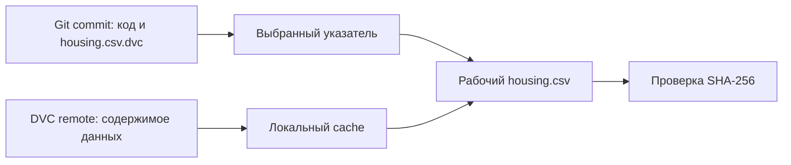

# 02. Воспроизводимость, данные и DVC

[Программа](../../README.md) · [Практика](practice.md) · [Подсказки](hints.md)

## Цель и вход

Восстановить запуск по данным, коду, окружению и параметрам. Нужен результат модуля 01. Модельный файл похож на бинарник сервиса, но для его получения помимо кода нужны входные данные, split и процедура обучения.

Конкретная проблема: вчера программа получила приемлемую ошибку, сегодня коллега повторяет команду и получает другую. Файл по имени `housing.csv` существует у обоих, но это ещё не означает одинаковые данные. Нужно уметь восстановить исходный вход, объяснить отличия среды и проверить поведение новой модели. Для Go-разработчика это расширение привычной воспроизводимой сборки: к исходникам и зависимостям добавляются данные и обученное состояние.

Нужны `work/housing.csv` и четыре файла собственного [запуска кандидата](../01-ml/tasks/02-candidate/README.md): `model.joblib`, `metrics.json`, `manifest.json`, `split.json` в его `output/`. CSV содержит восемь признаков районов и ответ `MedHouseVal` в единицах `100000 USD`. Модель читает только признаки. В этом модуле данные не пересобираются случайным образом: восстанавливается именно та версия CSV, из которой получены сохранённые индексы split.

## Из чего состоит происхождение модели

Обязательные поля учебной `build_manifest` — `schema_version=1`, `seed`, `data_sha256`, `split`, `versions`, `parameters`, `feature_order`. Версии описывают Python и библиотеки, параметры — конфигурацию обучения, split — конкретные строки выборок. Метрики сохраняются в отдельном `metrics.json`; идентификатор запуска, Git commit и сведения об источнике можно добавить как метаданные происхождения в программе обучения. Если Git ещё не инициализирован, укажи это явно и сохрани контрольную сумму исходников; не выдумывай commit.

Хеш отвечает на вопрос, совпадает ли содержимое. Он не объясняет, как данные собирались и можно ли использовать их в задаче. Для этого нужны источник, дата получения, единицы, схема и ограничения. Строки с одинаковыми числами после разного форматирования CSV могут иметь разные хеши; зафиксируй формат сериализации, а не сравнивай только размер файла.

Пример части манифеста:

```json
{
  "schema_version": 1,
  "seed": 42,
  "data_sha256": "полная-контрольная-сумма",
  "feature_order": ["MedInc", "HouseAge"],
  "target_unit": "100000 USD"
}
```

В реальном артефакте списка из двух полей недостаточно: используйте все восемь признаков. Пример показывает назначение полей, а не готовый манифест housing.

## Git, DVC и хранилище артефактов

Git хранит небольшие исходники и конфигурацию. DVC хранит в Git маленькие файлы-указатели на данные, а сами данные — в cache и remote. MLflow регистрирует эксперимент, метрики и модели. Эти роли пересекаются в метаданных, но один инструмент не отменяет остальные автоматически.

DVC remote может быть локальной директорией, поэтому платный S3 не нужен. В рабочей копии курса создай `work/dvc-demo` и отдельный учебный Git-репозиторий. Не превращай весь ноутбук в remote. После `dvc add` в Git попадают `.dvc`-указатель и правила игнорирования, а не большой CSV.

Для описания вычислительных шагов DVC использует зависимости, команду и выходы. Если вход и код не поменялись, ненужное обучение можно пропустить. Airflow из модуля 05 управляет расписанием и выполнением; DVC помогает определить происхождение и актуальность файлов. Не нужно дублировать один граф в обоих инструментах без причины.

## Повторяемые операции

Идемпотентный шаг при повторе с теми же входами даёт тот же смысловой результат. Загрузка одной партиции не должна каждый раз добавлять её второй раз. Практический ключ запуска — сочетание версии данных, конфигурации и кода. Запись сначала выполняется во временный файл, затем готовый результат публикуется атомарной заменой в пределах одной файловой системы.

Случайные timestamps и порядок JSON-ключей могут менять бинарный файл, не меняя прогнозов. Разделяй побитовую идентичность и численную эквивалентность. Для выбранной модели сравни predictions на фиксированной выборке с обоснованным допуском.

## Совместимость артефакта

`joblib` и pickle подходят для доверенных Python-артефактов внутри контролируемой среды, но не являются безопасным обменным форматом для произвольных файлов. Загружай только собственный артефакт. У сохраняемого bundle должны быть schema version, pipeline, feature order и model version. Несовпадение порядка признаков должно приводить к явной ошибке до обслуживания запросов.

Между разными версиями sklearn загрузка старого pickle не является гарантированным контрактом. Сохраняй requirements и возможность переобучения. ONNX в модуле 15 решает часть проблем переносимости, но требует проверки численного совпадения и поддержки операторов.

## Как Git и DVC восстанавливают одну версию

**Cache** DVC — локальные копии содержимого, адресуемые по контрольной сумме. **Remote** — выбранное хранилище, куда эти копии отправляют для восстановления. **Pointer**, или файл-указатель, например `housing.csv.dvc`, описывает отслеживаемый выход и его содержимое. Git хранит версии указателя; DVC получает соответствующие байты. Контрольная сумма внутри указателя DVC и наш SHA-256 выполняют близкую роль, но это разные поля: не подставляй SHA-256 в служебный формат DVC.



После `dvc add housing.csv` DVC учитывает данные и обновляет указатель. После изменения CSV нужен новый `dvc add`, иначе Git-версия указателя по-прежнему относится к прежним байтам. `dvc push` переносит содержимое в remote; `git commit` сохраняет указатель и код. Успешный commit без push не доказывает, что другая рабочая копия сможет получить данные.

`dvc checkout` приводит рабочие файлы к версии, описанной текущими указателями, используя локальный cache. `dvc pull` также получает недостающее содержимое из remote. Поэтому переключение Git commit не обязано само заменить CSV: после него нужно материализовать выбранную DVC-версию. В лабораторной remote — `work/dvc-remote`, отдельный от `work/dvc-demo`; каталог не является облаком и не защищает от потери диска с обеими копиями.

В [практике](practice.md#подготовка) команды изолированы в новом учебном Git-репозитории. Для двух версий V1 и V2 последовательность проверки такова: выбрать commit V1 → восстановить данные → сравнить SHA-256 с V1; затем выбрать V2 → восстановить → сравнить с V2. Если хеш соответствует V2 при указателе V1, восстановление ещё не доказано. Исходный `work/housing.csv` курса не меняется; работа идёт с копией внутри demo.

## Что именно доказывает контрольная сумма

Самостоятельный пример работает на двух маленьких файлах во временной директории и не использует учебные функции:

```python
import hashlib
from pathlib import Path
from tempfile import TemporaryDirectory

with TemporaryDirectory() as folder:
    first = Path(folder) / "first.csv"
    second = Path(folder) / "second.csv"
    first.write_bytes(b"x,y\n1,2\n")
    second.write_bytes(b"x,y\n1,3\n")
    a = hashlib.sha256(first.read_bytes()).hexdigest()
    b = hashlib.sha256(second.read_bytes()).hexdigest()
    print(first.stat().st_size == second.stat().st_size)  # True
    print(a == b)                                      # False
```

Входы имеют одинаковый размер и похожие имена. Изменение одной цифры меняет digest — строку контрольной суммы. Проверка равенства размеров пропустила бы изменение, проверка SHA-256 его обнаружила. Здесь `read_bytes` удобен для восьми байт; упражнение требует потокового хеширования блоками, чтобы размер большого CSV не определял расход памяти. `chunk_size` меняет размер чтения, а не итоговый SHA-256; нулевой размер недопустим, иначе цикл может не читать содержимое.

Хеш подтверждает байты, но не достоверность источника и не семантическую эквивалентность таблиц. Перестановка строк меняет и хеш, и смысл сохранённых позиционных индексов. Другое форматирование одинаковых чисел меняет хеш, хотя значения могли остаться эквивалентными. В учебном восстановлении требуется исходная сериализация, поэтому такие случаи не объявляются совпадением автоматически.

## Манифест как снимок условий запуска

**Манифест** — структурированный документ о том, как получен результат. В Go-поставке это похоже на сведения о commit и зависимостях рядом с бинарником. У модели дополнительно важны хеш CSV, split и гиперпараметры. `feature_order` описывает смысл восьми позиций на входе, `schema_version` — формат bundle/метаданных, `model_version` — конкретный результат обучения. Версия схемы 1 не означает sklearn версии 1.

Манифест должен быть снимком. Если после `build_manifest(..., split, ..., parameters)` вызывающий код изменил вложенный список `split["train"]`, сохранённое происхождение модели не должно измениться. Обычная поверхностная копия словаря оставляет вложенные объекты общими. Это та же проблема владения данными, что у Go map со slices: копирование внешнего контейнера не создаёт независимые вложенные значения.

Перед `predict` проверяются формат bundle, вызываемый `pipeline.predict`, непустая версия, точный список признаков и связь с ожидаемым SHA-256. Например, `features=["HouseAge", "MedInc", ...]` при ожидаемом начале `["MedInc", "HouseAge", ...]` — несовместимость, даже если оба списка содержат те же имена. Проверка контракта после загрузки доверенного joblib предотвращает неверный прогноз, но не делает загрузку чужого pickle безопасной: его код уже мог исполниться.

## Два вида повторения и численный допуск

Загрузка старого `model.joblib` проверяет сохранность и совместимость артефакта. Повторное обучение в новом окружении проверяет восстановление процесса. Копирование готового файла во вторую папку не является вторым обучением. Для второго опыта заново устанавливаются сохранённые зависимости, восстанавливается CSV и запускается тот же CLI с той же конфигурацией и seed.

`numpy.allclose(a, b, rtol=1e-6, atol=1e-8)` проверяет для каждой пары примерно `abs(a-b) <= 1e-8 + 1e-6*abs(b)`. Относительный допуск масштабируется значением, абсолютный помогает около нуля. Например, `1.0` и `1.0+1e-9` проходят, `1.0` и `1.01` — нет. До сравнения нужны одинаковая форма и конечность: broadcasting мог бы сравнить массивы разной формы с неожиданным смыслом. Прогнозы проверяются на одном фиксированном batch первых 20 строк признаков, а не на случайных разных входах.

В [задании восстановления](tasks/03-reproduce/README.md) разные SHA-256, split, seed, параметры или порядок признаков вызывают `ValueError`: сравнение изначально несопоставимо. При одинаковом происхождении, но разных числах возвращаются `predictions_equal=False` или `metrics_equal=False`. Это различает неверный вход и обнаруженную невоспроизводимость. ID двух запусков и байты joblib при этом могут отличаться.

## Диагностика восстановления

| Симптом | Возможная причина | Проверка |
|---|---|---|
| Git вернулся к старому commit, CSV прежний | Не выполнен DVC checkout/pull | Сопоставить указатель и SHA-256 рабочего файла |
| Указатель есть, данных нет | В remote не отправили нужный объект либо неверен адрес | Проверить конфигурацию remote и результат pull |
| SHA совпадает, метрики нет | Другой split, параметры, код или среда | Сравнивать эти поля до попытки менять seed |
| Прогнозы совпадают, метрики нет | Оценка использует другие строки или ответы | Проверить split.json и сопоставление X/y |
| Joblib не загружается | Несовместимые версии или отсутствующий класс | Восстановить исходные зависимости и пакет |

Атомарная замена файла в одной файловой системе не является распределённой транзакцией между Git, DVC и реестром. Аналогично, локальный remote не проверяет права и сбои сетевого хранилища. Учебная цель — явная цепочка происхождения, которую можно проверять по частям, а не обещание одинакового результата на произвольной платформе.

## Материалы

- [DVC get started](https://dvc.org/doc/start) — data management, local remote и восстановление версий.
- [DVC checkout](https://dvc.org/doc/command-reference/checkout) и [pull](https://dvc.org/doc/command-reference/pull) — различие рабочей копии, cache и remote; команды используются с DVC 3.59.2.
- [DVC pipelines](https://dvc.org/doc/start/data-pipelines) — deps, outs и воспроизведение шагов.
- [sklearn 1.6 model persistence](https://scikit-learn.org/1.6/model_persistence.html) — совместимость и ограничения pickle/joblib/ONNX для выбранного sklearn 1.6.1.
