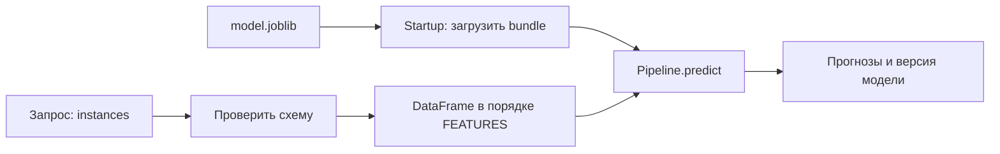

# 03. Проверить модель за API и собрать поставку

[Программа](../../README.md) · [Задания](#задания) · [Подготовка](#подготовка-к-заданиям)

## Какую проблему решаем

Обучение уже сохраняет модель, но другому приложению нужен прогноз без установки твоего notebook и библиотек обучения. Для этого проект предоставляет HTTP API. Теперь надо проверить, что через него применяется та же модель, что локально, а затем запустить API из Docker-образа и включить готовые проверки в CI.

HTTP-маршруты знакомы по Go. Особенность здесь — состояние модели: файл может отсутствовать, иметь другой порядок признаков или успешно загрузиться с неподходящей обработкой данных. Ответ 200 не обнаруживает эти ошибки автоматически. В упражнениях ты проверяешь предоставленный сервис, а не пишешь второй HTTP-сервер.

## Подготовка к заданиям

Подготовь основное Python-окружение по [SETUP](../../SETUP.md#основная-среда). Если оно уже существует, активируй его из корня курса:

```bash
source .venv/bin/activate
```

Зависимости housing и сам пакет должны быть установлены по SETUP. Повторно создавать окружение не нужно. Все команды модуля выполняются из корня репозитория.

| Тема | Какие входы нужны | Где выполняется |
|---|---|---|
| Проверки функций и API | Небольшие модели и временные bundle создаются готовыми тестами. Для понимания формата полезен [модуль воспроизводимости](../02-reproducibility/README.md#совместимость-артефакта) | В Python-процессе через FastAPI TestClient. Docker и отдельный сервер не требуются |
| Ручной запуск API | Собственный `work/artifacts/model.joblib`, сохранённый последней ячейкой [ML-notebook](../01-ml/housing.ipynb) | Uvicorn на локальном порту 8000 |
| Контейнер | Собственная модель, доступный Docker daemon и Compose | Docker. Порт 8000 должен быть свободен |
| CI | Готовая обвязка курса и её тесты. Для удалённой части нужна собственная копия репозитория на GitHub | Локальные команды и GitHub Actions |

Тесты задания API работают с синтетическими данными и собственными временными файлами. Настоящая обученная модель понадобится для ручного HTTP-запуска и проверки контейнера. Не загружай чужие joblib-файлы: этот формат может выполнять код при десериализации.

## Задания

| Тема | Что выполнить | Файлы |
|---|---|---|
| [01. Контракт API](tasks/01-api-contract/README.md) | Реализовать проверку ответа и сценарии HTTP-паритета. Добавить интеграционные тесты API | [Заготовка](tasks/01-api-contract/solution.py) · [Тесты](tasks/01-api-contract/test_task.py) |
| [02. Контейнер](tasks/02-container/README.md) | Собрать и запустить API. Проверить модель, пользователя, монтирование и состояние без модели | [Проверки стенда](tasks/02-container/test_task.py) · [Compose](../../labs/housing/compose.yaml) |
| [03. CI](tasks/03-ci/README.md) | Проследить намеренную ошибку теста до статуса job и восстановить корректную проверку | [Workflow](../../.github/workflows/check.yml) |

Начни с теории ниже, затем открывай README заданий по порядку. В каждом описаны входы, действия, команды проверки и завершение работы.

Проверка первого задания:

```bash
make task TASK=03-service-ci/01-api-contract
```

До реализации учебных функций ожидается `NotImplementedError`. `make test` проверяет готовую обвязку курса. Тесты запущенного контейнера включаются отдельно через `MLOPS_RUN_INTEGRATION=1` и параметры из второго задания. Пропуск этих тестов не подтверждает работу стенда. Третья тема — руководство с командами и примером ожидаемого поведения.

## Какие файлы превращаются в сервис

В [ML-notebook](../01-ml/housing.ipynb) последняя ячейка сохраняет четыре артефакта в `work/artifacts/`. Сервису для прогнозов нужен `model.joblib`. В нём находятся обученный Pipeline, порядок признаков и идентификатор модели. Это bundle, совместимость которого проверялась в [модуле 02](../02-reproducibility/README.md#совместимость-артефакта).

Запускаемый модуль `housing.api` использует три библиотеки с разными ролями. **Uvicorn** принимает HTTP-соединения и передаёт запросы Python-приложению. **FastAPI** связывает маршруты с обработчиками. **Pydantic** проверяет входное тело по описанной схеме. Интерфейс между сервером и приложением называется ASGI. Действия похожи на сервер, роутер и декодирование запроса в Go, но реализуются средствами Python.

По умолчанию путь модели — `work/artifacts/model.joblib`. Переменная `MODEL_PATH` позволяет выбрать другой собственный файл. При запуске приложение один раз загружает этот bundle. FastAPI называет этапы запуска и остановки **lifespan**, жизненным циклом приложения.



Запросы одного процесса используют уже загруженный объект из `app.state.bundle`. Замена файла на диске не меняет этот объект: при выборе другой модели требуется перезапуск или новая выкладка. Обучение внутри обработчика здесь не выполняется.

Для классификатора текста общий путь тот же: загрузить готовую цепочку обработки и выполнить прогноз. Отличался бы вход — например, текстовый столбец вместо восьми числовых признаков. Эти различия должны быть частью API-контракта. Реализовывать второй тип сервиса в модуле не требуется.

## Контракт данных

Чтобы HTTP-ответ можно было сопоставить с прямым прогнозом, клиент и сервер должны согласовать вход. В Housing запрос содержит `instances`: список от 1 до 256 объектов, каждый описывает один район с восемью числовыми признаками из `FEATURES`. Целевая стоимость не отправляется, её вычисляет модель.

Схема запрещает дополнительные и отсутствующие признаки, строки или булевы значения вместо чисел, NaN и Infinity. Проверка типа не определяет качество модели: необычное, но допустимое число ещё может находиться далеко от обучающих данных. Наблюдение за такими изменениями изучается в модуле мониторинга.

Имена JSON-полей определяют смысл, но их порядок клиент может менять. Перед `predict` сервер строит DataFrame с `columns=FEATURES`. Если просто взять значения словаря в полученном порядке, модель может принять доход за возраст и вернуть конечное, но неверное число.

Ответ содержит `predictions`, `model_version` и `target_unit="100000 USD"`. Количество прогнозов равно числу входных строк, а их порядок соответствует запросу. Версия берётся из загруженного bundle. Число 2.0 означает 200000 USD в единицах исторического датасета. Для классификации ответ мог бы содержать класс и вероятность, но проверка числа результатов и версии оставалась бы полезной.

## Разобранный запрос и независимые ошибки

Для ручного запроса уже есть [request.json](../../labs/housing/request.json). После запуска Uvicorn или контейнера отправь из корня курса:

```bash
curl -i http://127.0.0.1:8000/live
curl -i http://127.0.0.1:8000/ready
curl -i http://127.0.0.1:8000/predict \
  -H 'Content-Type: application/json' \
  --data-binary @labs/housing/request.json
```

Первый маршрут проверяет, жив ли процесс. Это **liveness**. Второй проверяет, загружена ли модель и можно ли обслуживать прогнозы. Это **readiness**. Разделение позволяет отличить существующее приложение от готовой модели.

| Ситуация | Наблюдаемый результат | Что проверить |
|---|---|---|
| Модель загружена, запрос корректен | `/live`, `/ready`, `/predict` возвращают 200 | Прогноз и версию сверить с Pipeline |
| Файла модели нет | `/live` — 200, `/ready` и корректный `/predict` — 503 | Выбранный `MODEL_PATH` внутри процесса |
| Запрос содержит `instances=[]` | 422 даже без модели | Проверка тела выполняется до инференса |
| Файл есть, но bundle несовместим | Ошибка startup | Схему bundle, Pipeline и порядок признаков |
| Процесс не слушает адрес | Ошибка соединения, HTTP-ответа нет | Процесс, порт и сетевой путь |

Для 422 ответ содержит путь до неверного поля в `detail`. Для NaN/Infinity важно действительно передать байты приложению. Если клиент отказался сериализовать их ещё до отправки, это проверка клиента. В задании такие запросы передаются через готовое текстовое тело и `Content-Type: application/json`.

## Тесты на разных уровнях

Сначала проверяем ответ без Docker. **TestClient** вызывает приложение внутри Python-процесса и позволяет отправлять HTTP-запросы без отдельного слушающего сервера. Контекст `with TestClient(app) as client` запускает lifespan, поэтому приложение успевает загрузить модель. Создание клиента без входа в контекст не заменяет startup.

В первом задании одна функция проверяет декодированный ответ, вторая отправляет корректные и ошибочные запросы. Для проверки чисел берётся один batch — набор строк — и выполняются два действия: `pipeline.predict(batch)` и POST тех же строк на `/predict`. Совпадение с допуском называется **паритетом прогнозов**. Оно проверяет доставку модели за API, а качество по настоящим target уже измерялось отдельно.

Временный небольшой Pipeline позволяет проверить загрузку и прогноз вместе. Такой тест является интеграционным по составу компонентов, хотя весь опыт выполняется на одном CPU без сети. Следующий уровень — запрос к настоящему контейнеру: он дополнительно проверяет зависимости, пути, пользователя и публикацию порта.

Готовая обвязка проверяется через `make test`, твои функции — через `make task TASK=03-service-ci/01-api-contract`. Число найденных тестов при collection показывает только возможность их собрать, а не выполнение упражнений.

## Как образ получает модель и адрес

После проверки в Python нужно повторить запуск из поставляемого окружения. **Docker-образ** содержит библиотеки, пакет приложения и команду старта. **Контейнер** — запущенный из него процесс. Сборке доступен каталог **build context**, в этом проекте корень курса. Dockerfile выбирает из него нужные файлы через `COPY`, а `.dockerignore` исключает рабочие данные и виртуальное окружение.

Модель поставляется отдельно от кода: Compose отображает `work/artifacts/` с компьютера в `/models` контейнера. Это **bind mount**. Режим `:ro` запрещает запись через него. В образе задано `MODEL_PATH=/models/model.joblib`, поэтому запуск использует файл по внутреннему пути, а не по пути из терминала на компьютере.

Сетевой адрес тоже зависит от места запроса. Uvicorn слушает `0.0.0.0:8000` внутри контейнера. Compose публикует `127.0.0.1:8000:8000`, чтобы клиент на компьютере мог подключиться к нему. `EXPOSE` в образе описывает порт, а публикацию выполняет `ports` Compose. `127.0.0.1` внутри другого контейнера означал бы тот контейнер, а не соседний API.

Приложение работает от UID 10001. Если файл нельзя прочитать, проверь права файла и прохода по каталогам для этого пользователя. Проверки второго задания читают реальный контейнер, mount и HTTP-ответы. Они запускаются только после ручного `up` и с указанным ID контейнера.

Один процесс загружает одну копию модели. Несколько Uvicorn workers загрузят несколько копий, а библиотека модели может дополнительно использовать потоки. Поэтому начинай с предоставленной конфигурации, а изменение параллелизма проверяй измерениями. Для классификатора изображений большой объём весов сделал бы эту связь особенно заметной.

## Что доказывает CI

Локальный тест легко забыть запустить перед отправкой кода. **Continuous integration**, CI, выполняет выбранные проверки автоматически для изменений репозитория. В предоставленном GitHub Actions workflow среда получает код, Python и зависимости, затем запускает:

```bash
make check
make test
make tasks-collect
```

`make check` проверяет целостность курса, `make test` — готовые компоненты, `make tasks-collect` — возможность собрать учебные тесты. Последняя команда не выполняет тела незавершённых функций. Пропущенная проверка контейнера также не подтверждает его запуск.

В третьей теме ты временно меняешь правильное ожидание HTTP-кода на неправильное. Ошибка должна пройти от assertion к ненулевому коду `make test` и статусу failure в job. После восстановления ожидания проверка должна пройти. Это конкретный способ убедиться, что зелёный статус относится к нужному поведению и нужному commit.

Доставка уже выбранной поставки в окружение называется **continuous delivery/deployment**, CD. Текущий workflow ничего не публикует и не разворачивает. К выкладке в кластер курс переходит отдельно. Это позволяет сначала проверить качество поставки, а затем управлять её выпуском.

## Граница обучения и обслуживания

Для воспроизводимого запуска понадобятся три связанные части: версия кода/образа, версия модели и конфигурация. Если откатить только образ, оставив под тем же путём новый `model.joblib`, прежнее поведение может не восстановиться. Поэтому сохраняй отдельные версии артефактов и явно выбирай, какую модель запускает конкретный процесс.

Сам файл с весами не означает готовую поставку. В этом модуле результат подтверждают правильный HTTP-прогноз, работа образа и выполняемые проверки. Учёт разных обучений и выбор модели по точной версии появятся в MLflow.

## Материалы

- [FastAPI testing](https://fastapi.tiangolo.com/tutorial/testing/) — TestClient, assertions и проверка HTTP-контракта.
- [FastAPI deployment](https://fastapi.tiangolo.com/deployment/concepts/) — startup, workers, память и репликация.
- [Docker workshop](https://docs.docker.com/get-started/workshop/) — image, container, volume и Compose.
- [GitHub Actions Python](https://docs.github.com/en/actions/tutorials/build-and-test-code/python) — проверки Python в workflow.
