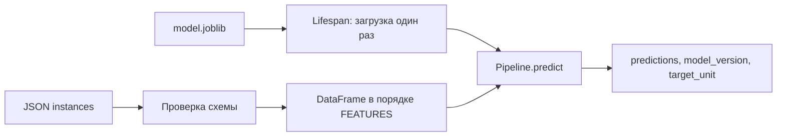

# 03. ML-сервис, Docker и CI

[Программа](../../README.md) · [Практика](practice.md) · [Подсказки](hints.md)

## Цель и вход

Превратить обученный артефакт в сервис с понятным контрактом и повторяемой поставкой. Нужны bundle и метрики модулей 01–02. Большая часть HTTP-инженерии знакома по Go; новые риски связаны с моделью, preprocessing и зависимостями научного Python.

Уже работает обучение из CSV, но другим программам неудобно устанавливать sklearn и читать твой joblib ради одного прогноза. HTTP API даёт стабильную сетевую границу. При этом оно должно отличать неправильный запрос от отсутствующей модели и подтверждать, какая версия дала ответ. Результат модуля — проверенная связка модели, API и образа, которую можно запускать одинаковыми командами и проверять в CI.

## Граница обучения и обслуживания

Обучение меняет параметры модели и пишет артефакт. Обслуживание загружает готовый артефакт и вычисляет predict. Не запускай обучение в обработчике каждого HTTP-запроса: это увеличивает задержку, создаёт гонки и делает результат зависимым от порядка обращений. Даже если обучение занимает секунды, отделение процессов упрощает контроль версии и откат.

В проекте модель загружается один раз при startup. Жизнеспособность процесса (`/live`) отделена от готовности обслуживать (`/ready`). Если файла модели нет, процесс жив, но `/predict` возвращает 503. Если bundle несовместим, startup завершается ошибкой: случайный порядок признаков нельзя скрыть успешным healthcheck.

## Какие файлы превращаются в сервис

Вход — собственный bundle из [обучения кандидата](../01-ml/housing.ipynb) после проверок [воспроизводимости](../02-reproducibility/README.md#совместимость-артефакта). Последняя ячейка ML-notebook сохраняет комплект прямо в `work/artifacts/`. По умолчанию `housing.api` читает `work/artifacts/model.joblib`; переменная окружения `MODEL_PATH` позволяет выбрать другой собственный файл. Само наличие CSV не делает API готовым: сервер использует уже обученный Pipeline, а не обучается из CSV при старте.

**FastAPI** связывает HTTP-маршруты и функции Python, **Pydantic** проверяет структуру входа, **Uvicorn** принимает сетевые запросы как ASGI-сервер. ASGI — интерфейс между сервером и Python-приложением. Для Go-разработчика это примерно роли HTTP server, маршрутизатора и декодирования/валидации структуры; библиотеки реализуют их иначе, но контракт запросов остаётся знакомым.



**Lifespan** — жизненный цикл приложения со стадиями запуска и остановки. `create_app` создаёт приложение, а загрузка bundle происходит при входе в lifespan. Поэтому в интеграционном тесте нужен `with TestClient(app) as client`: простой объект без входа в контекст может не выполнить startup. `app.state.bundle` хранит загруженный объект для запросов одного процесса. Замена файла на диске не меняет уже загруженный Python-объект; смена модели требует перезапуска или новой выкладки.

## Контракт данных

API принимает batch от 1 до 256 объектов с восемью числовыми признаками. Дополнительные поля, строки вместо чисел и нечисловые значения отвергаются. JSON не гарантирует семантический порядок признаков: порядок задаёт сервер через список FEATURES. Это особенно важно при переходе от DataFrame к массиву NumPy.

Для примера контракта вне housing:

```python
from pydantic import BaseModel, ConfigDict, FiniteFloat

class SensorReading(BaseModel):
    model_config = ConfigDict(extra='forbid', strict=True)
    temperature: FiniteFloat
```

Типовая проверка схемы не отвечает на вопрос качества данных. Число 999999 может быть формально допустимым, но не встречаться при обучении. Валидация, мониторинг распределений и бизнес-ограничения дополняют друг друга. Не отклоняй необычные значения только потому, что они отсутствовали в train: сначала определи требования задачи.

## Разобранный запрос и независимые ошибки

Готовый [request.json](../../labs/housing/request.json) содержит объект с ключом `instances` и одной строкой восьми признаков района. Отправка из корня:

```bash
curl -i http://127.0.0.1:8000/live
curl -i http://127.0.0.1:8000/ready
curl -sS http://127.0.0.1:8000/predict \
  -H 'Content-Type: application/json' \
  --data-binary @labs/housing/request.json
```

Для готовой собственной модели последний ответ имеет вид `{"predictions":[...],"model_version":"...","target_unit":"100000 USD"}`; многоточия обозначают твои действительные значения, это не готовый JSON для отправки. На одну входную строку нужен один конечный прогноз. Число 2.0 означало бы 200000 USD в единицах исторического датасета. `model_version` позволяет отличить ответ старого процесса от новой выкладки.

Если отправить `{"instances":[]}`, проверка длины списка даст 422. Это ошибка запроса даже при отсутствующей модели: тело проверяется до вызова функции `predict`. Если отправить корректный запрос, но модели нет, обработчик даст 503. Если файл существует, но содержит `schema_version=2`, startup завершится ошибкой, поэтому сетевой ответ может вообще отсутствовать. Эти три исхода диагностируют разные слои и не должны объединяться в «сервер не работает».

JSON-объект хранит именованные поля, поэтому клиент вправе переставить ключи. API явно строит DataFrame с `columns=FEATURES`; это восстанавливает канонический порядок перед Pipeline. Ответ 200 сам по себе не доказывает правильность преобразования. Для проверки берут один batch, вычисляют `pipeline.predict(batch)`, отправляют те же строки по HTTP и сравнивают числа с `rtol=1e-6`, `atol=1e-8`, длину и версию. Это **паритет** двух путей вычисления, а не измерение качества модели относительно истинного target.

NaN и Infinity не являются обычными конечными JSON-числами; некоторые библиотеки умеют отправлять их как расширение. Негативный тест должен действительно передать такие байты серверу, а не остановиться на ошибке сериализатора HTTP-клиента. Публичный API их отвергает. Числовые строки вроде `"2.0"` и `bool` тоже запрещены строгой схемой признаков: автоматическое приведение скрывало бы ошибки клиента.

## Тесты на разных уровнях

Unit-тест проверяет расчёт MAE или преобразование записи. Контрактный тест проверяет HTTP-коды, форму ответа и неверные поля. Интеграционный тест загружает настоящий маленький собственный артефакт и выполняет прогноз. Проверка качества оценивает модель на фиксированных данных. Smoke-тест контейнера подтверждает, что образ запускается и доступен по сети.

Тест `status_code == 200` не обнаружит перепутанные признаки, если модель всё ещё возвращает число. Поэтому проверь равенство прогнозов локального pipeline и HTTP для одинаковых строк. Установи допуск и сравни model_version. Готовые тесты обвязки проходят сразу; учебные проверки API запускаются через `make task TASK=03-service-ci/01-api-contract`, а проверки обучения — в ML-notebook.

## Контейнер и ресурсы

Docker image фиксирует пользовательское окружение и системные библиотеки, но не превращает x86-образ в ARM-образ. Используй многоархитектурный Python base и зависимости с доступными wheels. Не включай CSV, секреты и виртуальное окружение в build context. Учебный образ работает от непривилегированного пользователя, а модель монтируется read-only.

Слишком много Uvicorn workers загружают несколько копий модели в память. В каждом worker библиотеки могут запускать собственные потоки. Начни с одного процесса, измерь latency и RSS, затем меняй параллелизм. Убедись, что graceful shutdown заканчивает текущую работу в рамках доступного timeout.

## CI/CD и выпуск

CI проверяет изменения в изолированной среде: структуру курса, зависимости, тесты и сборку. CD доставляет выбранный image и версию модели в окружение. Заготовка GitHub Actions выполняет только проверки и ничего не публикует. После создания собственного репозитория она заработает на push/pull request; локально запускай те же команды.

Версия поставки должна связывать image, bundle и конфигурацию. Откат только образа при изменяемом общем файле модели может не восстановить прошлое поведение. В проекте сохраняй отдельные версии артефактов и меняй путь/ConfigMap при новой выкладке.

## Как образ получает модель и адрес

**Образ** Docker — собранный шаблон файловой системы и команды; **контейнер** — запущенный процесс из этого образа. **Build context** — каталог файлов, доступных сборке. У нашего Dockerfile context — корень курса, но `COPY` переносит только перечисленные исходники и зависимости. `.dockerignore` исключает ненужные рабочие данные; наличие `work/artifacts/model.joblib` на host не означает автоматического включения модели в образ.

Compose монтирует `work/artifacts` в `/models` с `:ro` и задаёт `MODEL_PATH=/models/model.joblib` через образ. Это **bind mount**, то есть отображение каталога host в контейнер, а `ro` запрещает запись через это монтирование. Поэтому один образ можно проверить с разными собственными моделями. Для конкретного выпуска путь и содержимое должны быть закреплены; изменяемый общий каталог затрудняет откат.

Uvicorn внутри контейнера слушает `0.0.0.0:8000`, чтобы принимать соединения через сеть контейнера. Compose публикует `127.0.0.1:8000:8000`: клиент с host обращается к первому порту, приложение — к внутреннему. `127.0.0.1` внутри другого контейнера означает сам этот контейнер, а не host или соседний сервис. Проверка `curl` с host и успешный startup внутри контейнера проверяют разные участки цепочки.

`USER 10001` задаёт непривилегированного пользователя. `EXPOSE 8000` описывает порт образа, но не публикует его на host; это делает `ports` Compose. Лимит памяти защищает общий стенд от бесконтрольного роста, но не ускоряет инференс. Read-only mount, UID и HTTP-контракт проверяются [интеграционной темой](tasks/02-container/README.md) только на уже запущенном тобой контейнере; тесты не управляют его жизненным циклом.

## Что доказывает CI

**CI** (continuous integration) автоматически проверяет изменения в чистой среде. В `.github/workflows/check.yml` checkout получает код, setup-python выбирает Python 3.12.12, затем устанавливаются закреплённые зависимости и пакет. `make check` проверяет целостность курса, `make test` — предоставленную обвязку, `make tasks-collect` — возможность собрать тесты упражнений. Collection импортирует тесты и находит функции, но не доказывает реализацию `train` и качество модели.

Каждая команда обязана вернуть ненулевой код при нарушении, чтобы job стал красным. Если локальный тест упал, а job зелёный, сначала проверь, выполняется ли он в workflow и относится ли запуск к нужному commit. Пропущенные интеграционные тесты не подтверждают контейнер. Учебный workflow не выполняет **CD** (continuous delivery/deployment), то есть не публикует и не развёртывает новую поставку. Руководство [CI](tasks/03-ci/README.md) проверяет распространение реального assertion до статуса job.

## Диагностика по слоям

| Симптом | Первая различающая проверка |
|---|---|
| Connection refused | Запущен ли процесс и опубликован ли нужный порт |
| `/live` 200, `/ready` 503 | Доступен ли выбранный MODEL_PATH внутри процесса |
| Startup завершился ошибкой | Совместимы ли bundle, признаки и зависимости |
| `/predict` 422 | Поле `detail` ответа: путь до неверного значения в instances |
| Прогноз другой при 200 | Паритет batch, порядок FEATURES и model_version |
| Контейнер неожиданно перезапускается | Exit code, логи и ограничения памяти, а не только HTTP |

Успешный smoke-тест показывает, что данный контейнер отвечает на маленький запрос. Он не измеряет пропускную способность, утечки памяти или качество на новых регионах. Для них нужны отдельные нагрузки и данные; увеличение workers до таких измерений может только размножить копии модели.

## Материалы

- [FastAPI testing](https://fastapi.tiangolo.com/tutorial/testing/) — TestClient, assertions и проверка HTTP-контракта.
- [FastAPI deployment](https://fastapi.tiangolo.com/deployment/concepts/) — startup, workers, память и репликация.
- [Docker workshop](https://docs.docker.com/get-started/workshop/) — image, container, volume и Compose.
- [GitHub Actions Python](https://docs.github.com/en/actions/tutorials/build-and-test-code/python) — проверки Python в workflow.
