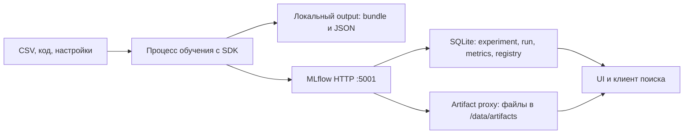

# 04. MLflow: эксперименты и реестр моделей

[Программа](../../README.md) · [Задания](#задания) · [Подготовка](#подготовка-к-заданиям)

## Цель и вход

Найти лучший запуск, восстановить его параметры и явно выбрать версию для выкладки. Требуются работающий train CLI и манифест. MLflow добавляет каталог экспериментов к уже воспроизводимому обучению. Он не исправляет утечку данных и не заменяет проверку качества.

После нескольких обучений папки `output-a`, `output-b` и `output-final` перестают отвечать на вопрос, какой файл лучше и почему. Нужно связать каждый результат с CSV, split, кодом и настройками, найти выбранный запуск и дать сервису точную ссылку на его модель. Это похоже на каталог сборок с метаданными, но критерием выбора здесь служат также измеренные ошибки на данных.

Используем [train кандидата](../01-ml/housing.ipynb) и [манифест](../02-reproducibility/tasks/02-manifest/README.md). На входе `work/housing.csv`: строка района, восемь признаков, target `MedHouseVal` в `100000 USD`. На выходе обучения — `model.joblib`, `metrics.json`, `manifest.json`, `split.json` в отдельном каталоге. MAE/RMSE берутся из действительного сравнения прогнозов с известными ответами, а не из успешного статуса программы. До реализации `train` SDK сможет записать демонстрационные события, но полноценного housing-запуска не получится.

## Подготовка к заданиям

Все команды выполняй из корня курса. Основное окружение из [SETUP](../../SETUP.md#основная-среда) подходит для быстрых тестов. Для настоящего MLflow используй отдельное окружение: requirements включает базовые библиотеки housing и закрепляет SDK 3.1.1.

```bash
python3.12 -m venv .venv-mlflow
source .venv-mlflow/bin/activate
python -m pip install -r labs/mlflow/requirements.txt
python -m pip install --no-deps -e labs/housing
```

| Что нужно | Откуда взять | Когда используется |
|---|---|---|
| CSV `work/housing.csv` | [SETUP](../../SETUP.md) | Собственные три обучения |
| Рабочий train и bundle | [ML-notebook](../01-ml/housing.ipynb) | Тема 01 вызывает настоящее обучение даже в быстром тесте |
| Manifest и split | [Воспроизводимость](../02-reproducibility/README.md) | SHA-256, настройки, версии и одинаковое разбиение |
| Docker daemon и Compose, свободный порт 5001 | Свой Docker runtime | HTTP tracking и Registry |

Запусти локальный сервер:

```bash
docker compose -f labs/mlflow/compose.yaml up -d --build
curl --fail --max-time 10 http://127.0.0.1:5001/health
```

С host используется `http://127.0.0.1:5001`, внутри контейнера сервер слушает 5000. Порт 5001 выбран, чтобы избежать конфликта с системным сервисом macOS. Backend SQLite и файлы artifact store лежат в named volume `mlflow-data`, подключённом к `/data`. SDK отправляет артефакты через HTTP artifact proxy. Локальный `./mlruns` будет другим хранилищем: серверный UI не покажет его run.

| Вход окружения | Значение и действие |
|---|---|
| `MLFLOW_TRACKING_URI` | Адрес сервера. CLI темы 01 использует его, если не задан `--tracking-uri`. По умолчанию `http://127.0.0.1:5001` |
| `MLOPS_RUN_SDK=1` | Разрешает тесты настоящего SDK на временном SQLite без сервера |
| `MLOPS_RUN_INTEGRATION=1` и `MLOPS_RUN_WRITES=1` | Оба нужны серверным тестам, создающим собственные experiment/model/run |

## Задания

| Тема | Что выполнить | Файлы |
|---|---|---|
| [01. Три запуска](tasks/01-experiments/README.md) | Обучить три конфигурации на одном split, записать результаты и выбрать по validation | [Заготовка](tasks/01-experiments/solution.py) · [Тесты](tasks/01-experiments/test_task.py) |
| [02. Registry](tasks/02-registry/README.md) | Зарегистрировать Pipeline, закрепить alias точной версией и проверить прогнозы | [Заготовка](tasks/02-registry/solution.py) · [Тесты](tasks/02-registry/test_task.py) |
| [03. Отказ](tasks/03-outage/README.md) | Сохранить pending и восстановить регистрацию исходного артефакта | [Заготовка](tasks/03-outage/solution.py) · [Тесты](tasks/03-outage/test_task.py) |

Проверки выбранной темы запускаются отдельно:

```bash
make task TASK=04-mlflow/01-experiments
```

До реализации ожидается `NotImplementedError`. `make test` проверяет готовую обвязку курса. Быстрые тесты темы 01 подменяют MLflow, но не обучение. SDK-тесты тем 01–02 включаются отдельно, например:

```bash
MLOPS_RUN_SDK=1 python scripts/run_task.py test 04-mlflow/01-experiments -- -m sdk
MLOPS_RUN_INTEGRATION=1 MLOPS_RUN_WRITES=1 python -m pytest modules/04-mlflow -m integration -q
```

Для второй команды сервер уже должен работать. Тесты создают уникальные имена ресурсов и удаляют только свои записи. Soft delete experiment не гарантирует удаления байтов артефактов. Health/UI подтверждают доступность сервера, но не заменяют проверку метрик, скачанных файлов и исходной версии. Ручной outage остаётся отдельным опытом темы 03.

## Остановка стенда

```bash
docker compose -f labs/mlflow/compose.yaml down
```

`down` сохраняет volume и историю. Удаление volume не входит в задания. Если намеренно сбрасываешь отдельный учебный стенд, сначала сохрани нужные run IDs, release manifests и артефакты. Окружение закрывается командой `deactivate`.

## Experiment, run, artifact и model version

Experiment группирует связанные запуски, run описывает конкретное выполнение. Параметр — обычно фиксированная настройка запуска, метрика — измерение, которое может меняться по шагам, artifact — файл: график, bundle, split или отчёт. Model Registry связывает именованную модель с версиями и метаданными.

Run ID, номер model version и image tag — разные идентификаторы. Один run может создать несколько артефактов. Один image способен обслуживать разные модели. В release manifest нужно явно связать эти значения.

«Параметр» MLflow обычно означает выбранную до обучения настройку, например `alpha=1.0` или `seed=42`. Коэффициенты Ridge тоже называют параметрами модели, но они вычисляются при `fit` и хранятся внутри объекта модели. Их нельзя смешивать с гиперпараметрами при сравнении конфигураций. Имя run помогает человеку, `run_id` однозначно указывает запись. Одинаковые имена не означают один запуск.

## Где что хранится

Tracking server — сервис учёта, который обслуживает API и UI. Backend store — хранилище метаданных запусков и реестра. artifact store — хранилище файлов. В учебном стенде backend — SQLite на volume, артефакты — другая директория того же сервера, выдаваемая через artifact proxy, HTTP-посредник передачи файлов. Volume сохраняет данные вне жизненного цикла контейнера. Клиент работает с HTTP URI, а не с абсолютным путём host.

SQLite подходит для маленького локального занятия. Для совместной работы нужно отдельно рассмотреть PostgreSQL, объектное хранилище, аутентификацию, резервирование и миграции. Отсутствие этих компонентов в ноутбучной лабораторной не означает, что они не нужны реальной платформе.

## Registry и продвижение

В выбранном учебном API можно зарегистрировать sklearn-модель и назначить alias, например `candidate` или `champion`. Alias — изменяемый указатель. Версия модели — конкретный объект. Для воспроизводимой выкладки разреши alias в номер версии и запиши его в release manifest. Смена alias сама по себе не обновляет уже загруженную модель в приложении.

Кандидата выбирают по validation. Перед выпуском выполняют финальную проверку test и совместимости контракта. Ручное повышение версии в UI без сохранённого решения плохо воспроизводится: нужны метрики, параметры и точная ссылка на выбранный run/версию.

## Что логировать и что не логировать

Минимум: data_sha256, seed, параметры, версии кода и окружения, validation/test metrics, split, bundle и ограничения. Не логируй токены, пароли и персональные записи. Большой DataFrame в параметре неудобен и бессмысленен. Сохраняй ссылку на версию данных и маленький диагностический artifact.

Autologging ускоряет первый запуск, но способен скрыть важные детали. Сначала явно залогируй минимальный набор, затем сравни с autologging. Если параметр уже записан в run, не пытайся менять его смысл в середине эксперимента: создай другой run.

## Сбои и повторные запуски

Падение tracking server не должно приводить к молчаливой потере информации о выпуске. В учебном проекте реши явно: завершать обучение ошибкой или сохранять локальный манифест для повторной регистрации. Нельзя продвигать модель, если нужные проверки не сохранились. Retry логирования без ключа идемпотентности может создать несколько run: свяжи их с собственным run_key и отметь повторы.

## Путь параметров, метрик и файлов

**Tracking URI** — адрес сервиса учёта, к которому обращается SDK. В нашем Compose это `http://127.0.0.1:5001` с host. В контейнере сервер слушает 5000. Публикация порта связывает эти адреса. Вызов `set_tracking_uri` выбирает место записи, но не запускает сервер. Устанавливай URI до создания experiment/run, иначе запись может попасть в другое локальное хранилище.



Сервер не выполняет `fit` за клиента. Обучение идёт в твоём Python-процессе, SQLite сохраняет сведения о запуске, artifact store — загруженные файлы. Внутренний `/data/artifacts` принадлежит контейнеру сервера. Передача клиенту такого абсолютного пути как будто он общий не обеспечит загрузку файлов с другой машины. Artifact proxy позволяет обращаться через HTTP, не выдавая клиенту доступ к файловой системе сервера. Эти роли реализованы в [Dockerfile](../../labs/mlflow/Dockerfile) и [Compose](../../labs/mlflow/compose.yaml).

Compose использует named volume `mlflow-data` для `/data`. `down` останавливает контейнер, сохраняя volume. Удаление volume уничтожит локальную историю и файлы стенда. Проверка страницы UI или `/health` подтверждает доступность сервера, но не наличие нужного артефакта. После запуска проверь отдельный run, его метрики и возможность скачать файл.

## Самостоятельный пример учёта

Создай отдельную среду по [подготовке к заданиям](#подготовка-к-заданиям), установи `labs/mlflow/requirements.txt` и подними стенд. Пример не вызывает учебный `train` и не решает сравнение трёх housing-моделей. У трёх известных ответов `[1,2,3]` постоянный прогноз 2 даёт абсолютные ошибки `[1,0,1]`, MAE=`2/3`.

```python
import json
from pathlib import Path
from tempfile import TemporaryDirectory

import mlflow

actual = [1.0, 2.0, 3.0]
constant = 2.0
mae = sum(abs(value - constant) for value in actual) / len(actual)
mlflow.set_tracking_uri("http://127.0.0.1:5001")
mlflow.set_experiment("course-sdk-demo")
with TemporaryDirectory() as folder:
    sample = Path(folder) / "sample.json"
    sample.write_text(json.dumps({"actual": actual}), encoding="utf-8")
    with mlflow.start_run(run_name="constant-predictor") as run:
        mlflow.log_param("constant", constant)
        mlflow.log_metric("demo_mae", mae)
        mlflow.log_artifact(str(sample))
        print(run.info.run_id)
```

Контекст `start_run` связывает записи с одним run и завершает его при выходе. Необработанная ошибка приводит к неуспеху запуска. `log_param` сохраняет настройку, `log_metric` — вычисленное измерение, `log_artifact` — содержимое файла. Временный файл удаляется после блока, но успешно загруженная копия должна оставаться у MLflow. Проверка: открыть напечатанный run ID в experiment `course-sdk-demo`, увидеть `constant=2`, `demo_mae≈0.666667` и скачать `sample.json` с теми же тремя ответами. Такая проверка отдельно подтверждает путь метаданных и путь файлов.

## Сравнимые запуски и выбор

Для [трёх запусков](tasks/01-experiments/README.md) нужен experiment `housing-course` и три разных `parameters` при одинаковых SHA-256 и split. Параметры Ridge можно менять в рамках заранее выбранного небольшого набора, сохраняя вход и процедуру оценки. Отдельная папка результата каждого run не даёт следующему обучению затереть предыдущую модель до загрузки артефактов.

Условный пример: A/B/C имеют validation MAE 0.8/0.5/0.6. Выбирается B. Если A имеет лучший test, это не меняет выбранного кандидата: test нужен для финальной оценки после выбора. Если B обучен на другом CSV, нельзя объявить его победителем в этой проверке. При одинаковой validation MAE контракт `select_candidate` использует run ID как детерминированный второй ключ. Этот порядок не имеет ML-смысла, но исключает зависимость результата от порядка списка.

Статус `FINISHED` говорит, что выполнение завершено без зафиксированной ошибки. Он не означает, что метрики допустимы или что модель полезнее baseline. Для сравнения нужны конечные неотрицательные числа, завершённость всех трёх запусков и сопоставимые входы. `comparison.json` — технический артефакт этих результатов, а не ручной пересказ работы.

## От Pipeline к версии реестра

**MLflow Model** — модель с описанием способа загрузки и дополнительных свойств. **Flavor** — поддерживаемый способ представления/загрузки, здесь sklearn. Загрузить `model.joblib` как обычный artifact полезно для сохранности, но это не равно зарегистрировать sklearn-модель. `mlflow.sklearn.log_model` сохраняет обученный Pipeline в формате MLflow Model. Именно весь Pipeline нужен, чтобы не потерять подготовку признаков.

**Input example** — маленький пример входных строк. **Signature** — описание схемы входа и выхода модели: имена и типы, с которыми она работает. Они помогают загрузившему модель понять её интерфейс. Signature не доказывает качество и не заменяет строгую валидацию публичного HTTP API. API `log_model` и его параметры сверены с [исходником MLflow 3.1.1](https://github.com/mlflow/mlflow/blob/v3.1.1/mlflow/sklearn/__init__.py). Используй SDK из закреплённых requirements.

**Registered model** — имя семейства моделей, например `housing`. **Model version** — конкретная версия под этим именем. При регистрации свяжи её с исходным `run_id`. Иначе нельзя уверенно восстановить, к какому обучению относятся метрики. `candidate` и `champion` — выбранные нами имена aliases, а не автоматические проверки MLflow. Изменение alias выполняет пользовательский код/оператор после quality gate — проверки качества и совместимости.

Если `champion` указывает на версию 7, разрешённый release должен хранить `version="7"`, исходный `run_id` и `model_uri="models:/housing/7"`. Плавающий `models:/housing@champion` при следующем чтении может дать уже версию 8. Это похоже на различие mutable image tag и точной версии поставки. После разрешения alias сравни прогнозы исходного Pipeline и загруженной registry-модели на одном batch, а не только наличие записи в UI. Способ разрешения alias описан в [MlflowClient выбранной версии](https://github.com/mlflow/mlflow/blob/v3.1.1/mlflow/tracking/client.py).

## Регистрация после сетевого отказа

Состояние `pending` означает: результат обучения есть, регистрацию ещё нельзя считать подтверждённой. Оно сохраняет `run_key`, исходный `run_id`, `artifact_uri` и прежний `champion_version`. При `ConnectionError` [функция восстановления](tasks/03-outage/README.md) атомарно сохраняет эту связь локально. После восстановления callback регистрирует тот же результат и возвращает точную версию. Состояние становится `registered`. Повтор `registered` не вызывает callback заново. Непредвиденный `ValueError` не следует превращать в «сеть недоступна»: неверная модель требует исправления входа.

Остаётся важное окно: сервер создал версию, но клиент не успел сохранить ответ. Локальный `pending` сам не доказывает, что remote side effect не произошёл. Для безопасного повтора внешней операции нужны поиск по устойчивому ключу, проверка исходного run и подходящая серверная политика. Ни callback-тест, ни атомарная запись JSON не дают распределённую гарантию exactly once. Отказ регистрации также не является разрешением автоматически поменять champion.

| Симптом | Что различить |
|---|---|
| Новый run не виден | Tracking URI/experiment другой или вызов не дошёл до сервера |
| Метрики есть, модель не скачивается | Запись backend успешна, передача artifact могла завершиться иначе |
| Alias указывает на другую модель | Проверить expected_run_id и конкретную версию до выпуска |
| После рестарта пустая история | Используется другой volume/project или данные были удалены |
| Повтор создал второй run/version | Нет устойчивого ключа либо remote side effect не был распознан |

SDK-проверка выбора кандидата работает offline. Настоящее сохранение, загрузка, переживание рестарта и отказ сети проверяются отдельно на стенде. Локальный SQLite и открытый loopback-порт достаточны для курса. Они не моделируют общую защищённую платформу экспериментов.

## Материалы

- [MLflow Tracking](https://mlflow.org/docs/3.1.1/ml/tracking/) — manual logging, tracking server и stores. Если URL перенаправляет, выбери версию 3.1.1.
- [MLflow Registry](https://mlflow.org/docs/3.1.1/ml/model-registry/) — registered models, versions и aliases.
- [MLOps Zoomcamp](https://github.com/DataTalksClub/mlops-zoomcamp/tree/main/02-experiment-tracking) — дополнительный разбор экспериментов. Адаптировать команды под закреплённый SDK.
