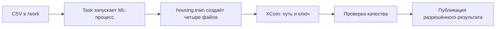

# 05. Airflow: от команды обучения к управляемому процессу

[Программа](../../README.md) · [Задания](#задания) · [Подготовка](#подготовка-к-заданиям)

## Какую проблему решаем

Собственная `train` уже создаёт модель и метрики, а MLflow хранит сведения о выбранном результате. Теперь эту работу нужно выполнять в определённом порядке: проверить вход, обучить модель, проверить качество и только затем разрешить выпуск. Если последний шаг упал, хочется повторить его с прежней моделью, а не начинать обучение заново.

Airflow хранит описание шагов и их зависимостей, запускает готовые к выполнению шаги и показывает, где остановилась работа. В модуле ты превратишь существующий CLI Housing в такой процесс. Сначала получишь файлы обучения, затем подключишь проверку и публикацию, после этого добавишь сохранение временного интервала и восстановление после сбоя.

Для классификатора писем последовательность была бы похожей: подготовить корпус, обучить модель, проверить метрику классификации и разрешить выпуск. У модели изображений обучение могло бы занимать больше времени, поэтому повторять только публикацию особенно полезно. Другие модели здесь реализовывать не нужно.

## Подготовка к заданиям

Нужны собственная [программа обучения](../01-ml/housing.ipynb), [манифест и split](../02-reproducibility/README.md), CSV `work/housing.csv` и понимание [точной версии модели](../04-mlflow/README.md#от-pipeline-к-версии-реестра). Состав четырёх файлов обучения закреплён в [контракте Housing](../../labs/housing/README.md). Данные и обучение повторно реализовывать не требуется.

Все команды выполняются из корня курса. Для pytest активируй [основное окружение](../../SETUP.md#основная-среда):

```bash
source .venv/bin/activate
```

Для стенда нужны работающие Docker daemon и Compose, свободный порт 8080 и ресурсы из [SETUP](../../SETUP.md). Airflow 3.1.0 устанавливается внутри образа, в основное окружение его добавлять не нужно. [Dockerfile](../../labs/airflow/Dockerfile) создаёт отдельную ML-среду `/opt/housing-venv`, чтобы библиотеки обучения не заменили зависимости оркестратора.

| Файл или каталог | Где доступен стенду | Когда обновляется |
|---|---|---|
| `work/housing.csv` | `/work/housing.csv`, общий каталог host `work/` подключён как `/work` | При изменении файла на host |
| [housing_pipeline.py](tasks/01-pipeline/housing_pipeline.py) | `/opt/airflow/dags/housing_pipeline.py`, подключён read-only | При изменении DAG-файла, без пересборки |
| `solution.py` и сохранённый ML-notebook | Копируются в image | После пересборки образа |
| Результаты одного обучения | `/work/runs/RUN_KEY` | При выполнении обучения. Ключ `RUN_KEY` будет определён ниже |

Запусти стенд:

```bash
docker compose -f labs/airflow/compose.yaml up -d --build
docker compose -f labs/airflow/compose.yaml logs --tail=80
```

Открой <http://localhost:8080>. Учётные данные standalone выводятся в логах и сохраняются в конфигурации auth manager внутри volume. Используй данные этого стенда. Если после правки `solution.py` task по-прежнему поднимает старый `NotImplementedError`, повтори сборку: обновление страницы не меняет код в image.

## Задания

| Тема | Исходное состояние | Результат |
|---|---|---|
| [01. Вызвать настоящее обучение](tasks/01-pipeline/README.md) | Есть рабочий CLI Housing | Шаг графа вызывает CLI в ML-среде и возвращает путь к четырём файлам |
| [02. Проверить качество и повтор публикации](tasks/02-gate-retry/README.md) | Обучение создало модель и метрики | Плохой результат заблокирован, повтор допустимого выпуска не создаёт дубликат |
| [03. Сохранить интервал и восстановить шаг](tasks/03-failure-intervals/README.md) | Публикация умеет узнавать свой результат | Два суточных UTC-интервала и повтор с прежними входами |

## Кто исполняет граф и кто исполняет обучение

Чтобы после обучения начиналась проверка качества, зависимость нужно описать явно. Airflow называет такое описание **DAG**: направленный граф без циклов. Отдельный шаг — **task**. В нашем [файле графа](tasks/01-pipeline/housing_pipeline.py) уже связаны `validate_data → train_evaluate → gate → publish`. Последние два тела пока оставлены для реализации.

Описание нужно отличать от конкретного выполнения. Один запуск всего графа называется **DagRun**, а выполнение определённой task в этом запуске — **task instance**. Поэтому `publish` может успешно выполниться в одном DagRun и ждать повтора в другом. Для диагностики нужны ID графа, ID запуска, имя шага и номер попытки.

Airflow периодически читает Python-файл, чтобы узнать структуру работ. На этом этапе обучение запускаться не должно: иначе простое обновление описания будет повторять `fit`. Декораторы из `airflow.sdk` создают описание task, а тело исполняется позже. **Scheduler** определяет, какие task instances готовы по зависимостям. Механизм их запуска задаёт **executor**. Состояния сохраняются в metadata database, служебной базе. В Airflow 3 управляющие интерфейсы обслуживает API server. Выполнение задач взаимодействует с ними через Execution API.

Учебный `airflow standalone` поднимает локальный набор компонентов с SQLite. Он позволяет наблюдать запуск, но не моделирует отказоустойчивую серверную установку. Роли компонентов описаны в [архитектуре Airflow 3.1.0](https://airflow.apache.org/docs/apache-airflow/3.1.0/core-concepts/overview.html).

## Один запуск от CSV до XCom

Сначала `validate_data` проверяет существование `/work/housing.csv`. Затем `train_evaluate` выбирает каталог результата и вызывает твою `run_training` отдельным Python-процессом. Та запускает `/opt/housing-venv/bin/python -m housing.train` с путями и seed. Ненулевой код завершения должен стать ошибкой task.

После успеха `run_training` проверяет наличие `model.joblib`, `metrics.json`, `manifest.json`, `split.json`. Следующему шагу нужны не байты модели, а сведения, где её найти. Для такого небольшого сообщения Airflow использует **XCom**. Контракт train — только `{"path": "/work/runs/...", "run_key": "..."}`.



Общий `/work` делает файлы доступными шагам этого стенда. На разных workers локальная папка одного процесса может быть недоступна другому: тогда понадобится общее хранилище. Передача DataFrame или joblib через XCom не решает эту задачу.

Код 0 и наличие файлов подтверждают минимальную полноту результата. Качество и происхождение проверяются отдельно. Старый файл в переиспользованной папке не становится результатом нового обучения только из-за совпадения имени.

## Почему run key не равен номеру попытки

Предположим, обучение уже создало модель, но публикация упала. Airflow может повторить шаг: это **retry**, повтор после ошибки. Чтобы он нашёл прежний результат, нужен устойчивый ключ работы — `run_key`. Он строится из содержимого данных, полной конфигурации и версии кода. В теме 03 к ним добавляется интервал данных.

Номер попытки и текущее время в такой ключ не входят: иначе повтор получил бы новую папку и новый выпуск. В заготовке ключ использует SHA-256 CSV, seed и условную строку `starter-v1`. Замени последнюю на настоящее происхождение кода и включи полную конфигурацию. SHA-256 и манифест уже разобраны в [модуле 02](../02-reproducibility/README.md).

У task задано `retries=1`: первая попытка и один автоматический повтор. При стандартной паузе в пять минут из [конфигурации Airflow 3.1.0](https://github.com/apache/airflow/blob/3.1.0/airflow-core/src/airflow/config_templates/config.yml) task может находиться в `up_for_retry`, а весь DagRun ещё оставаться `running`. `max_active_runs=1` ограничивает число одновременно активных запусков графа, но не гарантирует единственность внешней публикации.

## Gate и идемпотентная публикация

После успешного обучения модель ещё может уступать простому baseline. Поэтому отдельный шаг читает фактический `metrics.json` и проверяет правило допуска. Такую проверку называют **quality gate**. В упражнении candidate test MAE должна быть не больше `0.9 × baseline test MAE`: требуется хотя бы десятипроцентное снижение ошибки. Это учебная политика выпуска, а не универсальный порог для Housing. Настройки выбираются на validation, правило оценки test описано в [ML-модуле](../01-ml/README.md#разбиение-и-утечка).

Если `quality_gate` вернул `False`, функция вычислила ответ, но Airflow может считать её task успешно завершённой. В теле `gate` нужно явно запретить последующую публикацию. Для классификатора изображений аналогичное правило могло бы требовать минимальную accuracy. Направление сравнения и метрики изменились бы. Текущий контракт остаётся проверкой Housing MAE.

Допущенный выпуск здесь представлен небольшим JSON: `run_key`, путь модели и точная `version`. `publish` атомарно сохраняет его как `release_dir/run_key.json`. Сам MLflow Registry эта функция не вызывает. Версию передаёт вызывающий код. Если используется реестр, точный номер получают по [правилам модуля 04](../04-mlflow/tasks/02-registry/README.md).

Повтор с тем же ключом, путём и версией возвращает прежний файл. Это **идемпотентность**: повтор действия сохраняет тот же результат. Другая версия или путь под старым ключом вызывают конфликт. Атомарная замена не оставляет читателю половину JSON, но не решает все гонки независимых писателей и не обеспечивает «ровно один раз» во внешнем реестре. Граница файлового упражнения описана в [задании 02](tasks/02-gate-retry/README.md).

## Интервал данных и восстановление шага

Для ежедневной обработки мало знать время запуска: задача могла простоять в очереди или повториться позже. Нужно сохранить, за какой промежуток она работала. Airflow предоставляет **data interval**, интервал данных `[start, end)`: начало включено, конец принадлежит следующей части. Его часть можно обозначить устойчивым ключом **partition**, здесь датой начала в UTC. **Logical date** — логическая привязка запуска. Она не обязана совпадать с фактическим стартом процесса.

В третьей теме используется один статический Housing CSV. Расписание не создаёт новые наблюдения: опыт проверяет, что два интервала различимы, а повтор не подменяет прежний вход сегодняшней датой. Для корпуса писем интервал мог бы выбирать письма, поступившие за сутки. Тогда ошибка с `now()` изменила бы и реальные данные.

Сначала `schedule=None` оставляет запуск ручным, а `catchup=False` не создаёт автоматически пропущенную историю. Для ежедневной обработки понадобятся правила расписания — **timetable**. В Airflow 3.1.0 простой cron при стандартной настройке может выбрать trigger-семантику без нужного суточного интервала. Поэтому в задании явно используется `CronDataIntervalTimetable("0 0 * * *", timezone="UTC")`: от одной UTC-полуночи до следующей, запуск после окончания интервала. Импорт уже подготовлен в DAG. Различие описано в [timetables](https://airflow.apache.org/docs/apache-airflow/3.1.0/authoring-and-scheduling/timetable.html) и [конфигурации 3.1.0](https://github.com/apache/airflow/blob/3.1.0/airflow-core/src/airflow/config_templates/config.yml).

Автоматическое создание пропущенных интервалов называется **catchup**. Явно выбранная обработка истории — **backfill**. Для опыта выбери только два прошлых суточных UTC-интервала и затем выключи расписание. Границы читай из `get_current_context()`, сохраняй в манифест и включай в ключ. Нельзя восстанавливать их из `now()`.

После сбоя перед публикацией остаётся состояние `evaluated`, прежние артефакты и интервал. `resume_publish` вызывает публикацию и после успеха возвращает копию состояния `published` с release. Входной словарь не меняется. Уже подтверждённое `published` повторно не публикуется. Сохранение состояния на диске подключается в DAG: сама функция не принимает пути файла.

## Как проверить результат

Сначала запускай тест выбранной функции:

```bash
make task TASK=05-airflow/01-pipeline
```

Быстрый тест train подменяет subprocess, проверки gate/publish работают с временными файлами. До реализации ожидается `NotImplementedError`. Настоящий импорт графа в уже работающем контейнере проверяется отдельно:

```bash
MLOPS_RUN_INTEGRATION=1 python -m pytest modules/05-airflow/tasks/01-pipeline -m integration -q
```

Этот тест читает DAG через настоящий SDK и не исполняет tasks. Настоящее обучение проверяй по task instances, XCom и созданным файлам. В темах [02](tasks/02-gate-retry/README.md#обязательный-опыт-в-airflow) и [03](tasks/03-failure-intervals/README.md#приёмка-расписания-настоящим-sdk) приведены опыты с блокировкой, retry и двумя интервалами. Их тесты читают подготовленное состояние. ID запусков задаёт учащийся. Пропущенная интеграция не подтверждает выполненный опыт.

| Наблюдение | Что проверить |
|---|---|
| `list-import-errors` показывает ошибку | Синтаксис, импорт и код, исполняемый при чтении DAG |
| DagRun остаётся `queued` | Не paused ли граф, работает ли scheduler |
| Task в `up_for_retry` | Исключение предыдущей попытки и время разрешённого повтора |
| CSV не найден | Файл на host и его путь `/work/housing.csv` в контейнере |
| Старый `NotImplementedError` | Сохранение notebook/solution и пересборку image |
| Train успешен, publish не стартовал | Состояние gate и зависимостей этого DagRun |

## Остановка стенда

После опыта выключи добавленное расписание и останови Airflow:

```bash
docker compose -f labs/airflow/compose.yaml down
```

Результаты `work/` и volume `airflow-home` сохраняются. Удаление volume сбросит историю и для заданий не требуется.

## Материалы

- [Архитектура Airflow 3.1.0](https://airflow.apache.org/docs/apache-airflow/3.1.0/core-concepts/overview.html) — роли управляющих компонентов и исполнения.
- [DAG Runs](https://airflow.apache.org/docs/apache-airflow/3.1.0/core-concepts/dag-run.html) — интервалы, logical date и обработка истории.
- [Best practices](https://airflow.apache.org/docs/apache-airflow/3.1.0/best-practices.html) — повторяемые шаги, top-level code и передача данных.
