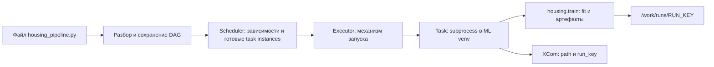

# 05. Airflow: оркестрация ML-пайплайнов

[Программа](../../README.md) · [Задания](#задания) · [Подготовка](#подготовка-к-заданиям)

## Цель и вход

Описать зависимые шаги обучения, повторить запуск после сбоя и не продублировать публикацию. Нужны train CLI, манифест и понимание MLflow. Airflow управляет выполнением задач. Сам по себе он не обучает модель и не гарантирует идемпотентность твоего кода.

Конкретное исходное состояние: `python -m housing.train` уже создаёт модель и JSON-метаданные, MLflow умеет сохранять сведения о запуске, но порядок шагов приходится держать в shell и памяти. После падения перед публикацией непонятно, надо ли снова обучаться и не появится ли вторая версия. Здесь ручная последовательность превращается в граф с явными зависимостями и сохраняемым состоянием выполнения.

Нужны собственная реализация [кандидата](../01-ml/housing.ipynb), [манифест](../02-reproducibility/tasks/02-manifest/README.md) и понимание [точной версии выпуска](../04-mlflow/README.md#от-pipeline-к-версии-реестра). Файл `work/housing.csv` содержит признаки района и ответ стоимости в `100000 USD`. Обучение разделяет строки и сохраняет четыре артефакта: `model.joblib`, `metrics.json`, `manifest.json`, `split.json`. Внутри контейнера тот же host-каталог `work/` доступен как `/work`, поэтому вход DAG — `/work/housing.csv`, выход отдельного запуска — `/work/runs/RUN_KEY`.

## Подготовка к заданиям

Все команды выполняются из корня курса. Для pytest активируй [основное окружение](../../SETUP.md#основная-среда):

```bash
source .venv/bin/activate
```

Для стенда нужны доступные Docker daemon и Compose, свободный порт 8080 и ресурсы из [SETUP](../../SETUP.md). ML-обучение работает на CPU. Airflow 3.1.0 запускается в контейнере, устанавливать его в основное Python-окружение не требуется.

| Вход или файл | Откуда берётся | Как используется |
|---|---|---|
| Рабочий train | [ML-notebook](../01-ml/housing.ipynb) | Вызывается CLI `housing.train`, фиктивное обучение не подходит |
| Manifest и split | [Модуль 02](../02-reproducibility/README.md) | Фиксируют данные, настройки и происхождение |
| `work/housing.csv` на host | [SETUP](../../SETUP.md) | Compose подключает `work/` как `/work`, DAG читает `/work/housing.csv` |
| [housing_pipeline.py](tasks/01-pipeline/housing_pipeline.py) | Заготовка темы 01 | Монтируется read-only в `/opt/airflow/dags/`, изменения видны без пересборки |
| `solution.py` и код обучения | Собственные реализации заданий | Копируются в image. После изменения нужно пересобрать контейнер |
| `/opt/housing-venv/bin/python` | Создаётся [Dockerfile](../../labs/airflow/Dockerfile) | Отдельное ML-окружение, не меняющее зависимости scheduler |

Подними стенд и прочитай логи:

```bash
docker compose -f labs/airflow/compose.yaml up -d --build
docker compose -f labs/airflow/compose.yaml logs --tail=80
```

UI находится на `http://localhost:8080`. Учётные данные standalone выводятся в логах и сохраняются в конфигурации auth manager внутри volume. Используй данные именно этого стенда. Старый совет `airflow users create` не следует переносить на Airflow 3 без проверки auth manager.

До trigger проверь импорт графа. Дальнейшие команды unpause/trigger/list-runs приведены в [теме 01](tasks/01-pipeline/README.md#требования-практического-опыта). Отсутствие ошибок импорта ещё не означает выполненное обучение. Gate и publish заготовки пока поднимают `NotImplementedError`.

## Задания

| Тема | Что выполнить | Файлы |
|---|---|---|
| [01. DAG и настоящее обучение](tasks/01-pipeline/README.md) | Вызвать train CLI отдельным ML-процессом, проверить файлы и XCom | [Функция](tasks/01-pipeline/solution.py) · [DAG](tasks/01-pipeline/housing_pipeline.py) · [Тесты](tasks/01-pipeline/test_task.py) |
| [02. Gate и повтор](tasks/02-gate-retry/README.md) | Блокировать плохое качество и публиковать один release на смысловой ключ | [Функции](tasks/02-gate-retry/solution.py) · [Файловые тесты](tasks/02-gate-retry/test_task.py) · [Состояния DAG](tasks/02-gate-retry/test_airflow.py) |
| [03. Сбой и интервалы](tasks/03-failure-intervals/README.md) | Сохранить суточный UTC-интервал и восстановить publish после сбоя | [Функции](tasks/03-failure-intervals/solution.py) · [Тесты функций](tasks/03-failure-intervals/test_task.py) · [Интервалы DAG](tasks/03-failure-intervals/test_airflow.py) |

Быстрые проверки запускаются отдельно от обвязки курса:

```bash
make task TASK=05-airflow/01-pipeline
```

До реализации учебных функций ожидается `NotImplementedError`. `make test` проверяет готовые компоненты курса. Быстрый тест `run_training` заменяет subprocess и не подтверждает исполнение Airflow. Загрузку настоящим SDK в уже работающем контейнере проверь так:

```bash
MLOPS_RUN_INTEGRATION=1 python -m pytest modules/05-airflow/tasks/01-pipeline -m integration -q
```

Это чтение графа, без trigger и исполнения task. Темы 02–03 содержат команды чтения реальных task instances и двух DagRun. Общая подготовка их переменных:

| Переменная | Что передать |
|---|---|
| `MLOPS_RUN_INTEGRATION` | `1`, разрешает доступ теста к работающему контейнеру |
| `AIRFLOW_ACCEPTANCE_RUN_ID` | ID своего завершённого run для темы 02 |
| `AIRFLOW_EXPECT_GATE` | `pass` по умолчанию или `reject` для запуска с плохой моделью |
| `AIRFLOW_MIN_PUBLISH_ATTEMPTS` | Минимум попыток publish, по умолчанию `1`. Для опыта retry укажи `2` |
| `AIRFLOW_INTERVAL_RUN_IDS` | JSON-массив двух разных ID успешных суточных запусков для темы 03 |

Эти переменные выбирают наблюдаемое состояние, а не создают его. Настоящая практика включает task instances, XCom `{path, run_key}`, model/metrics/release на диске, отказ gate, повтор упавшего publish и два прошлых интервала. Если добавляешь автоматические проверки, которые сами исполняют DAG или пишут ресурсы, они должны требовать оба флага `MLOPS_RUN_INTEGRATION=1 MLOPS_RUN_WRITES=1` и markers `integration`, `writes`. Существующие тесты наблюдения только читают подготовленные тобой результаты.

## Остановка стенда

После опыта отключи добавленное расписание и останови Airflow. Перед Kubernetes освободи его ресурсы:

```bash
docker compose -f labs/airflow/compose.yaml down
```

Данные в `work/` и named volume `airflow-home` сохраняются. Удаление volume сбрасывает историю DAG и для заданий не требуется.

## DAG и компоненты

DAG — ориентированный граф без циклов. Task описывает единицу работы, task instance — выполнение этой задачи в определённом DAG run. Scheduler решает, что пора выполнять. executor определяет механизм выполнения. metadata database хранит состояние. В Airflow 3 отдельную роль играет API server и взаимодействие компонентов через актуальные интерфейсы.

Учебный `airflow standalone` собирает компоненты в один локальный стенд с SQLite. Это удобно для первого графа и не моделирует отказоустойчивую production-инсталляцию. Масштабирование и внешний PostgreSQL рассматривай после понятного базового DAG.

## Время и интервалы данных

Scheduled run связан с интервалом данных. Logical date — не обязательно реальное время запуска. Если DAG обрабатывает вчерашнюю партицию, запрос к данным должен зависеть от интервала, а не от `datetime.now()` внутри task. Иначе повтор прошлой даты внезапно прочитает сегодняшние данные.

`catchup` определяет создание прошлых интервалов, backfill — осознанную обработку истории. Для первого DAG установлены `schedule=None` и `catchup=False`: запуск ручной, чтобы не создать неожиданную очередь. Позже добавь расписание с явным часовым поясом и проверь границы интервала.

```python
import pendulum
from airflow.sdk import dag, task

@dag(schedule=None, start_date=pendulum.datetime(2025, 1, 1, tz='UTC'), catchup=False)
def toy():
    @task
    def value():
        return {'partition': 'example'}
    value()

toy_dag = toy()
```

Этот пример предназначен для окружения Airflow 3.1.0 и создаёт описание графа с одной task. Вызов `toy()` строит DAG, но не выполняет тело `value` в текущем Python-процессе. Его выполнение запускается оркестратором. `schedule=None` оставляет запуск ручным. Фиксированный timezone-aware `start_date` задаёт начало допустимого расписания, а не команду немедленно исполнить функцию.

## Границы задач и XCom

Не делай одну task на каждую строку DataFrame. Шаг должен иметь понятный результат и политику повтора: validate data, train, evaluate, publish. Через XCom передавай небольшой JSON, путь или идентификатор артефакта, а не сам датасет и не pickle модели. Файлы на локальном диске одного worker могут быть недоступны другому: учебный общий volume явно упрощает эту проблему.

TaskFlow упрощает передачу маленьких результатов. В starter ML-библиотеки установлены в отдельный venv внутри image. Subprocess подходит для вызова существующего CLI. Передавай параметры безопасно, без конкатенации непроверенных строк shell. Ошибка CLI должна давать ненулевой код и провал task.

## Retry, идемпотентность и публикация

Retry повторяет выполнение после сбоя. Если task перед падением успела зарегистрировать модель, повтор может создать ещё одну версию. Определи run_key из data/config/code и проверь наличие готового результата перед новой публикацией. Результат обучения сначала запиши в отдельную директорию запуска. Не перезаписывай активную модель до проверки качества.

Airflow не обеспечивает магическое exactly once для внешних side effects. Практическая цель — повторяемый шаг с устойчивым ключом и безопасной публикацией. Ограничение `max_active_runs=1` снижает гонки учебного стенда, но не заменяет этот контракт.

## Проверка качества и восстановление

После train отдельная task проверяет метрики и формат bundle. Gate должен читать реальный metrics.json и блокировать publish при ухудшении. В starter оставлен один очевидный TODO вместо фиктивного успешного обучения. Научись отличать import error DAG от ошибки выполнения task: первый виден до создания task instance.

При инциденте сохраняй DAG run ID, task ID, попытку, run_key и ссылку на артефакт. Повтор только упавшего шага дешевле полного обучения, если предыдущие результаты устойчиво сохранены.

## Кто исполняет граф и кто исполняет обучение

Описание DAG — Python-файл, который Airflow периодически разбирает, чтобы получить структуру работ. Определение `@task` создаёт описание шага. Тело выполняется при запуске его task instance. Импорт файла не должен запускать обучение, читать большой CSV или обращаться к MLflow. Иначе обновление графа само становится дорогой внешней операцией. В нашем варианте импорты находятся в начале файлов, а ML-зависимости живут в отдельной программе: DAG импортирует Airflow/stdlib, ML-процесс импортирует sklearn.



В Airflow 3 task execution взаимодействует с управляющей частью через Execution API. API server также предоставляет интерфейсы сервиса и UI. metadata database хранит состояния. Executor — механизм, которым scheduler организует запуск. Он не является модельным алгоритмом. `standalone` поднимает локальный набор процессов, а не создаёт отказоустойчивый кластер. Роли компонентов и небольших сообщений описаны в [архитектуре Airflow 3.1.0](https://airflow.apache.org/docs/apache-airflow/3.1.0/core-concepts/overview.html).

`labs/airflow/Dockerfile` оставляет библиотеки Airflow в его среде и устанавливает зависимости housing в `/opt/housing-venv`. Это предотвращает случайную замену зависимостей оркестратора при установке ML-пакетов. Заготовка запускает `/opt/housing-venv/bin/python`, а не первый `python` из PATH. Это похоже на вызов отдельного Go-бинарника из worker: вызывающий процесс отвечает за аргументы, exit code и обработку результата, а вычисления происходят в дочерней программе.

Compose монтирует сам DAG read-only, поэтому правка `housing_pipeline.py` доступна разборщику. Реализации `solution.py` копируются в image при сборке. После их изменения требуется пересборка `docker compose -f labs/airflow/compose.yaml up -d --build`. Простое обновление страницы UI не обновит код внутри образа. Этот нюанс объясняет ситуацию «в редакторе функция реализована, в task всё ещё NotImplementedError».

## Один запуск от CSV до XCom

Сначала `validate_data` проверяет наличие `/work/housing.csv` и возвращает путь. `train_evaluate` строит устойчивый `run_key`, выбирает отдельный output и вызывает функцию `run_training` в ML-среде. Она запускает настоящий `housing.train` и проверяет наличие всех четырёх файлов. Затем task возвращает только `{"path":"/work/runs/...","run_key":"..."}`. **XCom** (cross-communication) сохраняет это небольшое сообщение для последующих шагов.

Наличие файлов после exit code 0 — минимальная проверка полноты, а не качества и не происхождения. Старый файл в переиспользованном output может пережить неуспешный запуск. Публикация должна читать артефакты именно выбранного run. Передача `Pipeline` или DataFrame через XCom усложняет сериализацию и раздувает служебное хранилище. Путь удобен, если следующий worker действительно видит то же хранилище. Общий volume `/work` делает это верным для учебного стенда. В распределённом исполнении нужен общий artifact store с доступными всем адресами.

Аргументы subprocess передают списком. Для пути `/work/input with spaces.csv` это один аргумент. Сборка строки для shell может разбить его и интерпретировать специальные символы. `check=True` превращает ненулевой exit code в `CalledProcessError`, чтобы task не стала успешной после неуспешного обучения. Проверка stdout полезна для сообщения metadata, stderr — для диагностики процесса. Ошибка JSON результата и ошибка `fit` требуют разного разбора.

## Почему run key не равен номеру попытки

**Run key** — собственный устойчивый ключ смысловой работы: версия данных + полная конфигурация + версия кода, при необходимости интервал данных. Две попытки одинакового обучения имеют разные номера попытки, но один ключ. Если ключ строить через текущее время, retry получит другое имя и перестанет узнавать уже выполненную публикацию. Если не включить параметры, разные обучения ошибочно сольются в один результат.

В starter ключ включает digest CSV, seed и строку `starter-v1`. Последняя — видимый TODO, который нужно заменить сведениями о действительной конфигурации и коде. Сам Airflow run ID обозначает выполнение графа и не заменяет этот ключ. Ограничение `max_active_runs=1` запрещает несколько одновременно активных запусков данного DAG в стенде, но не запрещает другому процессу опубликовать ту же модель.

## Gate и идемпотентная публикация

**Quality gate** — проверка, разрешающая переход к выпуску. В нашем контракте она читает `candidate.test.mae` и `baseline.test.mae` из реального `metrics.json`. При baseline=1.0 и candidate=0.9 отношение равно 0.9, граница проходит. 0.90001 — нет. Нулевой baseline делает отношение неопределённым, NaN не является корректной ошибкой, `True` не должен превращаться в 1. Поэтому неподходящие значения дают `ValueError`, а корректное, но недостаточное качество — `False`.

Важно различать вычисление булева результата и блокировку графа. Если task просто вернула `False`, Airflow может считать её успешно выполнившейся функцией. Само значение не запрещает downstream. Подключённая gate-task должна явно остановить путь публикации согласно выбранной реализации, а `publish` повторно проверяет метрики до записи release. Плохая модель не должна получить release только потому, что callback вернул значение без исключения.

**Публикация** здесь — атомарное сохранение `release_dir/run_key.json` с `run_key`, `model_path` и точной `version`. Повтор с тем же ключом, путём и версией возвращает прежний release. Тот же ключ с другой версией — конфликт, а не разрешение перезаписать выпуск. Это похоже на HTTP idempotency key: повтор запроса должен дать тот же результат, но новый payload под старым ключом требует отказа. Безопасное имя файла не содержит `/` и не равно `.`/`..`, иначе вход мог бы выйти за каталог releases.

Атомарная замена защищает читателя от половины JSON в одной файловой системе. Она не решает гонку двух независимых писателей и не превращает внешний Registry в транзакционный участник. Поэтому тест одного release-файла подтверждает локальный контракт. Распределённая публикация потребует дополнительной координации. Практики повторяемых шагов и передачи путей разобраны в [best practices Airflow 3.1.0](https://airflow.apache.org/docs/apache-airflow/3.1.0/best-practices.html#creating-a-task).

## Интервал данных и восстановление шага

**Data interval** — временной промежуток входных данных, который обслуживает запуск. **Partition** — часть набора данных с устойчивым ключом, например дата UTC начала интервала. Интервал удобно понимать как `[start, end)`: начало включено, конец принадлежит следующей части. Logical date описывает логическую привязку запуска. Фактическое время начала может быть позже из-за очереди или ручного восстановления.

Например, вход `2025-01-01T03:00:00+03:00` → `2025-01-02T03:00:00+03:00` описывает ровно тот же интервал, что UTC `2025-01-01T00:00:00Z` → `2025-01-02T00:00:00Z`. Контракт `interval_manifest` нормализует их в `+00:00` и partition `2025-01-01`. Дата без смещения не задаёт однозначный момент, поэтому отклоняется. В упражнении требуется ровно 24 часа в UTC. Это уже, чем произвольный календарный день зоны с переходом на летнее время.

Для первого графа `schedule=None` отключает автоматический календарный запуск, `catchup=False` не создаёт историю пропущенных интервалов. В третьей теме добавляется ежедневное UTC-расписание и проверяются две выбранные прошлые даты. У housing в этом упражнении один статический CSV: интервал учит сохранять идентичность обработки, но не создаёт из исторического датасета настоящий поток новых ежедневных данных. Политики catchup/backfill и интервалов следует сверять с [DAG Runs Airflow 3.1.0](https://airflow.apache.org/docs/apache-airflow/3.1.0/core-concepts/dag-run.html).

У Airflow 3.1.0 важна разновидность **timetable**, объекта правил расписания. Простая cron-строка при стандартном `create_cron_data_intervals=False` выбирает `CronTriggerTimetable`: запуск привязан к моменту срабатывания и без дополнительного интервала не даёт нужные сутки. Для задания с 24-часовым интервалом задавай явно `CronDataIntervalTimetable("0 0 * * *", timezone="UTC")` в `schedule`. Импорт класса из `airflow.timetables.interval` уже подготовлен в начале DAG-файла. Он создаёт интервал между соседними UTC-полуночами и планирует запуск по его окончании. Это выбор семантики входа, а не косметическая форма cron. После изменения проверь обе границы в контексте фактического запуска. Различие описано в [timetables](https://airflow.apache.org/docs/apache-airflow/3.1.0/authoring-and-scheduling/timetable.html), значение по умолчанию — в [конфигурации релиза 3.1.0](https://github.com/apache/airflow/blob/3.1.0/airflow-core/src/airflow/config_templates/config.yml).

При искусственном сбое непосредственно перед publish остаются готовые артефакты и состояние `evaluated`. Возобновление вызывает идемпотентный publish и возвращает новое состояние `published` с release, сохранив interval и run key. Входное состояние не мутируется. При ошибке callback исключение доходит до Airflow. Повтор уже `published` не вызывает callback. Окно после внешнего side effect по-прежнему требует идемпотентности самой публикации, а не только флага в памяти.

## От импорта графа до завершения попытки

| Наблюдение | Что это означает и что проверить |
|---|---|
| `list-import-errors` показывает ошибку | DAG ещё не готов к исполнению: синтаксис, пакет, импорт или код разбора |
| Run остаётся queued | Проверить paused, работу scheduler и доступность исполнения |
| Task `up_for_retry` | Попытка уже упала. Есть разрешённый повтор после паузы |
| `FileNotFoundError` в validate_data | CSV отсутствует по контейнерному пути или неверен mount |
| `NotImplementedError` в ML-процессе | Осталась заготовка либо образ содержит старый solution.py |
| Train success, publish не стартовал | Проверить gate и зависимости конкретных task instances |

У заданных task `retries=1`: первая попытка плюс один автоматический повтор, а не одна попытка всего. Общий DAG run может оставаться running, пока task ждёт retry. Для диагностики нужны run ID, task ID, attempt, run key и путь артефактов. Повторять только упавший шаг безопасно лишь тогда, когда сохранённые входы и результаты предыдущих стадий ещё доступны и соответствуют тому же ключу.

## Материалы

- [Airflow Docker 3.1.0](https://airflow.apache.org/docs/apache-airflow/3.1.0/howto/docker-compose/index.html) — требования к Docker, память и границы учебного стенда.
- [Airflow tutorials](https://airflow.apache.org/docs/apache-airflow/3.1.0/tutorial/index.html) — TaskFlow и устройство DAG.
- [Airflow best practices](https://airflow.apache.org/docs/apache-airflow/3.1.0/best-practices.html) — идемпотентность, top-level code и передача данных.

## Практическая приёмка настоящего DAG

Заготовка уже использует `airflow.sdk` и отдельные task wrappers gate/publish,
но их действия, daily timetable и interval wiring реализует ученик. Проверка
`DagBag` внутри работающего контейнера включается явно из
[темы 01](tasks/01-pipeline/README.md#настоящий-sdk-и-загрузка-dag).
Она доказывает импорт, а fake subprocess unit-тест — только CLI-обвязку.

Обязателен настоящий запуск: task instances и XCom `{path, run_key}`, реальные
model/metrics/release, блокировка плохого gate, retry одного упавшего publish
без нового результата и два прошлых суточных UTC интервала в manifest. Критерии
перечислены в темах [02](tasks/02-gate-retry/README.md#обязательный-опыт-в-airflow)
и [03](tasks/03-failure-intervals/README.md#приёмка-расписания-настоящим-sdk).
Mock task, тест функции или зелёный import DAG не засчитываются как этот опыт.
