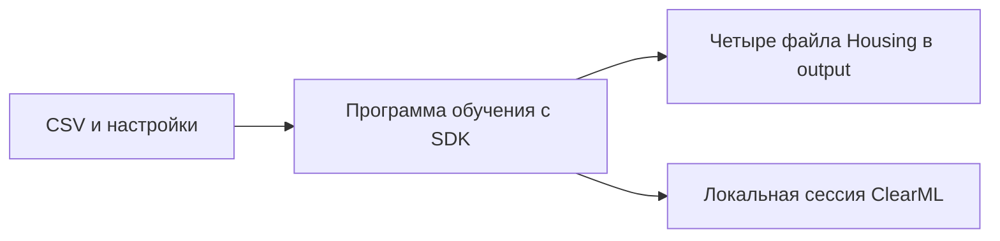
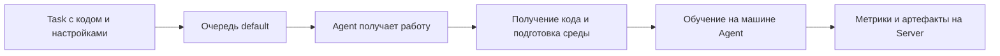

# 06. ClearML: учёт обучения и выполнение задач

[Программа](../../README.md) · [Задания](#задания) · [Подготовка](#подготовка-к-заданиям)

## Какую проблему решаем

В модуле MLflow ты связал обучение с параметрами, метриками и моделью. Airflow затем помог определить порядок шагов и повтор после ошибки. Теперь рассмотрим другую границу: как подготовленное обучение передать исполнителю, который сам получит код, создаст среду и запустит программу.

Начнём с локальной записи ClearML: подключим её к прежней `train`, проверим сохранённые сведения, затем используем сервер и очередь для повторного исполнения. Обучение остаётся Housing. Меняется способ учёта и запуска работы, поэтому результаты можно сравнить с предыдущими модулями на тех же данных.

Для текстовой модели исполнителю также потребовались бы корпус и преобразование текста. Для модели изображений — изображения, веса и настройки их подготовки. Путь в параметрах не переносит эти файлы на другую машину. Эта граница важна и для маленького Housing CSV, и для большого набора изображений. Новых моделей в модуле нет.

## Подготовка к заданиям

Все команды выполняй из корня курса. Для быстрых тестов достаточно [основного окружения](../../SETUP.md#основная-среда). Для настоящего SDK создай отдельное окружение с ClearML 1.18.0 и базовыми зависимостями housing:

```bash
python3.12 -m venv .venv-clearml
source .venv-clearml/bin/activate
python -m pip install -r labs/clearml/requirements.txt
python -m pip install --no-deps -e labs/housing
```

| Режим | Что подготовить | Где выполняется |
|---|---|---|
| Быстрые тесты `train_and_log` | pytest и пакет курса. Обучение и SDK подменяются тестом | Основная среда, без Server и без ClearML |
| Настоящий offline SDK-тест | Окружение выше. Включить `MLOPS_RUN_SDK=1` | Отдельный subprocess с временным cache/config |
| Собственное offline-обучение | Рабочий train из [ML-notebook](../01-ml/housing.ipynb), manifest из [модуля 02](../02-reproducibility/README.md), `work/housing.csv` из SETUP | Локальная CPU-машина. Server и Agent не нужны |
| Server и очередь | Совместимый Linux x86_64, Docker/Compose, данные и Git-исходники для исполнителя | [Руководство темы 02](tasks/02-agent/README.md). ARM64 для выбранного Compose не заявлен |
| Agent | Отдельная среда с `clearml-agent==1.9.3` и `setuptools==80.9.0` | Машина исполнителя. Точные команды в теме 02 |

Для просмотра платформы серверного образа без запуска контейнера можно использовать `docker buildx imagetools inspect allegroai/clearml:1.16.1`. Успешное скачивание или принудительная эмуляция одного образа не подтверждают совместимость всего набора Mongo/Elasticsearch/Server. При отсутствии совместимой Linux-среды начни с offline SDK.

Offline mode включай до `Task.init`. Локально CLI задания по умолчанию выбирает его через `CLEARML_OFFLINE_MODE=1`. Значение `0` нужно для online-запуска с настроенным Server. Не вводи выдуманный API endpoint для offline-работы. Готовый `finally` закрывает Task при успехе и исключении, сохраняя сессию, если SDK успел завершить запись. Сессия с исключением не является успешно обученной моделью.

## Задания

| Тема | Что выполнить | Файлы и проверка |
|---|---|---|
| [01. Offline train](tasks/01-offline/README.md) | Связать настоящее обучение с параметрами, метриками и артефактами Task | [Заготовка](tasks/01-offline/solution.py) · [Тесты](tasks/01-offline/test_task.py) |
| [02. Server и Agent](tasks/02-agent/README.md) | Настроить три адреса Server, подготовить код/данные и исполнить клон через очередь | Руководство. Автоматического теста очереди нет |
| [03. Сравнение и отказ](tasks/03-comparison-failure/README.md) | Сопоставить одинаковое обучение в системах и проверить ошибку с восстановлением | Руководство. Отдельной функции и обязательного отчёта нет |

Проверь функцию без ClearML, затем SDK в подготовленном окружении:

```bash
make task TASK=06-clearml/01-offline
MLOPS_RUN_SDK=1 python -m pytest modules/06-clearml/tasks/01-offline -m sdk -q
```

До реализации функция поднимает `NotImplementedError`. `make test` относится к готовой обвязке курса. SDK-тест проверяет реальные offline params/scalars/artifacts на подменённой границе обучения. Собственный запуск на housing CSV требуется отдельно. Ни fake SDK, ни offline-сессия не подтверждают очередь или получение задачи Agent. Для тем 02–03 runner указывает на руководство, проверки заполненности там нет.

## Что приходит из предыдущих модулей

Используй собственную `housing.train.train`, CSV `work/housing.csv` и четыре файла результата по [контракту проекта](../../labs/housing/README.md). Процедура split/fit/evaluate и смысл MAE/RMSE остаются прежними. Они разобраны в [ML-модуле](../01-ml/README.md). Повторно создавать обучение внутри интеграции не нужно.

В первом задании CLI уже разбирает пути и seed, создаёт запись ClearML и закрывает её в `finally`. В [solution.py](tasks/01-offline/solution.py) нужно реализовать только `train_and_log`: вызвать `train`, прочитать фактические метрики и происхождение, передать их библиотеке ClearML. Функция не должна подставлять ожидаемые числа вместо результатов файлов.

## SDK и Task: запись из Python-программы

Чтобы после обучения найти его модель, нужны общий идентификатор и связанная с ним запись. ClearML называет её **Task**. Она имеет проект, имя и ID. Проект объединяет связанные работы, имя помогает человеку найти их в интерфейсе, ID указывает на конкретную запись.

Смысл слова зависит от системы. Здесь Task хранит сведения об обучении. В Airflow task обозначает шаг графа. MLflow run выполняет похожую роль записи результатов, а Experiment группирует runs. Совпадение названия не связывает объекты разных систем автоматически.

Программа создаёт и дополняет Task через **SDK**, Python-библиотеку `clearml`. `Task.init` открывает запись, `task.connect` связывает с ней параметры. Для чисел используется **logger**, интерфейс записи измерений. `upload_artifact` добавляет существующий файл. Короткие настройки и факты происхождения удобно искать как параметры, полные файлы сохраняются как артефакты — по той же причине, что в [MLflow](../04-mlflow/README.md#что-сохраняем-после-обучения).

SDK может [переиспользовать подходящую недавнюю Task](https://github.com/clearml/clearml/blob/v1.18.0/clearml/task.py). В самостоятельном примере ниже каждый опыт намеренно получает отдельную запись через `reuse_last_task_id=False`. В CLI задания оставлена стандартная политика `Task.init`. Имя Task поэтому не служит доказательством нового независимого запуска.

## Offline: данные остаются локально

Чтобы проверить интеграцию без сервера, SDK может записывать сведения в локальную сессию. Это **offline-режим**. Его включают до `Task.init`, после закрытия Task SDK сохраняет сессию и печатает её путь.



`output` твоей программы и cache SDK — разные места. Первое содержит результат обучения, второе — сведения Task и подготовленные SDK копии. Сессию можно импортировать на сервер, но сама локальная запись ещё не показывает ни очередь, ни получение работы исполнителем.

## Server: общее хранилище и интерфейс

Теперь предположим, что результаты должны видеть несколько процессов. Им нужна общая точка приёма записей и файлов — **ClearML Server**. В [Compose стенда](../../labs/clearml/compose.yaml) для этого открыты три адреса:

| Адрес | Назначение |
|---|---|
| `http://localhost:8088` | Web UI: просмотр Task и результатов |
| `http://localhost:8008` | API: обращения SDK и исполнителя |
| `http://localhost:8081` | Файловый сервис: передача артефактов |

Открывшийся UI проверяет только первый путь. Успешная запись Task и загрузка файла требуют остальных. Сервер принимает результаты. Сам `fit` выполняет запущенная программа. Поэтому ручной online-запуск, подключённый к Server, ещё не является исполнением через очередь.

## Очередь и Agent: исполнение подготовленной задачи

Чтобы не запускать программу вручную для каждого опыта, подготовленную Task помещают в **очередь** — список ожидающей работы. Её слушает **Agent**, отдельный процесс на машине исполнения. Он получает Task, подготавливает код и Python-среду, затем запускает обучение.



Для первого опыта очередь называется `default`. Agent должен слушать именно её. Название очереди не выделяет ресурсы автоматически: очередь с именем `gpu` сама по себе не добавит видеокарту. CPU-обучению Housing она не требуется. Порядок подготовки кода, CSV и параметров дан в [задании 02](tasks/02-agent/README.md).

## Самостоятельный пример SDK

Пример ниже показывает три действия: запись параметров, запись вычисленной метрики и добавление файла. Он не обучает housing-модель и не реализует функцию из задания.

Возьмём три известных значения стоимости `[1, 2, 3]` и предсказатель, всегда возвращающий `2`. Абсолютные ошибки равны `[1, 0, 1]`, поэтому MAE=`2/3`. Число вычисляется из входа. Здесь нет выдуманной метрики обучения.

Используй [отдельное окружение модуля](#подготовка-к-заданиям).

Для отдельного примера назовём проект `course-sdk-demo`, запись — `constant-predictor`, а группу графика — `quality-demo`. Это учебные имена для поиска результата, они не относятся к Housing-запуску задания. Используется ClearML SDK 1.18.0 из requirements. Сохрани код как `work/clearml-demo.py` и выполни `python work/clearml-demo.py`. Папка `work/` создаётся при подготовке курса. Не называй файл `clearml.py`: такое имя может перекрыть импорт установленной библиотеки.

```python
import json
from pathlib import Path

from clearml import Task

actual = [1.0, 2.0, 3.0]
constant = 2.0
predicted = [constant] * len(actual)
mae = sum(abs(y - p) for y, p in zip(actual, predicted)) / len(actual)

output = Path("work/clearml-demo")
output.mkdir(parents=True, exist_ok=True)
example_file = output / "example-data.json"
example_file.write_text(
    json.dumps({"actual": actual, "predicted": predicted}), encoding="utf-8"
)

Task.set_offline(offline_mode=True)
task = Task.init(
    project_name="course-sdk-demo",
    task_name="constant-predictor",
    reuse_last_task_id=False,
    auto_connect_frameworks=False,
    auto_resource_monitoring=False,
)
try:
    task.connect({"constant": constant, "sample_count": len(actual)})
    task.get_logger().report_scalar(
        title="quality-demo", series="mae", value=mae, iteration=0
    )
    task.upload_artifact(
        name="example-data", artifact_object=example_file, wait_on_upload=True
    )
finally:
    task.close()

print(f"MAE: {mae:.6f}")
print(f"Offline folder: {task.get_offline_mode_folder()}")
```

Что делает каждый вызов:

- `Task.set_offline` выбирает локальный режим до создания Task.
- `Task.init` задаёт проект и имя. `reuse_last_task_id=False` создаёт отдельную запись. Два `auto_*` параметра ограничивают демонстрацию явными вызовами: без интеграций ML-фреймворков и фонового мониторинга ресурсов.
- `task.connect` записывает выбранную константу и размер примера. Числа остаются параметрами. Запись не запускает вычисление MAE повторно.
- `report_scalar` записывает одно значение числового ряда. `title` — группа графика, `series` — имя ряда, `value` — вычисленное число, `iteration` — номер шага. Для одной итоговой метрики подходит шаг 0. Если обучение несколько раз проходит по обучающей выборке, каждый такой проход называется эпохой. Для его метрики можно использовать очередной номер шага.
- `upload_artifact` добавляет существующий файл под именем `example-data`. `wait_on_upload=True` ожидает завершения операции, а `finally` закрывает Task даже при исключении.

Среди служебных сообщений ожидаются `MAE: 0.666667` и путь offline-сессии. ID и путь у разных запусков отличаются. `example-data.json` содержит реальные входы и прогнозы этого маленького примера. Интерфейс Server для просмотра этих данных появится только после импорта сессии либо отдельного online-запуска.

## От локального запуска к повтору на другой машине

В локальной сессии уже есть параметры и файлы. Чтобы повтор состоялся у Agent, проверь доступность самих ресурсов:

| Что требуется | Что проверить перед отправкой Agent |
|---|---|
| Код | Репозиторий доступен исполнителю, нужная версия зафиксирована |
| Python и библиотеки | Версия Python подходит. Зависимости устанавливаются. Локальный пакет housing доступен |
| Данные | CSV доступен на машине Agent и совпадает по SHA-256 |
| Параметры запуска | Пути и seed переданы реально исполняемому коду |
| Каталог результата | Процесс имеет право записи. Параллельные запуски используют разные каталоги |
| Подключение к Server | Адреса API/файлового сервиса доступны именно с машины Agent |

Запись параметра с путём к CSV не копирует CSV. Идентификатор версии кода, Git commit, также не включает автоматически данные, которые исключены из Git. Например, путь к файлу на одном компьютере не станет существовать на другом только потому, что он отображается в UI.

Отдельный нюанс — параметры CLI, то есть аргументы командной строки. SDK умеет работать с `argparse`, но для перехвата разбора аргументов должен быть подключён до `parse_args()`. В учебной заготовке импорт находится в начале модуля. Если ClearML не установлен, модуль остаётся доступным для тестов функций, а запуск `main()` объясняет, как установить SDK. В [руководстве по Agent](tasks/02-agent/README.md#подготовка-точки-входа) небольшая точка входа также делает локальный пакет курса доступным из копии Git-репозитория.

При удалённом исполнении подключённые параметры могут переопределяться конфигурацией Task. Отличай выбираемую настройку от наблюдаемого факта: SHA-256 описывает прочитанный файл и не должен вручную подменяться значением от другого датасета.

## ClearML, MLflow и Airflow на одном сценарии

Возьмём процесс: подготовить данные → обучить модель → проверить ошибку → опубликовать разрешённую версию.

| Инструмент | Роль в этом процессе | Что посмотреть для проверки |
|---|---|---|
| MLflow | Сохранить runs, метрики и модели, связать их с версиями реестра | Исходный run, конкретную версию модели и артефакты |
| ClearML | Сохранить Task с результатами. При использовании Agent организовать её выполнение | Параметры, метрики и файлы Task. Очередь и исполнителя для удалённого запуска |
| Airflow | Задать зависимости шагов, запускать их по расписанию и повторять после сбоев | Статусы шагов графа и результаты конкретного запуска |

Если надо сравнить несколько локальных запусков, достаточно начать с одной системы учёта. Если обучение должно выполняться на выделенных машинах, добавляется вопрос управления исполнителями. Если несколько шагов зависят друг от друга и должны запускаться по расписанию, появляется задача оркестрации — управления порядком и условиями их выполнения.

В курсе инструменты изучаются по отдельности, чтобы увидеть их ответственность. Для своего проекта выбирай состав под конкретную задачу. Одновременное использование всех трёх не является обязательным условием.

## Ошибки и способы их различать

| Симптом | Возможная причина | Что проверить |
|---|---|---|
| Task есть, файлов модели нет | Ошибка обучения или файл не был добавлен | Код завершения программы, исключение и наличие model.joblib в output |
| Локальная сессия создана, в UI ничего нет | Работал offline-режим | Режим запуска и необходимость импорта сессии |
| UI доступен, SDK не подключается | Неверный адрес API или настройки доступа | Адреса 8008/8081 и конфигурацию SDK |
| Task ждёт в очереди | Нет подходящего Agent или он слушает другую очередь | Запущенного исполнителя и имя очереди |
| Удалённый процесс не находит CSV | Путь описан, но данные недоступны | Файл на машине Agent и его SHA-256 |
| Повтор получился другим | Изменились данные, конфигурация, split или среда | Манифесты и численную эквивалентность прогнозов |

`task.close()` завершает работу SDK, но само наличие сессии не означает успешное обучение. Ошибка не должна скрываться: у неуспешной CLI остаётся ненулевой код, а частичная модель не становится готовым выпуском. После повтора могут появиться две Task, поэтому последующая публикация должна опираться на устойчивый ключ запуска и quality gate из модулей 04–05.

## Серверный стенд и завершение работы

Server нужен только для online-сценария темы 02. На совместимой Linux-машине:

```bash
docker compose -f labs/clearml/compose.yaml up -d
curl --fail --max-time 10 http://localhost:8088/
```

UI использует порт 8088, SDK/Agent API — 8008, файлы — 8081. Успех curl не проверяет два остальных пути. Адреса, ключи доступа, точку входа и данные настрой по [инструкции Server и Agent](tasks/02-agent/README.md#запуск-server-и-настройка-адресов). Если task ждёт в очереди, проверь исполнителя, имя очереди и доступ к коду. Очередь сама не исполняет работу. Путь к `work/housing.csv` не переносит CSV на другую машину: обеспечь файл с тем же SHA-256.

Останови своего Agent через `Ctrl+C`, затем Server:

```bash
docker compose -f labs/clearml/compose.yaml down
```

Именованные volumes сохраняются. Их удаление не требуется. После offline-опыта сервисов нет, достаточно `deactivate`. Сохрани нужные output и архивы сессий перед очисткой своих временных результатов.

## Материалы

- [Offline mode](https://clear.ml/docs/latest/docs/guides/set_offline/) — включение режима, каталог сессии и импорт. Читать после самостоятельного примера SDK.
- [Task API](https://clear.ml/docs/latest/docs/references/sdk/task/) — справочные разделы init, connect, upload_artifact и close. Сигнатуры примеров сверяются с закреплённым SDK 1.18.0.
- [Logger API](https://clear.ml/docs/latest/docs/references/sdk/logger/) — report_scalar и значения title/series/iteration.
- [ClearML Agent](https://clear.ml/docs/latest/docs/clearml_agent/) — получение кода, подготовка среды и исполнение задачи. Для лабораторной используется Agent 1.9.3.
- [Agent CLI](https://clear.ml/docs/latest/docs/clearml_agent/clearml_agent_ref/) — daemon, очереди и параметры процесса исполнителя.
- [ClearML Server](https://clear.ml/docs/latest/docs/deploying_clearml/clearml_server/) — устройство серверного стенда и настройки подключений.
