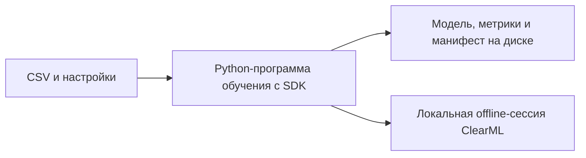
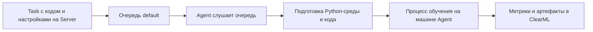

# 06. ClearML: учёт обучения и выполнение задач

[Программа](../../README.md) · [Задания](#задания) · [Подготовка](#подготовка-к-заданиям)

## Какую задачу решает этот модуль

Представь, что у тебя уже есть Python-программа, которая обучает модель прогнозирования стоимости жилья. Ты запускаешь её с одной настройкой модели, затем меняешь настройку и повторяешь запуск. В терминале появляются два числа ошибки, на диске — два файла модели. Теперь нужно понять: какой файл относится к лучшему результату, на каких данных он получен и как повторить именно это обучение.

Это задача **учёта экспериментов** — сохранения связи между исходными данными, кодом, настройками и результатами. В этом модуле ты подключишь к своей программе ClearML, чтобы сведения о запуске собирались вместе. Затем разберёшь, как отправить подготовленное обучение на выполнение другому процессу или другой машине.

ClearML состоит из нескольких компонентов. Их не нужно устанавливать одновременно, чтобы начать: локальный режим позволяет освоить запись параметров, метрик и файлов без сервера. Очередь и удалённый исполнитель понадобятся в отдельной теме практики.

## Подготовка к заданиям

Все команды выполняй из корня курса. Для быстрых тестов достаточно [основного окружения](../../SETUP.md#основная-среда). Для настоящего SDK создай отдельное окружение с ClearML 1.18.0 и базовыми зависимостями housing:

```bash
python3.12 -m venv .venv-clearml
source .venv-clearml/bin/activate
python -m pip install -r labs/clearml/requirements.txt
python -m pip install --no-deps -e labs/housing
```

| Режим | Что подготовить | Где выполняется |
|---|---|---|
| Быстрые тесты `train_and_log` | pytest и пакет курса. Обучение и SDK подменяются тестом | Основная среда, без Server и без ClearML |
| Настоящий offline SDK-тест | Окружение выше. Включить `MLOPS_RUN_SDK=1` | Отдельный subprocess с временным cache/config |
| Собственное offline-обучение | Рабочий train из [ML-notebook](../01-ml/housing.ipynb), manifest из [модуля 02](../02-reproducibility/README.md), `work/housing.csv` из SETUP | Локальная CPU-машина. Server и Agent не нужны |
| Server и очередь | Совместимый Linux x86_64, Docker/Compose, данные и Git-исходники для исполнителя | [Руководство темы 02](tasks/02-agent/README.md). ARM64 для выбранного Compose не заявлен |
| Agent | Отдельная среда с `clearml-agent==1.9.3` и `setuptools==80.9.0` | Машина исполнителя. Точные команды в теме 02 |

Для просмотра платформы серверного образа без запуска контейнера можно использовать `docker buildx imagetools inspect allegroai/clearml:1.16.1`. Успешное скачивание или принудительная эмуляция одного образа не подтверждают совместимость всего набора Mongo/Elasticsearch/Server. При отсутствии совместимой Linux-среды начни с offline SDK.

Offline mode включай до `Task.init`. Локально CLI задания по умолчанию выбирает его через `CLEARML_OFFLINE_MODE=1`. Значение `0` нужно для online-запуска с настроенным Server. Не вводи выдуманный API endpoint для offline-работы. Готовый `finally` закрывает Task при успехе и исключении, сохраняя сессию, если SDK успел завершить запись. Сессия с исключением не является успешно обученной моделью.

## Задания

| Тема | Что выполнить | Файлы и проверка |
|---|---|---|
| [01. Offline train](tasks/01-offline/README.md) | Связать настоящее обучение с параметрами, метриками и артефактами Task | [Заготовка](tasks/01-offline/solution.py) · [Тесты](tasks/01-offline/test_task.py) |
| [02. Server и Agent](tasks/02-agent/README.md) | Настроить три адреса Server, подготовить код/данные и исполнить клон через очередь | Руководство. Автоматического теста очереди нет |
| [03. Сравнение и отказ](tasks/03-comparison-failure/README.md) | Сопоставить одинаковое обучение в системах и проверить ошибку с восстановлением | Руководство. Отдельной функции и обязательного отчёта нет |

Проверь функцию без ClearML, затем SDK в подготовленном окружении:

```bash
make task TASK=06-clearml/01-offline
MLOPS_RUN_SDK=1 python -m pytest modules/06-clearml/tasks/01-offline -m sdk -q
```

До реализации функция поднимает `NotImplementedError`. `make test` относится к готовой обвязке курса. SDK-тест проверяет реальные offline params/scalars/artifacts на подменённой границе обучения. Собственный запуск на housing CSV требуется отдельно. Ни fake SDK, ни offline-сессия не подтверждают очередь или получение задачи Agent. Для тем 02–03 runner указывает на руководство, проверки заполненности там нет.

## Серверный стенд и завершение работы

Server нужен только для online-сценария темы 02. На совместимой Linux-машине:

```bash
docker compose -f labs/clearml/compose.yaml up -d
curl --fail --max-time 10 http://localhost:8088/
```

UI использует порт 8088, SDK/Agent API — 8008, файлы — 8081. Успех curl не проверяет два остальных пути. Адреса, ключи доступа, точку входа и данные настрой по [инструкции Server и Agent](tasks/02-agent/README.md#запуск-server-и-настройка-адресов). Если task ждёт в очереди, проверь исполнителя, имя очереди и доступ к коду. Очередь сама не исполняет работу. Путь к `work/housing.csv` не переносит CSV на другую машину: обеспечь файл с тем же SHA-256.

Останови своего Agent через `Ctrl+C`, затем Server:

```bash
docker compose -f labs/clearml/compose.yaml down
```

Именованные volumes сохраняются. Их удаление не требуется. После offline-опыта сервисов нет, достаточно `deactivate`. Сохрани нужные output и архивы сессий перед очисткой своих временных результатов.

## Что уже должно работать

Используем проект из [модуля ML](../01-ml/README.md), а не произвольный пример из интернета. В California Housing одна строка описывает район: доходы жителей, возраст домов, координаты и другие числовые признаки. **Признаки** — входные сведения, по которым модель вычисляет прогноз. **Целевая переменная** — известная медианная стоимость жилья, с которой сравнивают прогноз.

Программа `housing.train` вызывает твой код из [задания кандидата](../01-ml/housing.ipynb). После реализации она:

1. Читает CSV с данными.
2. Разделяет строки на обучающую, валидационную и тестовую выборки. На первой обучаются, на второй выбирают настройки, на третьей оценивают уже выбранную модель. Такое разбиение называют split.
3. Обучает Pipeline — последовательность подготовки признаков и вычисления прогноза.
4. Считает ошибки baseline и кандидата. Baseline — простая модель для сравнения. Кандидат — модель, полезность которой проверяется относительно неё.
5. Сохраняет результат в указанный каталог.

Запуск из корня репозитория выглядит так:

```bash
python -m housing.train --data work/housing.csv --output modules/06-clearml/tasks/01-offline/output --seed 42
```

`--data` задаёт входной файл, `--output` — каталог результатов, `--seed` — начальное состояние генератора случайности. Одинаковый seed помогает повторить разбиение и случайные операции, но для воспроизводимости также нужны те же данные, код и версии библиотек.

Эта команда работает после выполнения задания обучения. Пока в твоём `train` остаётся `NotImplementedError`, ClearML не сможет превратить его в обучающую программу. Для понимания SDK ниже есть самостоятельный пример, который не зависит от реализации `train`.

Результат обучения состоит из нескольких файлов:

| Файл | Содержание | Зачем он нужен |
|---|---|---|
| `model.joblib` | Pipeline с моделью и подготовкой признаков | Загрузить готовую модель для прогнозов |
| `metrics.json` | MAE/RMSE baseline и кандидата на validation/test | Сравнить результаты по одинаковым правилам |
| `manifest.json` | Настройки, версии, контрольная сумма данных и другие метаданные | Установить происхождение модели |
| `split.json` | Индексы строк каждой выборки | Повторить обучение и оценку на том же разделении |

Формат этих файлов закреплён в [контракте проекта](../../labs/housing/README.md). ClearML сохраняет сведения об их создании и сами выбранные файлы, а процедуру обучения выполняет твоя программа.

## Эксперимент, запуск, параметр и метрика

В обычной речи экспериментом можно назвать проверку гипотезы: «Другая сила регуляризации улучшит прогноз». **Регуляризация** ограничивает сложность модели. У Ridge её сила задаётся настройкой `alpha`. Чтобы проверить гипотезу, выполняют несколько **запусков обучения** с разными значениями `alpha` и сравнивают их результаты.

Термины интерфейсов различаются:

- В MLflow **Experiment** — группа связанных запусков, а **Run** — один конкретный запуск.
- В ClearML **Task** — запись о конкретной задаче. Для обучения в ней хранятся данные запуска. В интерфейсе такую Task также называют экспериментом.
- В Airflow **task** — шаг графа работ. Например, шаг, который запускает обучение. Само совпадение слова не делает его объектом ClearML.

Дальше под «запуском» понимается одно выполнение программы обучения, а под `Task` — его запись в ClearML.

| Понятие | Пример в нашем проекте | Откуда берётся |
|---|---|---|
| Настройка обучения | `alpha=1.0` или число деревьев | Выбирается перед обучением |
| Параметр запуска | `seed=42`, путь к данным | Передаётся программе |
| Обученные параметры модели | Коэффициенты Ridge | Вычисляются при обучении и сохраняются внутри модели |
| Метрика | MAE на тестовой выборке | Вычисляется сравнением прогнозов с известными ответами |
| Артефакт | `model.joblib` или `manifest.json` | Создаётся программой как файл результата |
| Метаданные | SHA-256 CSV, версия кода | Описывают входы и условия получения результата |

Настройки, выбираемые до обучения, обычно называют **гиперпараметрами** (hyperparameters). Обученные коэффициенты — другой вид параметров: их значения программа получает из данных.

Сохранение Python-объекта в файл называется **сериализацией**. В нашем проекте для этого используется joblib. Восстановленный Pipeline должен давать те же прогнозы на одинаковом входе.

SHA-256 — контрольная сумма содержимого файла. Она помогает отличить два CSV с одинаковым названием, но разными байтами. Записать путь `work/housing.csv` недостаточно: содержимое по этому пути может измениться.

MAE — средняя абсолютная ошибка прогноза. RMSE — корень из среднего квадрата ошибок, поэтому большие промахи влияют на неё сильнее. Единица target в housing — 100000 USD: MAE=0.5 соответствует средней абсолютной ошибке 50000 USD. Это пояснение масштаба метрики исторического датасета, а не оценка качества твоей модели.

Для иллюстрации представим два запуска. Числа ниже условные, это не результаты лабораторной:

| Запуск | Данные и split | Настройка | Validation MAE |
|---|---|---|---|
| A | Одинаковые | Ridge `alpha=1.0` | 0.55 |
| B | Одинаковые | Ridge `alpha=10.0` | 0.51 |

В таком примере B лучше по выбранной validation-метрике. Если одновременно заменить данные или split, разницу уже нельзя уверенно связать с `alpha`. Тестовую выборку используют для финальной оценки выбранной конфигурации. Повторный просмотр test не превращает её в данные для подбора настроек.

## Как устроен ClearML

### SDK и Task: запись из Python-программы

**SDK** — библиотека, через которую программа обращается к возможностям сервиса. Здесь это пакет `clearml`. В Python-коде `Task.init(...)` начинает работу с Task, `task.connect(...)` связывает с ней параметры, а объект logger принимает значения метрик. Logger — интерфейс для записи событий и числовых рядов.

Task имеет идентификатор, имя и проект. Проект группирует связанные задачи, имя помогает человеку ориентироваться, идентификатор позволяет обратиться к конкретной записи. SDK может переиспользовать подходящую недавнюю Task при повторном локальном запуске. Если нужен отдельный запуск, поведение следует задать явно. В примере ниже используется `reuse_last_task_id=False`.

В backend-разработке похожую задачу решают идентификатор фоновой работы и связанные с ним логи. У ML-запуска дополнительно важны версии данных, ошибки модели и файлы результата. По одному сообщению «обучение завершено» восстановить эту связь нельзя.

### Offline: данные остаются локально

В **offline-режиме** SDK сохраняет захваченные сведения в локальную сессию. Сервер и регистрация в облачном сервисе не требуются. Такой режим подходит для первой практики с SDK и для запуска без связи с сервером.



Каталог результатов твоей программы и сессия SDK — разные места хранения. В `output/` лежат созданные программой файлы. Сессия содержит сведения Task и подготовленные SDK данные для учёта. После закрытия Task SDK сохраняет архив сессии и печатает его путь. При необходимости его можно импортировать на ClearML Server.

Offline-сессия подтверждает локальную запись. Для проверки очереди нужен online-режим: сервер должен видеть Task и доступного исполнителя.

### Server: общее хранилище и интерфейс

**ClearML Server** принимает сведения от SDK и предоставляет общий интерфейс просмотра. В стенде курса у него три внешних адреса:

| Адрес | Назначение |
|---|---|
| `http://localhost:8088` | Web UI — страницы задач, метрик и конфигурации |
| `http://localhost:8008` | API — обращения SDK и Agent |
| `http://localhost:8081` | Файловый сервис — передача файлов артефактов |

Открывающаяся страница UI проверяет только один из этих путей. Для полноценного запуска SDK также нужны доступ к API и возможность передать файлы.

Server хранит и показывает задачи. Вычисления выполняет процесс обучения на машине, где он запущен. Если программу запустили вручную на ноутбуке с подключённым SDK, сервер покажет online Task, но это ещё не запуск через Agent.

### Очередь и Agent: исполнение подготовленной задачи

**Очередь** — список задач, ожидающих выполнения. **Agent** — процесс, который слушает выбранную очередь, получает задачу, подготавливает среду и запускает её код. Он работает на машине, ресурсы которой будут использованы для обучения.



Это похоже на обработчик фоновых заданий: очередь хранит работу, worker исполняет её. Для ClearML Agent также существенны получение версии кода и установка Python-зависимостей. Виртуальная среда Python изолирует библиотеки, но не добавляет машине новую видеокарту или другую версию ОС.

Название очереди, например `gpu`, само по себе не выделяет GPU. Нужны подходящая машина, запущенный Agent и корректные настройки. Если Agent не слушает очередь `default`, отправленная туда задача может продолжать ждать даже при работающем Server.

## Самостоятельный пример SDK

Пример ниже показывает три действия: запись параметров, запись вычисленной метрики и добавление файла. Он не обучает housing-модель и не реализует функцию из задания.

Возьмём три известных значения стоимости `[1, 2, 3]` и предсказатель, всегда возвращающий `2`. Абсолютные ошибки равны `[1, 0, 1]`, поэтому MAE=`2/3`. Число вычисляется из входа. Здесь нет выдуманной метрики обучения.

Используй [отдельное окружение модуля](#подготовка-к-заданиям).

Для примера используется ClearML SDK 1.18.0 из requirements. Сохрани код как `work/clearml-demo.py` и выполни `python work/clearml-demo.py`. Папка `work/` создаётся при подготовке курса. Не называй файл `clearml.py`: такое имя может перекрыть импорт установленной библиотеки.

```python
import json
from pathlib import Path

from clearml import Task

actual = [1.0, 2.0, 3.0]
constant = 2.0
predicted = [constant] * len(actual)
mae = sum(abs(y - p) for y, p in zip(actual, predicted)) / len(actual)

output = Path("work/clearml-demo")
output.mkdir(parents=True, exist_ok=True)
example_file = output / "example-data.json"
example_file.write_text(
    json.dumps({"actual": actual, "predicted": predicted}), encoding="utf-8"
)

Task.set_offline(offline_mode=True)
task = Task.init(
    project_name="course-sdk-demo",
    task_name="constant-predictor",
    reuse_last_task_id=False,
    auto_connect_frameworks=False,
    auto_resource_monitoring=False,
)
try:
    task.connect({"constant": constant, "sample_count": len(actual)})
    task.get_logger().report_scalar(
        title="quality-demo", series="mae", value=mae, iteration=0
    )
    task.upload_artifact(
        name="example-data", artifact_object=example_file, wait_on_upload=True
    )
finally:
    task.close()

print(f"MAE: {mae:.6f}")
print(f"Offline folder: {task.get_offline_mode_folder()}")
```

Что делает каждый вызов:

- `Task.set_offline` выбирает локальный режим до создания Task.
- `Task.init` задаёт проект и имя. `reuse_last_task_id=False` создаёт отдельную запись. Два `auto_*` параметра ограничивают демонстрацию явными вызовами: без интеграций ML-фреймворков и фонового мониторинга ресурсов.
- `task.connect` записывает выбранную константу и размер примера. Числа остаются параметрами. Запись не запускает вычисление MAE повторно.
- `report_scalar` записывает одно значение числового ряда. `title` — группа графика, `series` — имя ряда, `value` — вычисленное число, `iteration` — номер шага. Для одной итоговой метрики подходит шаг 0. При обучении по эпохам можно записывать значения на последовательных шагах. Эпоха — проход обучения по обучающей выборке.
- `upload_artifact` добавляет существующий файл под именем `example-data`. `wait_on_upload=True` ожидает завершения операции, а `finally` закрывает Task даже при исключении.

Среди служебных сообщений ожидаются `MAE: 0.666667` и путь offline-сессии. ID и путь у разных запусков отличаются. `example-data.json` содержит реальные входы и прогнозы этого маленького примера. Интерфейс Server для просмотра этих данных появится только после импорта сессии либо отдельного online-запуска.

## От локального запуска к повтору на другой машине

Сохранённые настройки помогают описать работу, но для исполнения нужны сами ресурсы:

| Что требуется | Что проверить перед отправкой Agent |
|---|---|
| Код | Репозиторий доступен исполнителю, нужная версия зафиксирована |
| Python и библиотеки | Версия Python подходит. Зависимости устанавливаются. Локальный пакет housing доступен |
| Данные | CSV доступен на машине Agent и совпадает по SHA-256 |
| Параметры запуска | Пути и seed переданы реально исполняемому коду |
| Каталог результата | Процесс имеет право записи. Параллельные запуски используют разные каталоги |
| Подключение к Server | Адреса API/файлового сервиса доступны именно с машины Agent |

Запись параметра с путём к CSV не копирует CSV. Git commit также не включает автоматически данные, которые исключены из Git. Например, путь к файлу на одном компьютере не станет существовать на другом только потому, что он отображается в UI.

Отдельный нюанс — параметры CLI, то есть аргументы командной строки. SDK умеет работать с `argparse`, но для перехвата разбора аргументов должен быть подключён до `parse_args()`. В учебной заготовке импорт находится в начале модуля. Если ClearML не установлен, модуль остаётся доступным для тестов функций, а запуск `main()` объясняет, как установить SDK. В [руководстве по Agent](tasks/02-agent/README.md#подготовка-точки-входа) небольшая точка входа также делает локальный пакет курса доступным из копии Git-репозитория.

При удалённом исполнении подключённые параметры могут переопределяться конфигурацией Task. Отличай выбираемую настройку от наблюдаемого факта: SHA-256 описывает прочитанный файл и не должен вручную подменяться значением от другого датасета.

## ClearML, MLflow и Airflow на одном сценарии

Возьмём процесс: подготовить данные → обучить модель → проверить ошибку → опубликовать разрешённую версию.

| Инструмент | Роль в этом процессе | Что посмотреть для проверки |
|---|---|---|
| MLflow | Сохранить runs, метрики и модели, связать их с версиями реестра | Исходный run, конкретную версию модели и артефакты |
| ClearML | Сохранить Task с результатами. При использовании Agent организовать её выполнение | Параметры, метрики и файлы Task. Очередь и исполнителя для удалённого запуска |
| Airflow | Задать зависимости шагов, запускать их по расписанию и повторять после сбоев | Статусы шагов графа и результаты конкретного запуска |

Если надо сравнить несколько локальных запусков, достаточно начать с одной системы учёта. Если обучение должно выполняться на выделенных машинах, добавляется вопрос управления исполнителями. Если несколько шагов зависят друг от друга и должны запускаться по расписанию, появляется задача оркестрации — управления порядком и условиями их выполнения.

В курсе инструменты изучаются по отдельности, чтобы увидеть их ответственность. Для своего проекта выбирай состав под конкретную задачу. Одновременное использование всех трёх не является обязательным условием.

## Ошибки и способы их различать

| Симптом | Возможная причина | Что проверить |
|---|---|---|
| Task есть, файлов модели нет | Ошибка обучения или файл не был добавлен | Код завершения программы, исключение и наличие model.joblib в output |
| Локальная сессия создана, в UI ничего нет | Работал offline-режим | Режим запуска и необходимость импорта сессии |
| UI доступен, SDK не подключается | Неверный адрес API или настройки доступа | Адреса 8008/8081 и конфигурацию SDK |
| Task ждёт в очереди | Нет подходящего Agent или он слушает другую очередь | Запущенного исполнителя и имя очереди |
| Удалённый процесс не находит CSV | Путь описан, но данные недоступны | Файл на машине Agent и его SHA-256 |
| Повтор получился другим | Изменились данные, конфигурация, split или среда | Манифесты и численную эквивалентность прогнозов |

`task.close()` завершает работу SDK, но само наличие сессии не означает успешное обучение. Ошибка не должна скрываться: у неуспешной CLI остаётся ненулевой код, а частичная модель не становится готовым выпуском. После повтора могут появиться две Task, поэтому последующая публикация должна опираться на устойчивый ключ запуска и quality gate из модулей 04–05.

## Платформы и дальнейшая практика

Локальная запись SDK и CPU-обучение доступны без NVIDIA GPU. Серверный Compose-стенд этого курса предназначен для совместимого Linux x86_64: в него входят несколько сервисов хранения и обработки запросов. Его запуск на ARM64 не заявлен проверенным. Эти ограничения относятся к выбранному стенду, а не к определению offline-режима или очереди.

Переходи к [локальной интеграции](tasks/01-offline/README.md), затем к [Server и Agent](tasks/02-agent/README.md) при наличии подходящей среды. [Сравнение и отказ](tasks/03-comparison-failure/README.md) показывает, какие результаты сохраняются при ошибке и что проверять после повторного запуска.

## Материалы

- [Offline mode](https://clear.ml/docs/latest/docs/guides/set_offline/) — включение режима, каталог сессии и импорт. Читать после самостоятельного примера SDK.
- [Task API](https://clear.ml/docs/latest/docs/references/sdk/task/) — справочные разделы init, connect, upload_artifact и close. Сигнатуры примеров сверяются с закреплённым SDK 1.18.0.
- [Logger API](https://clear.ml/docs/latest/docs/references/sdk/logger/) — report_scalar и значения title/series/iteration.
- [ClearML Agent](https://clear.ml/docs/latest/docs/clearml_agent/) — получение кода, подготовка среды и исполнение задачи. Для лабораторной используется Agent 1.9.3.
- [Agent CLI](https://clear.ml/docs/latest/docs/clearml_agent/clearml_agent_ref/) — daemon, очереди и параметры процесса исполнителя.
- [ClearML Server](https://clear.ml/docs/latest/docs/deploying_clearml/clearml_server/) — устройство серверного стенда и настройки подключений.

## Как проверяется настоящий SDK

В [теме 01](tasks/01-offline/README.md#автоматическая-проверка-настоящего-offline-sdk)
есть opt-in `MLOPS_RUN_SDK=1` тест ClearML 1.18.0: подменяется только
`housing.train.train`, а параметры, scalars и output artifacts сохраняет
настоящий SDK. Проверяются фактическая offline-сессия и байты копий файлов.
Отдельно требуется свой housing CSV/train. Ни fake unit, ни offline-сессия
не подтверждают enqueue/Agent: для этого нужен настоящий Server и совместимый
Linux исполнитель по [теме 02](tasks/02-agent/README.md#обязательное-подтверждение-очереди-и-результата).
