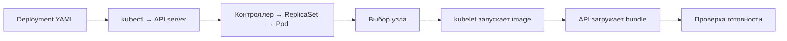

# 07. Kubernetes: выкладка и диагностика

[Программа](../../README.md) · [Задания](#задания) · [Подготовка](#подготовка-к-заданиям)

## Какую задачу решает этот модуль

Контейнер с housing API уже отвечает на запросы, пока запущен вручную. Теперь нужно заменить его версию, сохранить обслуживание во время обновления и отличить «процесс работает» от «модель готова делать прогноз». Если процесс упал, кто создаст новый? Если новый образ не запускается, что произойдёт со старым? Kubernetes решает задачу управления такими экземплярами приложения по описанию желаемого состояния.

Чтобы управлять экземплярами, нужна среда, где их можно размещать и перезапускать. Kubernetes объединяет такие машины под общим управлением в **кластер**. Каждая машина называется **узлом** и предоставляет CPU, память и запуск контейнеров. В курсе kind 0.27.0 создаёт узлы Kubernetes 1.32.2 внутри Docker. Это локальный стенд: для него нужен работающий Docker daemon, а одних установленных CLI недостаточно.

Результат модуля — проверяемый выпуск API с собственной моделью: готовые экземпляры, стабильный адрес сервиса, успешный `/predict` и известная `model_version`. Удаление одного Pod демонстрирует восстановление экземпляра. Оно не проверяет устойчивость к потере Docker VM или датацентра.

## Подготовка к заданиям

Активируй основное Python-окружение по [SETUP](../../SETUP.md#основная-среда). Все команды выполняются из корня курса. Для стенда нужны Docker daemon, kind 0.27.0 и kubectl для Kubernetes 1.32.2. Python Kubernetes SDK не нужен: тесты вызывают `kubectl` и читают HTTP.

```bash
source .venv/bin/activate
docker info
kind create cluster --name mlops-course
export MLOPS_KUBE_CONTEXT=kind-mlops-course
export MLOPS_KUBE_NAMESPACE=default
export MLOPS_API_URL=http://127.0.0.1:8000
```

Создавай кластер только если его ещё нет. `MLOPS_KUBE_CONTEXT` задаёт явный контекст доступа и обязателен для тестов. `MLOPS_KUBE_NAMESPACE` выбирает область ресурсов и по умолчанию равен `default`. `MLOPS_API_URL` — адрес на компьютере после port-forward, а не внутреннее DNS-имя Service. Экспортируй эти значения и в терминале, из которого запускаешь pytest. Освободи порт 8000 от другого API или forwarding.

| Задание | Нужные входы | Какой стенд подготовить |
|---|---|---|
| 01 | Базовый Dockerfile API | `housing:course` без bundle. Обученная модель не требуется |
| 02 | Собственный доверенный `work/artifacts/model.joblib` из [ML-notebook](../01-ml/housing.ipynb), базовый image | `housing:v1`, содержащий bundle, загруженный в kind |
| 03 | Рабочий выпуск задания 02 и сохранённый image v1 | Сначала неуспешный rollout, затем восстановленный выпуск |

Образ с компьютера загружай в узлы командой `kind load docker-image` из задания. Task-local `deployment.yaml` относится к конкретному опыту. Общий `labs/kubernetes/deployment.yaml` не заменяет его. Состояния 01 и 02 несовместимы: запускай live-проверки отдельно после подготовки нужного состояния.

## Задания

| Тема | Что выполнить | Файлы |
|---|---|---|
| [01. Живой, но неготовый API](tasks/01-unready/README.md) | Применить Deployment без bundle и различить Running, Ready, HTTP и endpoints | [Манифест](tasks/01-unready/deployment.yaml) · [Тест](tasks/01-unready/test_task.py) |
| [02. Рабочий выпуск](tasks/02-release/README.md) | Поставить свой bundle в image v1, подключить ConfigMap и проверить версию ответа | [Манифест](tasks/02-release/deployment.yaml) · [Тест](tasks/02-release/test_task.py) |
| [03. Сбой и восстановление](tasks/03-failure/README.md) | Наблюдать отказ нового image, вернуть рабочую ревизию и проверить модель | Руководство. Для результата используется тест 02 |

Команды `apply`, `set image`, `rollout undo` меняют учебные ресурсы. Тесты только читают подготовленные объекты и отправляют HTTP-запросы. Без `MLOPS_RUN_INTEGRATION=1` они пропускаются с инструкцией. С флагом отсутствие CLI, контекста или доступного API означает ошибку проверки. `make test` проверяет готовую обвязку курса, а не готовность твоего стенда.

## Остановка и очистка

Останавливай каждый port-forward через `Ctrl+C` перед сменой задания. После 03 удали ресурсы командой из задания, прежде чем устанавливать Helm. Кластер можно оставить для следующего модуля. Если он больше не нужен, `kind delete cluster --name mlops-course` удалит только этот учебный кластер. Собственный bundle и image v1 сохрани для дальнейшей работы.

## Что приходит из предыдущих модулей

Из [обучения](../01-ml/housing.ipynb) нужны созданная твоим кодом модель и экспорт в `work/artifacts/model.joblib`. **Bundle** здесь — сериализованный словарь с `pipeline`, `features`, `schema_version` и `model_version`, который читает API. Из [Docker](../03-service-ci/README.md) приходят `labs/housing/Dockerfile` и образ `housing:course`. Базовый образ содержит код и зависимости, но не обученную модель. Учёт запусков в [ClearML](../06-clearml/README.md) помогает установить происхождение модели. Kubernetes получает уже выбранный артефакт, а обучение не запускает.

`labs/housing/request.json` содержит HTTP-вход `instances`: список районов с восемью числовыми признаками, включая доход `MedInc` и координаты. `/predict` возвращает по одному числу на район, `model_version` и единицу target `100000 USD`. Наличие корректного JSON ещё не означает точность прогноза: качество оценивалось отдельно по известным ответам.

Приложение читает путь из `MODEL_PATH` при старте. Если файла нет, оно остаётся живым: `/live` отвечает 200, `/ready` и `/predict` — 503. Если файл существует, но bundle несовместим, загрузка может завершить старт ошибкой. Это два разных сценария, и практика начинается с первого. Загружай joblib только из собственного доверенного обучения: десериализация может выполнять код.

## Желаемое состояние и участники выкладки

Пусть API должен работать в одном экземпляре. Вместо команды «один раз запусти контейнер» мы сохраняем YAML-описание требуемого состояния — **манифест**. `kubectl apply` отправляет его в **API server**, управляющий интерфейс кластера. После завершения команды управление продолжается: **контроллер** сравнивает требование с наблюдаемым состоянием и создаёт недостающее.

Для запуска контейнера нужна единица размещения. Kubernetes называет её **Pod**. Она объединяет один или несколько контейнеров с общей сетью. В нашем Pod один контейнер `api`. Чтобы при его потере появился новый и обновление имело историю, используется **Deployment**. Его `spec.replicas` задаёт число экземпляров, `spec.template` — шаблон каждого Pod. Для поддержания нужного количества одной версии Deployment создаёт **ReplicaSet**.

После создания Pod нужно выбрать узел и действительно запустить процесс. Первое делает планировщик, второе обеспечивает **kubelet**, процесс на выбранном узле, через контейнерную среду исполнения. Он же выполняет проверки здоровья. Приложение внутри контейнера затем загружает bundle.



Поэтому успешный `apply` означает принятие описания, а не готовую модель. `spec` содержит требование, `status` — наблюдаемое состояние. `rollout status` ждёт завершения обновления, после чего отдельный HTTP-запрос проверяет полезный ответ.

Чтобы команда обратилась к нужной среде, kubectl использует **контекст** — сочетание кластера, пользователя и области ресурсов. Такая именованная область называется **namespace**. В курсе это `kind-mlops-course` и `default`. Команды и тесты получают их явно через переменные из подготовки.

## Как запрос находит готовую модель

При замене Pod его IP может измениться. Клиенту нужен постоянный адрес, за которым выбираются подходящие экземпляры. Эту роль выполняет **Service**. Чтобы связать его с Pod, мы ставим на Pod **label**, метку `app: housing`, а в Service задаём **selector**, условие выбора этой метки. Оно должно совпасть с `spec.template.metadata.labels` Deployment.

Одного совпадения метки мало: экземпляр без модели пока не должен получать обычный трафик. Адреса выбранных Pod и признаки готовности хранятся в **EndpointSlice**. Обычный Service направляет запросы к готовым адресам. Внутри кластера клиент обращается к `housing:8000`, после выбора адреса запрос приходит на порт 8000 контейнера и обрабатывается API. [Документация Service 1.32](https://v1-32.docs.kubernetes.io/docs/concepts/services-networking/service/) разбирает эту связь.

С компьютера в учебном опыте используется `kubectl port-forward`: команда временно направляет локальный порт в Pod через API Kubernetes. Даже форма `port-forward service/housing` выбирает Pod, а не проверяет весь сетевой путь ClusterIP. Поэтому отдельно проверяем EndpointSlice и HTTP. В задании без модели forward к Deployment намеренно позволяет опросить живой, но неготовый процесс.

## Разобранный манифест и поставка модели

Ниже фрагмент существующего примера. Он находится внутри описания контейнера, а не является отдельным запускаемым YAML:

```yaml
name: api
image: housing:course
imagePullPolicy: Never
env:
  - name: MODEL_PATH
    value: /models/model.joblib
resources:
  requests: {cpu: 100m, memory: 128Mi}
  limits: {cpu: "1", memory: 768Mi}
livenessProbe:
  httpGet: {path: /live, port: 8000}
  initialDelaySeconds: 15
readinessProbe:
  httpGet: {path: /ready, port: 8000}
  initialDelaySeconds: 10
```

`name: api` — имя контейнера для `set image`. `image` задаёт код и файловую систему запуска. `Never` запрещает скачивание: этот образ нужно заранее загрузить в kind командой `kind load docker-image`. Локальный Docker image компьютера сам по себе не появляется в среде узла kind. `MODEL_PATH` — путь внутри контейнера, а не путь на твоём компьютере.

Чтобы планировщик оценил, помещается ли Pod на узел, ему передают **requests**, запрошенный объём ресурсов: `100m` CPU равно 0.1 CPU, `128Mi` — 128 мебибайт. Чтобы ограничить потребление во время исполнения, задают **limits**: CPU может ограничиваться по времени выполнения, превышение доступной контейнеру памяти способно привести к завершению с `OOMKilled`. CPU request не означает выделенный физический процессор. Эти числа взяты из заготовки для маленького CPU API, они не являются измеренными требованиями любой модели. У классификатора изображений большой файл весов и подготовка входа могут требовать другой памяти. Несколько процессов API также могут загрузить несколько копий модели. Начинать измерения удобно с одного процесса.

Для рабочего выпуска `labs/kubernetes/Dockerfile.model` берёт `FROM housing:course` и копирует `work/artifacts/model.joblib` в `/models/model.joblib` с владельцем 10001. Образ `housing:v1` соединяет код и bundle в одном неизменяемом выпуске. Тег — имя ссылки, его технически можно переписать. Неизменяемость здесь достигается дисциплиной отдельного тега на выпуск. Digest — идентификатор содержимого образа — даёт более строгую фиксацию. Сохраняй соответствие версии модели и образа до обновления.

## Probes, конфигурация и хранение

Процесс может отвечать на `/live`, пока модель ещё не загружена. Kubernetes должен различить необходимость перезапуска и возможность направлять запросы. Для этого kubelet периодически выполняет **probes**, проверки контейнера. **Liveness probe** проверяет живой процесс и при установленном числе неуспехов приводит к перезапуску. **Readiness probe** меняет готовность принимать трафик. Её отказ сам по себе не требует перезапуска. `initialDelaySeconds` откладывает начало соответствующей проверки.

В Housing отсутствие файла модели даёт `/live` 200 и `/ready` 503. Замена readiness на `/live` скрыла бы проблему и направила запросы к процессу без модели. Для большой модели изображений сама загрузка может занимать долгое время. Тогда **startup probe**, проверка завершения старта, позволяет отложить liveness/readiness до её успеха. Условия описаны в [документации probes 1.32](https://v1-32.docs.kubernetes.io/docs/tasks/configure-pod-container/configure-liveness-readiness-startup-probes/). Дополнительные модели и проверки в упражнение добавлять не нужно.

Обычные настройки процесса хочется менять независимо от образа. Для этого используется **ConfigMap**, объект с конфигурацией. В задании 02 ты добавишь собственный несекретный ключ и подключишь его через `envFrom`, чтобы новый процесс получил ключ как переменную окружения. Изменение ConfigMap не меняет окружение уже работающего процесса: нужен новый Pod или отдельный механизм перечитывания. Автоматический запуск нового Pod при изменении конфигурации появится в [Helm](../08-helm/README.md#конфигурация-и-новый-pod).

Модель в образе восстанавливается вместе с контейнером, поэтому основной опыт использует этот способ. Если хранить модель отдельно, потребуется точная версия, проверка целостности и доступ. Для постоянного тома приложение может создать **PVC**, запрос хранилища. Его возможности зависят от поставщика. Файлы, просто записанные в контейнер, постоянным хранилищем не становятся. Доступ к внешнему хранилищу и чувствительные настройки разбираются далее в [Vault](../10-vault/README.md). Для текущего выпуска их добавлять не нужно.

## Обновление, откат и диагностика

При обновлении хочется подготовить новый экземпляр прежде, чем убрать старый. Стратегия **RollingUpdate** постепенно заменяет Pod и позволяет сохранить обслуживание готовой версией. Изменение шаблона Pod создаёт новую ревизию Deployment. Новый Pod с отсутствующим образом может быть неготов, пока старый Ready Pod продолжает обслуживать запросы: провал rollout не всегда означает полную недоступность API. `rollout undo` восстанавливает прежний шаблон, но не откатывает внешний изменённый файл модели или содержимое базы. С image v1, содержащим bundle, код и модель возвращаются вместе. При нескольких изменениях выбирай конкретную рабочую ревизию из `rollout history`.

Диагностика начинается с наблюдаемого слоя:

| Симптом | Что могло случиться | Как различить |
|---|---|---|
| Pod Pending | Нет подходящего узла или ресурсов | `describe pod`, события FailedScheduling |
| ErrImageNeverPull | Образ отсутствует в узле при Never | Сверить tag и загрузку именно в этот kind |
| ImagePullBackOff | Не удаётся скачать образ из registry | События загрузки, имя, доступ к registry |
| CrashLoopBackOff | Процесс многократно падает | `logs`, `logs --previous`, код завершения |
| Running, Ready 0/1 | Проверка `/ready` неуспешна | HTTP 503, MODEL_PATH, файл и журнал загрузки |
| OOMKilled | Превышена память | Причина прошлого завершения и лимит |
| Ready Pod, нет endpoints | Selector не находит нужные метки | Сравнить Service selector и Pod labels |

После исправления проверяй одновременно rollout, готовые endpoints и `/predict` с ожидаемой версией из доверенного bundle. Версию задают независимо от HTTP-ответа: сравнение ответа с ним самим ничего не доказывает. Тесты заданий только читают явно подготовленный стенд и отправляют запросы, не создают кластер и не устраняют отказ.

## Материалы

- [Deployment 1.32](https://v1-32.docs.kubernetes.io/docs/concepts/workloads/controllers/deployment/) — ReplicaSet, rollout history и rollback.
- [Ресурсы контейнеров 1.32](https://v1-32.docs.kubernetes.io/docs/concepts/configuration/manage-resources-containers/) — единицы CPU/памяти, requests и limits.
- [kind quick start](https://kind.sigs.k8s.io/docs/user/quick-start/) — создание учебного кластера и загрузка образов. Версия курса указана в [матрице](../../docs/versions.md).
