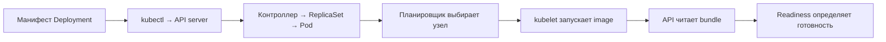

# 07. Kubernetes: выкладка и диагностика

[Программа](../../README.md) · [Практика](practice.md) · [Подсказки](hints.md)

## Какую задачу решает этот модуль

Контейнер с housing API уже отвечает на запросы, пока запущен вручную. Теперь нужно заменить его версию, сохранить обслуживание во время обновления и отличить «процесс работает» от «модель готова делать прогноз». Если процесс упал, кто создаст новый? Если новый образ не запускается, что произойдёт со старым? Kubernetes решает задачу управления такими экземплярами приложения по описанию желаемого состояния.

**Кластер** — группа узлов под общим управлением Kubernetes. **Узел** (node) предоставляет CPU, память и контейнерную среду исполнения. В курсе kind 0.27.0 создаёт узлы Kubernetes 1.32.2 внутри Docker: это локальный стенд, а не несколько независимых физических серверов. Работающие CLI без Docker daemon, процесса управления контейнерами, для такого кластера недостаточны.

Результат модуля — проверяемый выпуск API с собственной моделью: готовые экземпляры, стабильный адрес сервиса, успешный `/predict` и известная `model_version`. Удаление одного Pod демонстрирует восстановление экземпляра; оно не проверяет устойчивость к потере Docker VM или датацентра.

## Что приходит из предыдущих модулей

Из [обучения](../01-ml/housing.ipynb) нужны созданная твоим кодом модель и экспорт в `work/artifacts/model.joblib`. **Bundle** здесь — сериализованный словарь с `pipeline`, `features`, `schema_version` и `model_version`, который читает API. Из [Docker](../03-service-ci/README.md) приходят `labs/housing/Dockerfile` и образ `housing:course`. Базовый образ содержит код и зависимости, но не обученную модель. Учёт запусков в [ClearML](../06-clearml/README.md) помогает установить происхождение модели; Kubernetes получает уже выбранный артефакт, а обучение не запускает.

`labs/housing/request.json` содержит HTTP-вход `instances`: список районов с восемью числовыми признаками, включая доход `MedInc` и координаты. `/predict` возвращает по одному числу на район, `model_version` и единицу target `100000 USD`. Наличие корректного JSON ещё не означает точность прогноза: качество оценивалось отдельно по известным ответам.

Приложение читает путь из `MODEL_PATH` при старте. Если файла нет, оно остаётся живым: `/live` отвечает 200, `/ready` и `/predict` — 503. Если файл существует, но bundle несовместим, загрузка может завершить старт ошибкой. Это два разных сценария, и практика начинается с первого. Загружай joblib только из собственного доверенного обучения: десериализация может выполнять код.

## Желаемое состояние и участники выкладки

**Манифест** — YAML-описание объекта Kubernetes. Команда `kubectl apply` отправляет его в API server, входную точку управления кластером. **Контроллер** постоянно сравнивает сохранённое описание с наблюдаемым состоянием и создаёт недостающие объекты. Это цикл согласования (reconciliation), похожий на фоновый Go-worker, который повторно проверяет состояние работы. В отличие от однократного shell-скрипта, цикл продолжает действовать после завершения `kubectl`.

**Pod** — единица размещения: один или несколько контейнеров с общей сетью. В наших Pod один контейнер `api`. **Deployment** описывает число реплик и шаблон Pod. Через **ReplicaSet**, объект учёта нужного количества экземпляров одной версии шаблона, Deployment управляет созданием Pod и обновлениями. Планировщик выбирает подходящий узел, а **kubelet**, процесс на узле, поручает контейнерной среде запустить контейнер и выполняет проверки здоровья.



`spec` в объекте задаёт желаемое, `status` содержит наблюдаемое. Успешный `apply` означает принятие описания; он ещё не означает загрузку образа и готовность модели. `rollout status` ждёт завершения обновления. После него нужен реальный запрос, потому что готовность процесса не измеряет качество его ответов.

**Контекст** kubectl выбирает кластер, пользователя и namespace. **Namespace** — именованная область объектов внутри кластера. В тестах контекст задаётся `MLOPS_KUBE_CONTEXT` явно, чтобы чтение состояния не зависело от случайного текущего контекста. Задания используют собственные манифесты в `tasks/`, а не общий пример из `labs/`.

## Как запрос находит готовую модель

IP и имя Pod меняются при его замене. **Service** даёт постоянное имя и виртуальный сетевой адрес выбранной группе Pod. **Label** — метка `ключ: значение`; **selector** — условие выбора по меткам. У Service `selector: {app: housing}` должны находиться Pod с такой же меткой в `spec.template.metadata.labels` Deployment.

**EndpointSlice** хранит адреса выбранных экземпляров и признаки их готовности. Для обычного Service трафик направляется к готовым адресам. Путь внутри кластера: клиент обращается к Service `housing:8000`, сетевой механизм Kubernetes выбирает готовый endpoint, запрос приходит на порт 8000 контейнера, HTTP-обработчик проверяет вход и вызывает Pipeline. Неверный selector оставит Service без подходящих адресов даже при исправном приложении. [Устройство Service в Kubernetes 1.32](https://v1-32.docs.kubernetes.io/docs/concepts/services-networking/service/) поясняет эту связь.

В локальной практике `kubectl port-forward service/housing 8000:8000` даёт доступ с компьютера к выбранному Pod через API Kubernetes. Эта команда не превращает Service в внешний балансировщик и не проверяет весь путь ClusterIP. Поэтому отдельно читаем EndpointSlice, а затем выполняем HTTP-проверку. Прямой forward к Deployment/Pod в задании без модели намеренно позволяет опросить живой, но неготовый процесс.

## Разобранный манифест и поставка модели

Ниже фрагмент существующего примера; он находится внутри описания контейнера, а не является отдельным запускаемым YAML:

```yaml
name: api
image: housing:course
imagePullPolicy: Never
env:
  - name: MODEL_PATH
    value: /models/model.joblib
resources:
  requests: {cpu: 100m, memory: 128Mi}
  limits: {cpu: "1", memory: 768Mi}
livenessProbe:
  httpGet: {path: /live, port: 8000}
  initialDelaySeconds: 15
readinessProbe:
  httpGet: {path: /ready, port: 8000}
  initialDelaySeconds: 10
```

`name: api` — имя контейнера для `set image`. `image` задаёт код и файловую систему запуска. `Never` запрещает скачивание: этот образ нужно заранее загрузить в kind командой `kind load docker-image`. Локальный Docker image компьютера сам по себе не появляется в среде узла kind. `MODEL_PATH` — путь внутри контейнера, а не путь на твоём компьютере.

`requests` — объём ресурсов, учитываемый планировщиком: `100m` CPU равно 0.1 CPU, `128Mi` — 128 мебибайт. `limits` задают ограничения во время исполнения: CPU может ограничиваться по времени выполнения, превышение доступной контейнеру памяти способно привести к завершению с `OOMKilled`. CPU request не означает выделенный физический процессор. Если в одном Pod четыре worker-процесса, память модели может потребоваться каждому; начинай измерения с одного worker.

Для рабочего выпуска `labs/kubernetes/Dockerfile.model` берёт `FROM housing:course` и копирует `work/artifacts/model.joblib` в `/models/model.joblib` с владельцем 10001. Образ `housing:v1` соединяет код и bundle в одном неизменяемом выпуске. Тег — имя ссылки, его технически можно переписать; неизменяемость здесь достигается дисциплиной отдельного тега на выпуск. Digest — идентификатор содержимого образа — даёт более строгую фиксацию. Сохраняй соответствие версии модели и образа до обновления.

## Probes, конфигурация и хранение

**Probe** — периодическая проверка контейнера, которую выполняет kubelet. Liveness отвечает, нужен ли перезапуск. Readiness отвечает, можно ли принимать трафик. `initialDelaySeconds` откладывает начало соответствующей проверки; неуспех readiness сам по себе не требует перезапуска. **Startup probe** выделяет время на долгий старт: до её успеха liveness и readiness не выполняются. Это полезно для большой модели, когда обычный интервал liveness обрывает ещё не завершившуюся загрузку. [Документация probes 1.32](https://v1-32.docs.kubernetes.io/docs/tasks/configure-pod-container/configure-liveness-readiness-startup-probes/) описывает условия перезапуска и задержки.

Это похоже на разделение `/health` и `/ready` в Go-сервисе с подключением к БД. Граница аналогии: здесь файл модели может отсутствовать при живом процессе, а перезапуск не создаст этот файл. Нельзя «исправить» readiness заменой `/ready` на `/live`: Service начнёт направлять запросы к процессу, который всё ещё отвечает 503 на predict.

**ConfigMap** хранит обычные настройки. `envFrom` переносит его ключи в переменные окружения нового процесса. Изменение ConfigMap не меняет окружение уже запущенного процесса: нужен новый Pod или отдельный механизм перечитывания. **Secret** — объект для чувствительных значений; одна лишь запись в Secret не гарантирует шифрование в хранилище и корректное ограничение доступа. Управление доступом подробнее разбирается в [Vault](../10-vault/README.md).

Файловая система контейнера не служит постоянным хранилищем. **PVC** (PersistentVolumeClaim) — запрос приложения на постоянный том; конкретные возможности определяет поставщик хранения. Модель в образе восстанавливается вместе с контейнером. Модель во внешнем хранилище требует версии, проверки целостности и доступа; initContainer, контейнер подготовки до старта основного, может её скачать. Такой вариант добавляет сетевую зависимость и секреты. Общий изменяемый файл без версии мешает воспроизводимому откату.

## Обновление, откат и диагностика

**RollingUpdate** постепенно заменяет экземпляры. Изменение шаблона Pod создаёт новую ревизию Deployment. Новый Pod с отсутствующим образом может быть неготов, пока старый Ready Pod продолжает обслуживать запросы: провал rollout не всегда означает полную недоступность API. `rollout undo` восстанавливает прежний шаблон, но не откатывает внешний изменённый файл модели или содержимое базы. С image v1, содержащим bundle, код и модель возвращаются вместе. При нескольких изменениях выбирай конкретную рабочую ревизию из `rollout history`.

Диагностика начинается с наблюдаемого слоя:

| Симптом | Что могло случиться | Как различить |
|---|---|---|
| Pod Pending | Нет подходящего узла или ресурсов | `describe pod`, события FailedScheduling |
| ErrImageNeverPull | Образ отсутствует в узле при Never | Сверить tag и загрузку именно в этот kind |
| ImagePullBackOff | Не удаётся скачать образ из registry | События загрузки, имя, доступ к registry |
| CrashLoopBackOff | Процесс многократно падает | `logs`, `logs --previous`, код завершения |
| Running, Ready 0/1 | Проверка `/ready` неуспешна | HTTP503, MODEL_PATH, файл и журнал загрузки |
| OOMKilled | Превышена память | Причина прошлого завершения и лимит |
| Ready Pod, нет endpoints | Selector не находит нужные метки | Сравнить Service selector и Pod labels |

После исправления проверяй одновременно rollout, готовые endpoints и `/predict` с ожидаемой версией из доверенного bundle. Версию задают независимо от HTTP-ответа: сравнение ответа с ним самим ничего не доказывает. Тесты заданий только читают явно подготовленный стенд и отправляют запросы, не создают кластер и не устраняют отказ.

## Материалы

- [Deployment 1.32](https://v1-32.docs.kubernetes.io/docs/concepts/workloads/controllers/deployment/) — ReplicaSet, rollout history и rollback.
- [Ресурсы контейнеров 1.32](https://v1-32.docs.kubernetes.io/docs/concepts/configuration/manage-resources-containers/) — единицы CPU/памяти, requests и limits.
- [kind quick start](https://kind.sigs.k8s.io/docs/user/quick-start/) — создание учебного кластера и загрузка образов; версия курса указана в [матрице](../../docs/versions.md).
