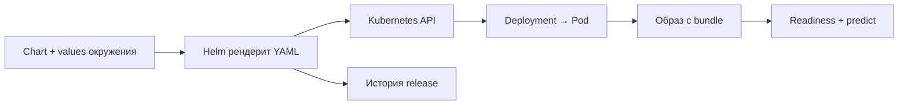

# 08. Helm: воспроизводимые релизы

[Программа](../../README.md) · [Практика](practice.md) · [Подсказки](hints.md)

## Какую задачу решает этот модуль

В [Kubernetes](../07-kubernetes/README.md) ты выпустил housing API, связал Service с готовыми Pod и проверил откат. Теперь один набор YAML приходится менять для разных окружений: тег модели, число реплик, ограничения памяти, настройки процесса. Копирование всего Deployment для каждой комбинации быстро приводит к несовпадающим probes и selectors. Helm собирает согласованный набор манифестов из шаблонов и значений и ведёт историю установленных выпусков.

На входе нужны локальный Kubernetes 1.32.2, образ `housing:v1` с собственным bundle и понимание `/live`, `/ready`, `/predict`. Образ должен быть загружен в kind. Перед установкой удали свои ручные ресурсы предыдущего модуля по его инструкции: уже существующий объект без ожидаемых метаданных владельца может конфликтовать с Helm. Helm 3.17.3 не обучает модель, не строит image и не переносит его в узел.

## Chart, values и release

**Chart** — пакет шаблонов Kubernetes и метаданных. В каталоге `chart/` файл `Chart.yaml` описывает пакет, `values.yaml` задаёт значения по умолчанию, `templates/` содержит шаблоны Deployment, Service и других объектов. **Values** — дерево параметров, например `image.tag` и `resources.requests.memory`, которое передают шаблонам при рендере. **Рендер** — превращение шаблонов в обычный YAML.

**Release** — установленный экземпляр chart с именем, namespace, values и историей ревизий. Один chart можно установить как `housing-demo` и отдельно как `housing-test`. В нашей заготовке `.Release.Name` задаёт имена Deployment и Service, а также значения меток. Поэтому release `housing-demo` создаёт Service `housing-demo`, а не `housing`. Это ближе к экземпляру приложения с журналом выпусков, чем к имени Docker image.

У версий разные владельцы и смысл:

| Поле | Что обозначает | Что само по себе не делает |
|---|---|---|
| `Chart.yaml: version` | Версию пакета шаблонов | Не выбирает модель |
| `Chart.yaml: appVersion` | Справочную версию приложения | Не меняет image без обращения из шаблона |
| `image.tag` в values | Тег контейнерного образа | Не доказывает неизменность его содержимого |
| `model_version` в bundle | Версию модели, возвращаемую API | Не является номером Helm revision |
| Helm revision | Порядок операций с release | Не означает, что выпуск был успешным |

Неудачный upgrade тоже оставляет след в истории. Перед откатом находи конкретную рабочую ревизию, а не полагайся на соседний номер.

## От параметров до HTTP-ответа

Путь выпуска состоит из нескольких границ. Ты выбираешь bundle и строишь image. Helm объединяет defaults chart с overrides, вычисляет шаблоны и отправляет манифесты в Kubernetes API. Контроллер Deployment создаёт Pod, kubelet запускает image, приложение читает модель, readiness становится успешной. Только после этого клиент проверяет `/predict` и сравнивает версию с ожидаемой.



Здесь Helm отвечает за описание и историю поставки. Запуск контейнера остаётся работой Kubernetes, а проверка качества прогноза — задачей ML-процесса. Аналогия с Go `text/template` помогает понять подстановку полей: значения передаются шаблону, итог становится входом другой системы. Граница аналогии в том, что валидный текст YAML может всё ещё описывать несогласованные ресурсы или отсутствующий image.

## Как читать шаблон

Фрагмент существующего Deployment показывает параметры, но не является самостоятельным манифестом:

```yaml
metadata:
  name: {{ .Release.Name }}
spec:
  replicas: {{ .Values.replicaCount }}
  template:
    spec:
      containers:
        - name: api
          image: "{{ .Values.image.repository }}:{{ .Values.image.tag }}"
          env:
            - name: MODEL_PATH
              value: {{ .Values.modelPath | quote }}
          resources:
            {{- toYaml .Values.resources | nindent 12 }}
```

`.Release.Name` приходит из аргумента команды Helm. `.Values.replicaCount` — число экземпляров; оно должно стать YAML-числом. `repository` и `tag` соединяются в ссылку вида `housing:v1`. `quote` сохраняет путь строкой. `toYaml` превращает карту resources в YAML, `nindent 12` ставит новую строку и нужный отступ для вложенного блока. Дефис в `{{-` убирает лишние пробелы перед действием; неосторожное удаление пробелов может склеить строки.

Defaults и файл окружения объединяются: можно переопределить `image.tag`, сохранив `image.repository` из chart. При нескольких `-f` более поздний файл имеет приоритет для совпадающих значений; `--set` позволяет задать отдельный override. Например, `--set image.tag=missing` меняет образ только в этой операции, не редактируя файл на диске. Проверить реальные параметры установленного release помогает `helm get values`, а реально сохранённые манифесты — `helm get manifest`.

Практика использует `modules/08-helm/tasks/01-values/chart`, а `labs/helm/housing` — отдельный общий пример. В task-local chart намеренно отсутствует часть конфигурации. Не подменяй выполнение упражнения рендером другого каталога.

## Конфигурация и новый Pod

ConfigMap — обычная конфигурация Kubernetes, например выбранный режим логирования. `envFrom` переносит её ключи в окружение процесса. Секреты в values не помещают: они могут оказаться в Git, выводе рендера и данных release.

Проблема: обновление ConfigMap меняет объект конфигурации, но не окружение живого процесса. Deployment создаёт новую версию Pod при изменении `spec.template`. Поэтому в шаблон Pod добавляют аннотацию с **checksum**, контрольной суммой содержимого конфигурации. Для SHA-256 это 64 шестнадцатеричных символа. Новое содержимое → другая сумма → другой шаблон Pod → rollout → новый процесс с новым окружением.

Аннотация должна зависеть от содержимого config, а не от текущего времени. Время вызывало бы перезапуск при каждом рендере даже без изменения настройки. Метаданные самого Deployment вне `spec.template` не запускают нужный механизм. В задании тебе предстоит выбрать способ рендера ConfigMap и вычисления суммы; целый шаблон решения здесь не приводится.

## Рендер, установка и откат

Проверяй от дешёвого к дорогому. `helm lint` ищет ошибки структуры chart. `helm template` работает локально и показывает YAML, который увидит Kubernetes:

```bash
helm template demo modules/08-helm/tasks/01-values/chart -f modules/08-helm/tasks/01-values/values-dev.yaml
```

Сверь имена, selector и Pod labels, image, `MODEL_PATH`, probes, ресурсы и подключение ConfigMap. Эти команды доступны без кластера, но не проверяют наличие image, свободную память или загрузку bundle. После установки нужны `rollout status`, готовые endpoints и HTTP-запросы с ожидаемой моделью.

`helm upgrade --install` создаёт release, если его нет, либо обновляет существующий. `--wait` ждёт готовности поддерживаемых ресурсов в пределах `--timeout`. `--atomic` в upgrade включает ожидание и при неуспехе пытается откатить изменения к предыдущему выпуску. Ошибка всё равно требует чтения диагностики: откат тоже может встретить проблему инфраструктуры. Значение флага сверяется с [исходником Helm 3.17.3](https://github.com/helm/helm/blob/v3.17.3/cmd/helm/upgrade.go).

`helm rollback NAME REVISION --wait` создаёт новую ревизию release с конфигурацией выбранной старой. Для нашего образа с bundle это возвращает код и модель совместно. Внешняя база, уже отправленное событие или перезаписанный объект хранилища этим не восстанавливаются. HTTP200 после rollback подтверждает обслуживание, а прежняя `model_version` — возвращение выбранной модели.

## Как различать ошибки

Если `template` не может разобрать YAML, посмотри итоговый отступ и тип поля; проблема возникает до запуска приложения. Если Kubernetes отверг selector или схему ресурса, исправляй полученный манифест и источник значения в шаблоне. Если upgrade ждёт до timeout, читай `describe` и логи Pod: отсутствующий image при `Never`, 503 readiness и нехватка памяти требуют разных исправлений.

Если Service не найден, сначала сверь имя release. Если релиз помечен deployed, а ответы содержат другую модель, сверь `helm get manifest`, imageID Pod и ожидаемый bundle; mutable tag мог сохранить прежнее содержимое на узле. Если config изменился, а процесс видит старое значение, проверь checksum именно в Pod template и создание новых Pod. Метка deployed сама по себе не заменяет проверку входа и выхода API.

## Материалы

- [Helm 3: values](https://helm.sh/docs/v3/chart_template_guide/values_files/) — источники параметров и их приоритет.
- [Helm 3: debugging](https://helm.sh/docs/v3/chart_template_guide/debugging/) — lint, template и диагностика YAML.
- [Helm 3.17.3 upgrade](https://github.com/helm/helm/blob/v3.17.3/cmd/helm/upgrade.go) и [rollback](https://github.com/helm/helm/blob/v3.17.3/cmd/helm/rollback.go) — точные флаги версии курса; справочник ветки v3 может описывать более поздний патч.
