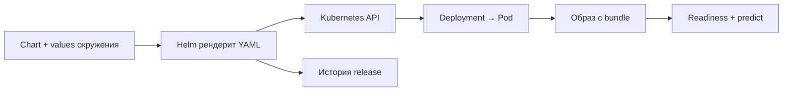

# 08. Helm: воспроизводимые релизы

[Программа](../../README.md) · [Задания](#задания) · [Подготовка](#подготовка-к-заданиям)

## Какую задачу решает этот модуль

В [Kubernetes](../07-kubernetes/README.md) ты выпустил housing API, связал Service с готовыми Pod и проверил откат. Теперь один набор YAML приходится менять для разных окружений: тег модели, число реплик, ограничения памяти, настройки процесса. Копирование всего Deployment для каждой комбинации быстро приводит к несовпадающим probes и selectors. Helm собирает согласованный набор манифестов из шаблонов и значений и ведёт историю установленных выпусков.

Для установки используем уже подготовленные кластер и image из предыдущего модуля. Сначала можно выполнить локальный рендер без кластера. Затем перейти к установке, смене конфигурации и откату.

## Подготовка к заданиям

Все команды выполняются из корня курса. Активируй основное окружение по [SETUP](../../SETUP.md#основная-среда). Для рендера нужны Helm 3.17.3, а для чтения полученного YAML в тесте — PyYAML. Кластер для этого теста не нужен.

```bash
source .venv/bin/activate
python -m pip install PyYAML
helm version
```

Для ручной установки дополнительно нужны Docker daemon, kind, kubectl, кластер из [Kubernetes](../07-kubernetes/README.md#подготовка-к-заданиям) и загруженный туда `housing:v1` с собственным bundle. Helm сам не строит и не загружает image. Удали свои ручные Deployment/Service по [заданию 07/03](../07-kubernetes/tasks/03-failure/README.md). Конфликт существующего объекта с Helm обычно означает несовпадение владения ресурсом.

```bash
export MLOPS_KUBE_CONTEXT=kind-mlops-course
export MLOPS_KUBE_NAMESPACE=default
```

`--kube-context` выбирает кластер, `--namespace` — область release. Эти переменные используются в командах CLI. Offline-тест их не читает. Освободи порт 8000 перед port-forward. Во всех заданиях используется `modules/08-helm/tasks/01-values/chart`, а не общий `labs/helm/housing`.

## Задания

| Тема | Что выполнить | Файлы |
|---|---|---|
| [01. Values и ConfigMap](tasks/01-values/README.md) | Заполнить параметры, добавить ConfigMap/envFrom/checksum, проверить рендер и установить release | [Values](tasks/01-values/values-dev.yaml) · [Chart](tasks/01-values/chart/Chart.yaml) · [Тест](tasks/01-values/test_task.py) |
| [02. Неудачный релиз и откат](tasks/02-rollback/README.md) | Сохранить рабочую v1, наблюдать atomic upgrade и вернуть v1 после реального выпуска v2 | Руководство с командами и HTTP-проверками |

Проверка 01 включается через `MLOPS_RUN_INTEGRATION=1`, хотя выполняет только два локальных `helm template`. Она создаёт временный override и не меняет chart, values или кластер. Без флага ожидается skip, с флагом незавершённый шаблон или отсутствие Helm/PyYAML дают failure. Рендер не подтверждает доступность image и модели: после установки выполняй HTTP-проверки из задания.

## Остановка и очистка

После 01 останови port-forward через `Ctrl+C`, сохрани release для 02. После 02 удали свой `housing-demo` командой `helm uninstall` из задания. Кластер удаляй только когда он больше не нужен: `kind delete cluster --name mlops-course`. Локальные bundle v1/v2 и рабочие image сохраняй для воспроизводимого отката.

## Chart, values и release

Пусть тот же API нужно установить с другим тегом образа и числом экземпляров. Копировать весь Deployment неудобно: можно случайно изменить selector или потерять readiness. Вместо копий сохраним описание ресурсов как шаблоны, а изменяемые значения передадим отдельно.

Пакет таких шаблонов Helm называет **chart**. В нашем `chart/` файл `Chart.yaml` описывает пакет, `templates/` содержит шаблоны Deployment и Service, а `values.yaml` задаёт параметры по умолчанию. Дерево параметров, например `image.tag` и `resources.requests.memory`, называется **values**. Подстановка этих значений в шаблоны даёт обычный Kubernetes YAML. Это **рендер**.

Теперь один пакет можно установить несколько раз с разными именами и параметрами. Каждый установленный экземпляр — **release** — хранит выбранные values и историю операций. Учебный экземпляр назовём `housing-demo`. В готовых шаблонах `.Release.Name` используется для имён Deployment, Service и меток, поэтому его Service тоже будет `housing-demo`. Название Docker image остаётся `housing:v1`: это другая сущность.

У версий разные владельцы и смысл:

| Поле | Что обозначает | Что само по себе не делает |
|---|---|---|
| `Chart.yaml: version` | Версию пакета шаблонов | Не выбирает модель |
| `Chart.yaml: appVersion` | Справочную версию приложения | Не меняет image без обращения из шаблона |
| `image.tag` в values | Тег контейнерного образа | Не доказывает неизменность его содержимого |
| `model_version` в bundle | Версию модели, возвращаемую API | Не является номером Helm revision |
| Helm revision | Порядок операций с release | Не означает, что выпуск был успешным |

Неудачный upgrade тоже оставляет след в истории. Перед откатом находи конкретную рабочую ревизию, а не полагайся на соседний номер.

## От параметров до HTTP-ответа

Путь выпуска состоит из нескольких границ. Ты выбираешь bundle и строишь image. Helm объединяет defaults chart с overrides, вычисляет шаблоны и отправляет манифесты в Kubernetes API. Контроллер Deployment создаёт Pod, kubelet запускает image, приложение читает модель, readiness становится успешной. Только после этого клиент проверяет `/predict` и сравнивает версию с ожидаемой.



Здесь Helm отвечает за описание и историю поставки. Запуск контейнера остаётся работой Kubernetes, а проверка качества прогноза — задачей ML-процесса. Успешная подстановка ещё не означает готовое приложение: корректный YAML может описывать несогласованные ресурсы или отсутствующий image.

## Как читать шаблон

Фрагмент существующего Deployment показывает параметры, но не является самостоятельным манифестом:

```yaml
metadata:
  name: {{ .Release.Name }}
spec:
  replicas: {{ .Values.replicaCount }}
  template:
    spec:
      containers:
        - name: api
          image: "{{ .Values.image.repository }}:{{ .Values.image.tag }}"
          env:
            - name: MODEL_PATH
              value: {{ .Values.modelPath | quote }}
          resources:
            {{- toYaml .Values.resources | nindent 12 }}
```

Для release `housing-demo` значение `.Release.Name` приходит из одноимённого аргумента команды Helm. `.Values.replicaCount` — число экземпляров. Оно должно стать YAML-числом. `repository` и `tag` соединяются в ссылку вида `housing:v1`. `quote` сохраняет путь строкой. `toYaml` превращает карту resources в YAML, `nindent 12` ставит новую строку и нужный отступ для вложенного блока. Дефис в `{{-` убирает лишние пробелы перед действием. Неосторожное удаление пробелов может склеить строки.

Defaults и файл окружения объединяются: можно переопределить `image.tag`, сохранив `image.repository` из chart. При нескольких `-f` более поздний файл имеет приоритет для совпадающих значений. `--set` позволяет задать отдельный override. В опыте отказа выберем тег `missing`, которого нет в kind. `--set image.tag=missing` меняет образ только в этой операции, не редактируя файл на диске. Проверить реальные параметры установленного release помогает `helm get values`, а реально сохранённые манифесты — `helm get manifest`.

Практика использует `modules/08-helm/tasks/01-values/chart`, а `labs/helm/housing` — отдельный общий пример. В task-local chart намеренно отсутствует часть конфигурации. Не подменяй выполнение упражнения рендером другого каталога.

## Конфигурация и новый Pod

ConfigMap — обычная конфигурация Kubernetes, например выбранный режим логирования. `envFrom` переносит её ключи в окружение процесса. В values практики используются только обычные настройки: они попадут в Git, вывод рендера и данные release.

Само обновление ConfigMap меняет объект конфигурации, но не окружение живого процесса. Deployment создаёт новую версию Pod при изменении `spec.template`. Поэтому в шаблон Pod добавляют аннотацию с **checksum**, контрольной суммой содержимого конфигурации. Для SHA-256 это 64 шестнадцатеричных символа. Новое содержимое → другая сумма → другой шаблон Pod → rollout → новый процесс с новым окружением.

Аннотация должна зависеть от содержимого config, а не от текущего времени. Время вызывало бы перезапуск при каждом рендере даже без изменения настройки. Метаданные самого Deployment вне `spec.template` не запускают нужный механизм. В задании тебе предстоит выбрать способ рендера ConfigMap и вычисления суммы. Целый шаблон решения здесь не приводится.

## Рендер, установка и откат

Проверяй от дешёвого к дорогому. `helm lint` ищет ошибки структуры chart. `helm template` работает локально и показывает итоговый YAML. Для предварительного просмотра ниже выбрано имя `demo`: команда использует его при подстановке, но ничего не устанавливает в кластер:

```bash
helm template demo modules/08-helm/tasks/01-values/chart -f modules/08-helm/tasks/01-values/values-dev.yaml
```

Сверь имена, selector и Pod labels, image, `MODEL_PATH`, probes, ресурсы и подключение ConfigMap. Эти команды доступны без кластера, но не проверяют наличие image, свободную память или загрузку bundle. После установки нужны `rollout status`, готовые endpoints и HTTP-запросы с ожидаемой моделью.

`helm upgrade --install` создаёт release, если его нет, либо обновляет существующий. Чтобы команда дождалась готовности поддерживаемых ресурсов, добавляют `--wait`. Параметр `--timeout` ограничивает это ожидание. Если при неуспехе нужно попытаться вернуть прежний выпуск, используют `--atomic` в upgrade. Он также включает ожидание. Ошибка всё равно требует чтения диагностики: откат тоже может встретить проблему инфраструктуры. Значение флага сверяется с [исходником Helm 3.17.3](https://github.com/helm/helm/blob/v3.17.3/cmd/helm/upgrade.go).

`helm rollback NAME REVISION --wait` создаёт новую ревизию release с конфигурацией выбранной старой. Для нашего образа с bundle это возвращает код и модель совместно. Для текстового классификатора в таком образе могли бы находиться ещё словарь и преобразование текста: восстановление только весов без них не вернуло бы прежний интерфейс. У модели изображений аналогично важна версия подготовки входа. Эти примеры поясняют границу выпуска и не добавляют заданий. Внешняя база, уже отправленное событие или перезаписанный объект хранилища этим не восстанавливаются. HTTP 200 после rollback подтверждает обслуживание, а прежняя `model_version` — возвращение выбранной модели.

## Как различать ошибки

Если `template` не может разобрать YAML, посмотри итоговый отступ и тип поля. Проблема возникает до запуска приложения. Если Kubernetes отверг selector или схему ресурса, исправляй полученный манифест и источник значения в шаблоне. Если upgrade ждёт до timeout, читай `describe` и логи Pod: отсутствующий image при `Never`, 503 readiness и нехватка памяти требуют разных исправлений.

Если Service не найден, сначала сверь имя release. Если релиз помечен deployed, а ответы содержат другую модель, сверь `helm get manifest`, imageID Pod и ожидаемый bundle. Mutable tag мог сохранить прежнее содержимое на узле. Если config изменился, а процесс видит старое значение, проверь checksum именно в Pod template и создание новых Pod. Метка deployed сама по себе не заменяет проверку входа и выхода API.

## Материалы

- [Helm 3: values](https://helm.sh/docs/v3/chart_template_guide/values_files/) — источники параметров и их приоритет.
- [Helm 3: debugging](https://helm.sh/docs/v3/chart_template_guide/debugging/) — lint, template и диагностика YAML.
- [Helm 3.17.3 upgrade](https://github.com/helm/helm/blob/v3.17.3/cmd/helm/upgrade.go) и [rollback](https://github.com/helm/helm/blob/v3.17.3/cmd/helm/rollback.go) — точные флаги версии курса. Справочник ветки v3 может описывать более поздний патч.
