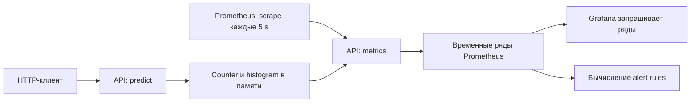

# 09. Prometheus, Grafana и качество модели

[Программа](../../README.md) · [Практика](practice.md) · [Подсказки](hints.md)

## Какую задачу решает этот модуль

Выпуск housing API прошёл проверку `/predict`, но через час клиенты жалуются на задержки. Нужно понять: вырос трафик, часть запросов получает 503, перестал работать процесс или модель стала хуже прогнозировать? Это разные вопросы с разными источниками данных. Мониторинг связывает наблюдаемые числа со временем и помогает выбрать следующую проверку.

**Метрика** — измеряемое числовое значение; в мониторинге это обычно временной ряд, последовательность значений с отметками времени. **Лог** — отдельное событие с контекстом, например ошибка загрузки bundle. **Трасса** (trace) связывает этапы одного запроса через компоненты. Для небольшого сервиса здесь достаточно метрик и логов; по среднему времени ответа нельзя восстановить ошибочный JSON конкретного клиента.

Выход модуля — собственные измерения нагрузки, запросы к метрикам в dashboard и правило обнаружения отказа. Отдельно рассчитывается качество на данных с известными ответами. Dashboard — набор панелей с сохранёнными запросами; он показывает данные источника, а не создаёт измерения сам.

## Что уже готово и где запускается стенд

Из [Docker](../03-service-ci/README.md) нужен образ API и собственный bundle `work/artifacts/model.joblib`. В [Kubernetes](../07-kubernetes/README.md) и [Helm](../08-helm/README.md) ты различал живой процесс, готовность модели и успешный выпуск. Здесь тот же API запускается в отдельном Compose-стенде, чтобы изучать метрики без установки ещё одной платформы в kind. Не оставляй другой API или port-forward на порту 8000.

`labs/monitoring/compose.yaml` запускает три процесса: `api` на порту компьютера 8000, Prometheus 3.2.1 на 9090 и Grafana 11.6.0 на 3000. Bundle монтируется в API из `work/artifacts` как `/models:ro`: это доступ только на чтение. Если модели нет, `/metrics` и `/live` могут работать при 503 на `/ready` и `/predict`.

Housing принимает `instances` — районы с восемью числовыми признаками, возвращает `predictions`, `model_version`, `target_unit`. Target — известная стоимость в единицах `100000 USD`; её нет в обычном HTTP-запросе предсказания. Поэтому обработчик `/predict` не знает собственную MAE: истинный ответ не приходит вместе с признаками.

## Путь запроса и путь метрики

При запросе middleware, обвязка вокруг HTTP-обработчика, отмечает время начала. Обработчик валидирует JSON и вызывает Pipeline или возвращает ошибку. В `finally` обвязка увеличивает счётчик ответа с метками route/status и добавляет длительность в гистограмму. `/metrics` отдаёт накопленные измерения в формате Prometheus.

**Scrape** — периодический HTTP-опрос источника метрик. Prometheus сам ходит к `api:8000/metrics` по внутреннему DNS-имени Compose, сохраняет ряды и вычисляет запросы и правила. **Datasource** — настройка источника данных Grafana; в стенде это `http://prometheus:9090`. Браузер пользователя открывает `localhost:3000`, но сервер Grafana обращается к Prometheus внутри контейнерной сети. `localhost` внутри Grafana означал бы сам контейнер Grafana.



В `labs/monitoring/prometheus.yml` заданы:

```yaml
global:
  scrape_interval: 5s
  evaluation_interval: 5s
rule_files: [/etc/prometheus/alerts.yml]
scrape_configs:
  - job_name: housing
    static_configs:
      - targets: ["api:8000"]
```

`scrape_interval` определяет период опроса, `evaluation_interval` — период пересчёта правил. `job_name` добавляет метку `job="housing"`; target задаёт адрес в сети Prometheus. `rule_files` указывает файл уже внутри его контейнера. Успешный запуск Grafana не доказывает правильность этого адреса. Сначала смотри Prometheus `/targets`, значение `up` и время последней выборки.

## Счётчики, длительность и запросы

**Counter** — накопительный счётчик. `http_requests_total` увеличивается после каждого ответа и сбрасывается при рестарте процесса. Абсолютное значение 10000 не говорит, сколько запросов было за последнюю минуту. **Rate** — скорость прироста в секунду на выбранном временном окне с учётом сбросов. **Gauge** — измерение текущего состояния, которое может увеличиваться и уменьшаться; `up` показывает результат последнего scrape, а не число обслуженных запросов.

PromQL — язык запросов Prometheus. Запрос бизнес-RPS, числа запросов в секунду, исключает технический `/metrics`:

```promql
sum(rate(http_requests_total{job="housing",route="/predict"}[1m]))
```

Селектор в `{}` выбирает источник и маршрут. `[1m]` берёт последнюю минуту; `rate` вычисляется отдельно для каждого исходного ряда, затем `sum` объединяет их. Так сбросы счётчиков разных экземпляров обрабатываются до суммирования. 200 запросов за 10 секунд на клиенте дают 20 RPS. Оценка Prometheus по минутному окну может отличаться от этого числа из-за иной границы окна и частоты scrape.

Доля серверных ошибок считается по тому же потоку и тому же окну:

```promql
sum(rate(http_requests_total{job="housing",route="/predict",status=~"5.."}[1m]))
/
sum(rate(http_requests_total{job="housing",route="/predict"}[1m]))
```

`=~` выбирает статусы регулярным выражением. 10 ответов 503 из 200 дают 0.05, то есть 5%. 422 — ошибка валидации входа, не серверный 5xx. При нулевом трафике доля не определена: отсутствие ошибок без запросов не доказывает обслуживание. Учебная функция возвращает `None`; график также должен отличать отсутствие данных от нуля.

**Histogram**, гистограмма длительности, считает наблюдения в накопительных **buckets**, интервалах с верхней границей `le`. Ряд `_bucket{le="0.1"}` включает запросы длительностью до 0.1 секунды; `_count` — число наблюдений, `_sum` — сумма длительностей. **p95** — длительность, ниже которой лежит примерно 95% запросов. Для нескольких экземпляров объединяют buckets с одинаковой границей:

```promql
histogram_quantile(0.95,
  sum by (le) (
    rate(http_request_duration_seconds_bucket{job="housing",route="/predict"}[5m])
  )
)
```

Это оценка по границам buckets, а не точная сортировка всех длительностей. Средняя задержка и p95 отвечают на разные вопросы; среднее может скрывать редкие медленные ответы. p95 разных экземпляров нельзя усреднить для получения общего p95. На малом количестве запросов квантиль нестабилен. [Функции Prometheus 3.2.1](https://github.com/prometheus/prometheus/blob/v3.2.1/docs/querying/functions.md) описывают `rate` и `histogram_quantile`.

## Метки и стоимость измерений

**Label**, метка, различает ряды одного имени: здесь `route` и `status`. Каждая уникальная комбинация порождает отдельный ряд; число комбинаций называют **cardinality**. Два маршрута и три статуса могут дать шесть рядов счётчика, а histogram добавляет ряд для каждой границы. Request ID, пользовательский ID и текст запроса имеют слишком много значений для меток.

Обвязка использует шаблон маршрута, а не произвольный URL. Это похоже на группировку HTTP middleware в Go по имени handler: детали одного запроса идут в лог, агрегаты — в метрики. Граница аналогии: каждый label становится постоянным измерением в хранилище, а не бесплатным полем строки лога. Model version допустима как метка при ограниченном числе активных версий, но история тысяч экспериментов уже хранится в MLflow/ClearML.

## Три уровня здоровья и качество модели

Доступность процесса проверяется `/live` или scrape. Готовность модели — `/ready` и рабочим predict. Техническое качество обслуживания — долей ошибок, пропускной способностью, задержками и занятостью ресурсов. Качество модели — сравнением прогноза с истинным target. Успешный scrape даёт `up=1`, даже если predict возвращает 503, а HTTP200 может содержать неточный прогноз.

**Data drift** — изменение распределения входных признаков относительно выбранной эталонной выборки (reference). Например, медиана `MedInc` сдвинулась с 3 до 5. Это сигнал о другом составе входов, но не доказательство ухудшения MAE. **Concept drift** — изменение связи входов с target: прежние закономерности перестали давать прежнюю точность. Для проверки фактической ошибки нужны свежие известные ответы.

В практике моделируется задержанное поступление ответов: prediction и target приходят отдельными списками с ID. Их нужно соединить по ID, потому что порядок доставки может различаться. Для `a: target=1, prediction=2`, `b: 3 и 3`, `c: 5 и 4` абсолютные ошибки `[1,0,1]`, MAE=`2/3`. В housing это около 66667 USD среднего абсолютного отклонения в масштабе исторического датасета. Это учебный расчёт, не наблюдение живого рынка.

Квантили `.1`, `.5`, `.9` описывают распределение признака; `.5` — медиана. Для отсортированных `[1,2,3,4,5]` линейная интерполяция использует позицию `(n-1)q`: при q=.1 позиция .4 даёт 1.4. У `[3,4,5,6,7]` соответствующее значение 3.4, а разность медиан 2. Тесты проверяют вычисление и соединение записей, но не доказывают качество настоящей модели без реальных target.

## Алерты и поиск причины

**Alert rule** — выражение, которое периодически проверяется и создаёт сигнал при выполнении условия. В стенде есть:

```yaml
- alert: HousingTargetDown
  expr: up{job="housing"} == 0
  for: 30s
  labels: {severity: warning}
```

`expr` обнаруживает неуспешный scrape. Состояние inactive означает отсутствие условия, pending — условие наблюдается, но ещё не выдержало `for`, firing — выдержало. `for: 30s` фильтрует короткие отказы; время обнаружения также зависит от scrape/evaluation intervals. Поле severity помогает классифицировать сигнал, но не отправляет сообщение. Alertmanager, отдельный компонент маршрутизации уведомлений, в этом стенде не подключён.

При остановленном API сначала получишь `up=0`; после запуска и успешного scrape — `up=1`. При отсутствии bundle процесс жив и `up=1`: нужно отдельное правило по readiness или 5xx predict. В API нет отдельного gauge готовности, поэтому для readiness потребуется источник такой метрики; правило по существующему счётчику 5xx требует настоящих predict-запросов. Не придумывай имя метрики, которую никто не экспортирует.

Если dashboard пуст, проверь datasource, `/targets`, labels и временной диапазон. Если выросли 503 при `up=1`, проверь `/ready`, MODEL_PATH и последний выпуск. Если latency выросла без ошибок, сравни concurrency и ресурсы, затем журнал приложения. **Runbook** — короткая последовательность действий по сигналу: что проверить, как восстановить и каким запросом подтвердить успех. Сигнал указывает на наблюдаемый симптом; причина устанавливается дополнительными данными.

## Материалы

- [Конфигурация Prometheus 3.2.1](https://github.com/prometheus/prometheus/blob/v3.2.1/docs/configuration/configuration.md) — targets и интервалы.
- [Alert rules 3.2.1](https://github.com/prometheus/prometheus/blob/v3.2.1/docs/configuration/alerting_rules.md) — выражения и состояния `for`.
- [Grafana: Prometheus datasource](https://grafana.com/docs/grafana/latest/datasources/prometheus/) — адрес источника и запросы панелей; стенд закрепляет Grafana 11.6.0 в Compose.
