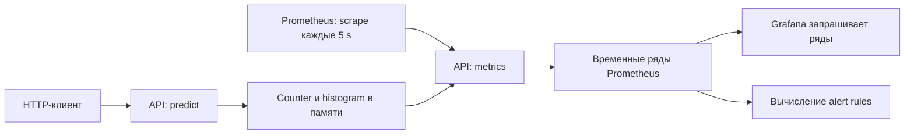

# 09. Prometheus, Grafana и качество модели

[Программа](../../README.md) · [Задания](#задания) · [Подготовка](#подготовка-к-заданиям)

## Какую проблему решаем

Housing API прошёл проверку одного `/predict`, но клиенты начали ждать дольше. Нужно выяснить, выросло ли число запросов, появились ли 503, остановился ли процесс или прогнозы стали менее точными. У этих вопросов разные источники ответа. В модуле ты сначала создашь и измеришь HTTP-нагрузку, затем настроишь наблюдение во времени и проверишь два отказа. В конце отдельно оценишь качество по известным target.

Числа, измеренные во время работы, называются **метриками**. Число ответов, доля 5xx и длительность запросов описывают обслуживание. Prometheus периодически собирает их и хранит значения с отметками времени. Grafana запрашивает эти данные и показывает **dashboard**, набор панелей с сохранёнными запросами. Она не создаёт исходные измерения сама.

У классификатора изображений HTTP-метрики были бы похожими, но для качества нужны истинные классы вместо стоимости Housing. Batch-inference может вообще не обслуживать HTTP: тогда наблюдаются длительность задания, число обработанных строк и его ошибки. Практика ниже остаётся на прежнем Housing API и не добавляет новых сервисов.

## Подготовка к заданиям

Все команды выполняются из корня курса.

Основное Python-окружение подготовь по [SETUP](../../SETUP.md#основная-среда). Проверки `summarize_run` и `analyze` используют фиксированные входы и работают без Docker. Для `measure_load`, dashboard и опыта отказа нужен следующий стенд. Собственный bundle `work/artifacts/model.joblib` создаётся в [ML-notebook](../01-ml/housing.ipynb) и нужен для успешного `/predict`.

Порт 8000 должен принадлежать этому стенду: останови другой API или port-forward, который уже его использует. Признаки и формат запроса остаются [прежними](../03-service-ci/README.md).

```bash
docker compose -f labs/monitoring/compose.yaml up -d --build
```

Проверь готовность API перед нагрузкой:

```bash
curl --fail http://127.0.0.1:8000/ready
```

В браузере открой Prometheus на <http://127.0.0.1:9090> и Grafana на <http://127.0.0.1:3000>. Локальный вход Grafana — `student` / `local-course-only`. Готовый dashboard `Housing course` и источник Prometheus создаются автоматически. В первом задании ты добавишь собственные панели в отдельный dashboard. Если bundle отсутствует, процесс и `/metrics` могут работать, а `/ready` и `/predict` возвращать 503. Нагрузочный опыт требует готовой модели.

## Задания

| Тема | Что выполнить | Файлы |
|---|---|---|
| [01. Нагрузка и dashboard](tasks/01-load-dashboard/README.md) | Реализовать сводку и настоящий HTTP-замер, сравнить серии и панели | [Функции](tasks/01-load-dashboard/solution.py) · [Тесты расчётов](tasks/01-load-dashboard/test_task.py) · [Тест нагрузки](tasks/01-load-dashboard/test_live.py) |
| [02. Отказ](tasks/02-outage/README.md) | Подключить дополнительное alert rule, наблюдать stop/start и API без модели | [Rules](tasks/02-outage/rules.yaml) · [Тест стенда](tasks/02-outage/test_task.py) |
| [03. Качество и drift](tasks/03-quality-drift/README.md) | Соединить target/prediction по ID, вычислить MAE и квантили MedInc | [Функция](tasks/03-quality-drift/solution.py) · [Тесты](tasks/03-quality-drift/test_task.py) |

Функциональные тесты запускаются через `make task TASK=09-monitoring/01-load-dashboard` и `make task TASK=09-monitoring/03-quality-drift`. До реализации заготовок ожидается `NotImplementedError`. Чтение Prometheus включается через `MLOPS_RUN_INTEGRATION=1`. Нагрузочный тест дополнительно требует `MLOPS_RUN_WRITES=1`, потому что создаёт реальный predict-трафик. Флаги и адреса описаны в заданиях.

Пропуск теста без инфраструктурных флагов не подтверждает работу стенда. Нагрузочный тест проверяет настоящий трафик и его счётчик. Dashboard и историю срабатывания alert наблюдай отдельно по заданиям.

## Остановка и очистка

`docker compose -f labs/monitoring/compose.yaml down`. Перед удалением volume выгрузи свой dashboard JSON.

## Что уже готово и где запускается стенд

Из [Docker](../03-service-ci/README.md) нужен образ API и собственный bundle `work/artifacts/model.joblib`. В [Kubernetes](../07-kubernetes/README.md) и [Helm](../08-helm/README.md) ты различал живой процесс, готовность модели и успешный выпуск. Здесь тот же API запускается в отдельном Compose-стенде, чтобы изучать метрики без установки ещё одной платформы в kind. Не оставляй другой API или port-forward на порту 8000.

`labs/monitoring/compose.yaml` запускает три процесса: `api` на порту компьютера 8000, Prometheus 3.2.1 на 9090 и Grafana 11.6.0 на 3000. Bundle монтируется в API из `work/artifacts` как `/models:ro`: это доступ только на чтение. Если модели нет, `/metrics` и `/live` могут работать при 503 на `/ready` и `/predict`.

Предсказание возвращает оценку стоимости, но в запросе API нет известного правильного target. Поэтому обработчик `/predict` не может измерить собственную MAE. Формат входа и единицы результата уже разобраны в [сервисном модуле](../03-service-ci/README.md). Здесь важно, что техническое обслуживание и точность прогноза измеряются разными данными.

## Путь запроса и путь метрики

Чтобы увидеть обслуживание без изменения каждого обработчика, API использует **middleware**, обвязку вокруг HTTP-обработчика. Она отмечает начало запроса, даёт обработчику проверить JSON и вызвать Pipeline, затем записывает статус и длительность. Так учитывается и успешный прогноз, и ответ с ошибкой. `/metrics` отдаёт накопленные измерения в формате Prometheus. Типы счётчика и гистограммы разберём после пути передачи.

Следующий шаг — регулярно переносить измерения из памяти API в хранилище. Prometheus сам ходит к `api:8000/metrics` по внутреннему DNS-имени Compose. Такой опрос называют **scrape**. По полученным временным рядам он вычисляет запросы и правила. Grafana должна знать, откуда читать эти ряды: настройку источника называют **datasource**. В стенде это `http://prometheus:9090`. Браузер пользователя открывает `localhost:3000`, но сервер Grafana обращается к Prometheus внутри контейнерной сети. `localhost` внутри Grafana означал бы сам контейнер Grafana.



В `labs/monitoring/prometheus.yml` заданы:

```yaml
global:
  scrape_interval: 5s
  evaluation_interval: 5s
rule_files: [/etc/prometheus/alerts.yml]
scrape_configs:
  - job_name: housing
    static_configs:
      - targets: ["api:8000"]
```

`scrape_interval` определяет период опроса, `evaluation_interval` — период пересчёта правил. `job_name` добавляет метку `job="housing"`. Target задаёт адрес в сети Prometheus. `rule_files` указывает файл уже внутри его контейнера. Успешный запуск Grafana не доказывает правильность этого адреса. Сначала смотри Prometheus `/targets`, значение `up` и время последней выборки.

## Счётчики, длительность и запросы

Нужно посчитать ответы, не сохраняя отдельную запись каждого запроса. Для этого API увеличивает `http_requests_total` после каждого ответа. Накопительный счётчик называют **counter**. При рестарте процесса он сбрасывается. Абсолютное значение 10000 не говорит, сколько запросов пришло за последнюю минуту. Скорость прироста в секунду по окну с учётом сбросов вычисляет **rate**.

Для текущего состояния подходит другой тип — **gauge**, значение, которое может увеличиваться и уменьшаться. Создаваемый Prometheus ряд `up` принимает 1 при успешном scrape и 0 при неуспешном. Он не считает обслуженные запросы.

PromQL — язык запросов Prometheus. Запрос бизнес-RPS, числа запросов в секунду, исключает технический `/metrics`:

```promql
sum(rate(http_requests_total{job="housing",route="/predict"}[1m]))
```

Селектор в `{}` выбирает источник и маршрут. `[1m]` берёт последнюю минуту. `rate` вычисляется отдельно для каждого исходного ряда, затем `sum` объединяет их. Так сбросы счётчиков разных экземпляров обрабатываются до суммирования. 200 запросов за 10 секунд на клиенте дают 20 RPS. Оценка Prometheus по минутному окну может отличаться от этого числа из-за иной границы окна и частоты scrape.

Доля серверных ошибок считается по тому же потоку и тому же окну:

```promql
sum(rate(http_requests_total{job="housing",route="/predict",status=~"5.."}[1m]))
/
sum(rate(http_requests_total{job="housing",route="/predict"}[1m]))
```

`=~` выбирает статусы регулярным выражением. 10 ответов 503 из 200 дают 0.05, то есть 5%. 422 — ошибка валидации входа, не серверный 5xx. При нулевом трафике доля не определена: отсутствие ошибок без запросов не доказывает обслуживание. Учебная функция возвращает `None`. График также должен отличать отсутствие данных от нуля.

Одного количества ответов мало: нужно оценить, какая часть клиентов ждала долго. API распределяет измеренные длительности по накопительным интервалам — **buckets**. Этот тип метрики называется **histogram**, гистограммой. У bucket есть верхняя граница `le`. Ряд `_bucket{le="0.1"}` включает запросы длительностью до 0.1 секунды. `_count` — число наблюдений, `_sum` — сумма длительностей. **p95** — длительность, ниже которой лежит примерно 95% запросов. Для нескольких экземпляров объединяют buckets с одинаковой границей:

```promql
histogram_quantile(0.95,
  sum by (le) (
    rate(http_request_duration_seconds_bucket{job="housing",route="/predict"}[5m])
  )
)
```

Это оценка по границам buckets, а не точная сортировка всех длительностей. Средняя задержка и p95 отвечают на разные вопросы. Среднее может скрывать редкие медленные ответы. p95 разных экземпляров нельзя усреднить для получения общего p95. На малом количестве запросов квантиль нестабилен. [Функции Prometheus 3.2.1](https://github.com/prometheus/prometheus/blob/v3.2.1/docs/querying/functions.md) описывают `rate` и `histogram_quantile`.

## Метки и стоимость измерений

Ошибки `/predict` нужно отличать от успешных обращений к `/ready`. Поэтому у метрики сохраняются небольшие признаки группы — **labels**, метки, здесь `route` и `status`. Каждая уникальная комбинация порождает отдельный ряд. Количество получившихся рядов называют **cardinality**. Два маршрута и три статуса могут дать шесть рядов счётчика, а histogram добавляет ряд для каждой границы. Request ID, пользовательский ID и текст запроса имеют слишком много значений для меток.

Обвязка использует шаблон маршрута, а не произвольный URL. Для поиска причины конкретного сбоя нужен **лог**, отдельное событие с контекстом. Request ID и текст ошибки подходят для него, но не для бесконечно растущего набора рядов. Model version допустима как метка при ограниченном числе активных версий, но история тысяч экспериментов уже хранится в MLflow/ClearML.

## Три уровня здоровья и качество модели

Доступность процесса проверяется `/live` или scrape. Готовность модели — `/ready` и рабочим predict. Техническое качество обслуживания — долей ошибок, пропускной способностью, задержками и занятостью ресурсов. Качество модели — сравнением прогноза с истинным target. Успешный scrape даёт `up=1`, даже если predict возвращает 503, а HTTP 200 может содержать неточный прогноз.

Допустим, в новых запросах изменился состав районов: медиана `MedInc` стала выше, чем в выбранной эталонной выборке (**reference**). Такое изменение распределения входов называют **data drift**. Оно требует проверки применимости модели, но ещё не доказывает ухудшения MAE. Может измениться и связь признаков с target: прежние закономерности дают другую точность. Это **concept drift**. Чтобы измерить фактическую ошибку в обоих случаях, нужны свежие известные ответы.

В практике моделируется задержанное поступление ответов: prediction и target приходят отдельными списками с ID. Их нужно соединить по ID, потому что порядок доставки может различаться. Для `a: target=1, prediction=2`, `b: 3 и 3`, `c: 5 и 4` абсолютные ошибки `[1,0,1]`, MAE=`2/3`. В housing это около 66667 USD среднего абсолютного отклонения в масштабе исторического датасета. Это учебный расчёт, не наблюдение живого рынка.

Квантили `.1`, `.5`, `.9` описывают распределение признака. `.5` — медиана. Для отсортированных `[1,2,3,4,5]` линейная интерполяция использует позицию `(n-1)q`: при q=.1 позиция .4 даёт 1.4. У `[3,4,5,6,7]` соответствующее значение 3.4, а разность медиан 2. Тесты проверяют вычисление и соединение записей, но не доказывают качество настоящей модели без реальных target.

## Алерты и поиск причины

Наблюдать dashboard непрерывно неудобно. Условие отказа можно записать в **alert rule**, правило, которое Prometheus проверяет периодически. Базовое правило отвечает на один вопрос: перестал ли Prometheus получать метрики от API? Оно использует уже разобранный `up`:

```yaml
- alert: HousingTargetDown
  expr: up{job="housing"} == 0
  for: 30s
  labels: {severity: warning}
```

`expr` обнаруживает неуспешный scrape. Состояние inactive означает отсутствие условия, pending — условие наблюдается, но ещё не выдержало `for`, firing — выдержало. `for: 30s` фильтрует короткие отказы. Время обнаружения также зависит от scrape/evaluation intervals. Поле severity помогает классифицировать сигнал, но не отправляет сообщение. Alertmanager, отдельный компонент маршрутизации уведомлений, в этом стенде не подключён.

При остановленном API сначала получишь `up=0`. После запуска и успешного scrape — `up=1`. При отсутствии bundle процесс жив и `up=1`: нужно отдельное правило по readiness или 5xx predict. В API нет отдельного gauge готовности, поэтому для readiness потребуется источник такой метрики. Правило по существующему счётчику 5xx требует настоящих predict-запросов. Не придумывай имя метрики, которую никто не экспортирует.

Если dashboard пуст, проверь datasource, `/targets`, labels и временной диапазон. Если выросли 503 при `up=1`, проверь `/ready`, MODEL_PATH и последний выпуск. Если latency выросла без ошибок, сравни concurrency и ресурсы, затем журнал приложения. **Runbook** — короткая последовательность действий по сигналу: что проверить, как восстановить и каким запросом подтвердить успех. Сигнал указывает на наблюдаемый симптом. Причина устанавливается дополнительными данными.

## Материалы

- [Конфигурация Prometheus 3.2.1](https://github.com/prometheus/prometheus/blob/v3.2.1/docs/configuration/configuration.md) — targets и интервалы.
- [Alert rules 3.2.1](https://github.com/prometheus/prometheus/blob/v3.2.1/docs/configuration/alerting_rules.md) — выражения и состояния `for`.
- [Grafana: Prometheus datasource](https://grafana.com/docs/grafana/latest/datasources/prometheus/) — адрес источника и запросы панелей. Стенд закрепляет Grafana 11.6.0 в Compose.
