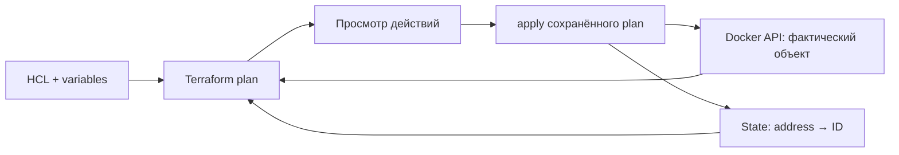

# 11. Terraform: инфраструктура как код

[Программа](../../README.md) · [Задания](#задания) · [Подготовка](#подготовка-к-заданиям)

## Какую проблему решаем

После ручного создания контейнера хочется повторить настройку окружения: сохранить исправный объект, изменить только нужное свойство и восстановить объект, если кто-то удалил его напрямую. Для этого нужно связать описание в файле с конкретным объектом Docker и перед действием увидеть, что именно изменится.

Terraform хранит такое описание как код, читает фактические объекты через API и строит план действий. Этот подход называют **Infrastructure as Code**, инфраструктурой как кодом. В модуле ты применишь готовую конфигурацию, получишь повтор без изменений, затем обнаружишь удаление вне Terraform и восстановишь объект.

В основном проекте такой этап мог бы подготовить узел или хранилище перед выпуском Housing API. Чтобы состояние инфраструктуры не зависело от готовности модели, здесь используется отдельный Nginx-контейнер с готовой HTTP-страницей. Облачный аккаунт не нужен. Проверка HTTP показывает доступность страницы. Для Housing дополнительно понадобились бы готовность bundle и настоящий прогноз.

## Подготовка к заданиям

Все команды выполняются из корня курса.

Основное Python-окружение подготовь по [SETUP](../../SETUP.md#основная-среда). Нужны Docker daemon и CLI Docker. Порт 8099 должен быть свободен. Housing bundle, kind и облачный аккаунт не требуются. Все три задания работают с одним каталогом `modules/11-terraform/tasks/01-repeat` и его локальным state. Общий `labs/terraform/main.tf` одновременно не применяй.

Нужен Terraform 1.11.4. Проверь `terraform version`. Для Docker Desktop endpoint может отличаться от `/var/run/docker.sock`:

```bash
docker context inspect --format '{{.Endpoints.docker.Host}}'
```

Передай найденное значение через `TF_VAR_docker_host` в своём терминале, без подмены системных переменных. Например, после проверки активного Docker context:

```bash
export TF_VAR_docker_host="$(docker context inspect --format '{{.Endpoints.docker.Host}}')"
export MLOPS_TERRAFORM_DIR="$PWD/modules/11-terraform/tasks/01-repeat"
docker info
```

Docker CLI использует свой context, provider — `TF_VAR_docker_host`. Если endpoint не отвечает, сначала исправь подключение, а не HCL. Нельзя применять два задания одновременно к одному state. Init без сети возможен только при заранее подготовленном provider cache.

На этом подготовка заканчивается. Создание ресурсов выполняй в [задании 01](tasks/01-repeat/README.md#шаг-2-применить-просмотренный-план), после разбора ресурса, state и плана ниже. `init` загружает provider из сети, если подходящего пакета ещё нет в локальном кеше.

## Задания

| Тема | Что выполнить | Файлы |
|---|---|---|
| [01. Повтор](tasks/01-repeat/README.md) | Применить план Nginx-контейнера, получить no-op и изучить замену порта | [Конфигурация](tasks/01-repeat/main.tf) · [Тест плана](tasks/01-repeat/test_task.py) |
| [02. Drift](tasks/02-drift/README.md) | Удалить только учебный контейнер, проверить create в плане и восстановить | Та же конфигурация 01 · [Тест drift](tasks/02-drift/test_task.py) |
| [03. State](tasks/03-state/README.md) | Сравнить Terraform resource ID с фактическим ID Docker | Тот же state 01 · [Тест привязки](tasks/03-state/test_task.py) |

Live-проверки включаются через `MLOPS_RUN_INTEGRATION=1` и требуют явный `MLOPS_TERRAFORM_DIR="$PWD/modules/11-terraform/tasks/01-repeat"`. Они не выполняют init/apply/destroy. Тесты 01 и 02 читают настоящий Docker через provider и сохраняют временный plan для разбора JSON. Тест 03 сравнивает state с `docker inspect`. Состояния no-op и удалённого контейнера проверяй отдельно, по README заданий.

Без флага live-тесты пропускаются. При включённой проверке отсутствие CLI, provider или подготовленного state означает ошибку подготовки. Не запускай проверки разных состояний одновременно: задача 02 ожидает отсутствие контейнера, а 01 и 03 — восстановленный ресурс.

## Остановка и очистка

Из той же конфигурации и с тем же Docker endpoint выполни `terraform -chdir=modules/11-terraform/tasks/01-repeat destroy`. Проверь удаление только учебного контейнера. Удали `course.tfplan`, если он больше не нужен. State не добавляй в Git.

## Файлы, процессы и граница с предыдущими модулями

Нужны Docker daemon, доступный Docker CLI и CLI Terraform указанной версии. Все три задания используют `modules/11-terraform/tasks/01-repeat/main.tf` и один state в этом же каталоге. `labs/terraform/main.tf` — отдельный пример. Одновременное применение двух каталогов с одинаковым именем контейнера вызовет конфликт владения.

Bundle из ML-модулей, Vault и кластер kind для этого опыта не требуются. Они объясняют возможное место Terraform в большом процессе: получить сеть/compute/storage, передать адреса настройке приложения, затем выпустить проверенный image. В лабораторной выход `endpoint` играет роль такого адреса, а `curl` проверяет реальную доступность. Статическая строка output сама не измеряет HTTP.

Чтобы создать контейнер, Terraform должен знать операции Docker API и свойства контейнера. Эту часть выполняет отдельный плагин — **provider**. Здесь закреплён `kreuzwerker/docker` 3.0.2. Terraform CLI разбирает конфигурацию и зависимости, provider читает и меняет Docker-объекты, Docker daemon запускает контейнеры. Адрес daemon передаётся `docker_host`. Docker CLI и provider должны смотреть в один endpoint: иначе можно успешно создать ресурс в одной среде и тщетно искать его в другой.

## Конфигурация и реальные привязки

Сначала опишем желаемое: подготовить image и оставить один контейнер с опубликованным HTTP-портом. Для записи используется **HCL**, HashiCorp Configuration Language. Каждое объявление управляемого объекта называется **resource**. Тип определяет, чем управлять, локальное имя различает объявления одного типа.

После создания нужно запомнить, какой внешний объект соответствует объявлению. Terraform сохраняет эту связь и известные свойства в **state**. Например, адрес `docker_container.web` будет связан с ID Docker-контейнера с именем `mlops-course-terraform`. Адрес, имя и ID имеют разные роли: совпадение видимых имён не заменяет связь в state.

Фрагмент существующего `main.tf`:

```hcl
resource "docker_image" "web" {
  name         = "nginx:1.27.5-alpine"
  keep_locally = true
}

resource "docker_container" "web" {
  name         = "mlops-course-terraform"
  image        = docker_image.web.image_id
  network_mode = "bridge"
  ports {
    internal = 80
    external = 8099
    ip       = "127.0.0.1"
  }
}
```

`docker_image.web` управляет локальным образом. `keep_locally=true` сохраняет скачанный image при уничтожении ресурса образа Terraform. `image_id` — ID образа для создаваемого контейнера. Ссылка `docker_image.web.image_id` формирует зависимость: сначала подготовить образ, затем контейнер. Это граф зависимостей, а не порядок строк как в shell-скрипте. `bridge` — режим сети Docker. `internal` — порт внутри контейнера, `external` — порт на компьютере, `ip` ограничивает опубликованный порт loopback-адресом.

В начале файла `required_version = "= 1.11.4"` ограничивает CLI. `required_providers` задаёт источник и версию плагина, а `provider "docker" { host = var.docker_host }` — его подключение. Переменная `docker_host` имеет тип string. `TF_VAR_docker_host` передаёт её из окружения. Значение узнают через `docker context inspect`, а не угадывают путь к socket.

Если потерять эту связь, Docker-контейнер продолжит существовать, но Terraform может попытаться создать новый и столкнуться с занятым именем. Поэтому state не удаляют как кеш при ошибке plan. В третьем задании ты проверишь его назначение сравнением двух ID.

## Путь init — plan — apply

Конфигурация контейнера готова, но Terraform ещё не подготовил плагин Docker и не сопоставил описание с окружением. Все эти действия относятся к выбранной папке конфигурации и её служебным файлам — **рабочему каталогу**. Параметр `-chdir` позволяет выбирать его явно из корня курса. Процесс проходит последовательные шаги:

1. `init` готовит каталог, находит provider нужной версии и создаёт `.terraform.lock.hcl`. Интернет нужен для первой загрузки, если нет локального кеша. Ресурс при этом не создаётся.
2. `validate` проверяет согласованность конфигурации с доступной схемой. Он не доказывает доступность Docker и HTTP.
3. `plan` через provider читает существующие объекты, сопоставляет их со state и конфигурацией и предлагает действия. Само чтение плана не создаёт контейнер.
4. `plan -out=course.tfplan` сохраняет конкретный план. `apply course.tfplan` выполняет сохранённые действия. Перед этим нужно прочитать предложенные изменения.
5. После применения state содержит ID ресурса. `curl -I http://127.0.0.1:8099` проверяет HTTP 200. Следующий plan при тех же входах ожидается без изменений.



В человекочитаемом плане `+` означает создание, `~` изменение на месте, `-/+` замену через удаление и создание. Для automation у `plan -detailed-exitcode` код 0 означает отсутствие изменений, 2 — наличие изменений, 1 — ошибку. Код 2 не является сломанным CLI. Это поведение закреплено в [документации Terraform 1.11.4](https://github.com/hashicorp/terraform/blob/v1.11.4/website/docs/cli/commands/plan.mdx).

Не используй сохранённый plan после произвольных правок как доказательство применения новых настроек: он содержит выбранные ранее действия. Для нового изменения сформируй и просмотри новый plan. Файл может содержать чувствительные значения и требует такого же ограничения доступа, как state.

## Повтор, замена и drift

После успешного apply больше нечего менять: описание и наблюдаемые свойства совпадают. Такой результат называют **no-op**, операцией без изменений. Второй plan с неизменённым `main.tf` должен показать `No changes`. Это не проверка качества приложения: provider знает контейнер, но не знает бизнес-правила прогноза.

Изменение внешнего порта с 8099 на 8100 у учебного `docker_container` требует замены: в [схеме provider 3.0.2](https://github.com/kreuzwerker/terraform-provider-docker/blob/v3.0.2/internal/provider/resource_docker_container.go#L439-L457) у `ports` и `external` задано `ForceNew`. Изучи фактический план до применения. Уничтожение и создание могут дать новый ID и краткий перерыв. Для stateful-системы с данными такая же операция могла бы затронуть сохранность данных, поэтому в упражнении выбран одноразовый web-контейнер. После опыта верни конфигурацию и объект в согласованное состояние перед no-op тестом.

**Drift** — расхождение реального объекта и описанного состояния из-за изменения вне Terraform. В задании вручную удаляется только учебный контейнер. HCL всё ещё требует его существования, state указывает прежний ID, а Docker API сообщает отсутствие. Следующий plan предлагает `create`, код завершения 2. Применение возвращает контейнер, но уже с новым ID. State обновляется после успешного действия.

План обнаруживает только то, что provider умеет читать и сравнивать. Редактирование файла внутри контейнера не обязано отражаться как изменение ресурса. `-refresh=false` пропускает чтение актуального состояния и не подходит для опыта обнаружения удаления. Не редактируй state для имитации drift: тогда меняется учёт, а не реальная инфраструктура.

## State, lock-файл и работа команды

После apply нужно убедиться, что Terraform учитывает именно тот контейнер, который доступен через Docker. Для этого `terraform state list` показывает адреса связей, а `terraform show -json` позволяет программно читать сохранённые ID. Задание сравнивает ID `docker_container.web` с `docker inspect`. Оно подтверждает конкретную привязку. HTTP 200 без проверки ID мог прийти от другого контейнера на том же порту.

`.terraform.lock.hcl` фиксирует версии provider и контрольные суммы пакетов. Его сохраняют в инфраструктурном Git-репозитории. State хранит объекты, а не версии зависимостей, и в Git не попадает. `sensitive=true` скрывает значение в обычном выводе, но не шифрует его в state. JSON-вывод и saved plan также могут раскрывать чувствительные данные.

При потере state существующий Docker-контейнер не исчезает. Новый plan может предложить создание и получить конфликт имени. **Import** связывает существующий ID с объявленным resource address. Он не восстанавливает автоматически всю корректную конфигурацию. Не выполняй import для уже связанного адреса и не удаляй рабочий state ради демонстрации.

Когда несколько людей управляют одной средой, каждому нужен один актуальный state. Механизм его хранения называется **backend**. Для команды обычно выбирают общий удалённый backend с контролем доступа, резервированием и **locking** — взаимным исключением одновременной записи. Без него два процесса могут строить планы по разным представлениям. Наличие блокировки зависит от backend. Локальный state этой лабораторной рассчитан на одного оператора. Тесты используют временные планы и не применяют изменения. Они не предназначены для параллельной работы со state команды.

## Ошибки и граница с Ansible

Если init не скачивает provider, проверь сеть, источник и выбранную версию. Если validate прошёл, а plan не соединяется с Docker, проверь daemon и `TF_VAR_docker_host`: синтаксическая корректность не означает доступный socket. Если create получает конфликт имени, проверь существующий state, рабочий каталог и объект в Docker. Не удаляй случайный контейнер. Если no-op тест видит create, различи настоящее удаление и чтение другого daemon.

Terraform удобен для объектов с API и явным жизненным циклом: контейнера, сети, диска. [Ansible](../12-ansible/README.md) управляет настройкой узла и файлов. Граница не абсолютна, но право создавать ресурс и право менять его конфиг лучше распределить явно. Shell provisioner, произвольная команда в Terraform, не должен заменять обычный ресурс provider без технической причины. Для локального housing одного Compose может быть достаточно. Изучение инструмента не означает обязательное усложнение приложения.

## Материалы

- [Docker provider 3.0.2: container](https://github.com/kreuzwerker/terraform-provider-docker/blob/v3.0.2/docs/resources/container.md) — точные поля ресурса, порты и ID.
- [Terraform state](https://developer.hashicorp.com/terraform/language/state) — привязки, хранение и совместная работа.
- [Планы Terraform 1.11.4](https://github.com/hashicorp/terraform/blob/v1.11.4/website/docs/cli/commands/plan.mdx) — refresh, saved plan и detailed exit code.
