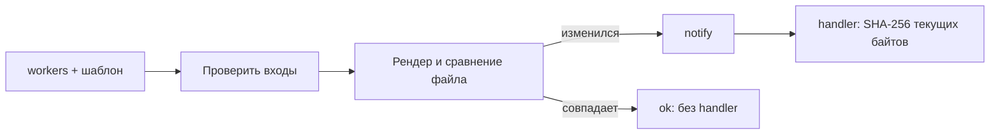

# 12. Ansible: настройка и идемпотентность

[Программа](../../README.md) · [Задания](#задания) · [Подготовка](#подготовка-к-заданиям)

## Какую задачу решает этот модуль

Контейнер или VM уже существует, но внутри нужен каталог, конфигурация сервиса и действие после её изменения. Shell-скрипт с `echo ... >> file` легко допишет одну настройку дважды, а безусловный restart создаст перерыв при каждом запуске. Ansible описывает шаги настройки так, чтобы повтор с теми же входами сохранял нужное состояние без лишних изменений.

**Идемпотентность** — свойство операции: повторное применение после достижения нужного состояния не меняет результат. Для настройки это означает одинаковые файлы и права при повторе, а не просто exit code 0. Ansible выполняется по запросу оператора или автоматизации. В отличие от контроллера Kubernetes он не продолжает проверять узел после завершения playbook.

Результат модуля — конфигурация с наблюдаемым `changed=0` при повторе и обработчик, который реагирует на реальное изменение. Используется ansible-core 2.18.4 внутри Python 3.12.12 Docker-образа. Настраивается изолированный Linux-контейнер, основной компьютер не становится управляемым узлом.

## Подготовка к заданиям

Все команды выполняются из корня курса.

Для заданий используй отдельные Compose-файлы в `tasks/`, а не общий `labs/ansible/compose.yaml`. Нужны Docker daemon и основное Python-окружение по [SETUP](../../SETUP.md#основная-среда). Ansible core 2.18.4 устанавливается при сборке controller из `labs/ansible/Dockerfile`. На компьютере Ansible и SSH для локального inventory не требуются.

```bash
mkdir -p work/ansible work/ansible-template
docker compose -f modules/12-ansible/tasks/01-idempotency/compose.yaml build
docker compose -f modules/12-ansible/tasks/01-idempotency/compose.yaml run --rm controller ansible-playbook -i inventory.ini playbook.yaml --syntax-check
docker compose -f modules/12-ansible/tasks/02-template-handler/compose.yaml build
docker compose -f modules/12-ansible/tasks/02-template-handler/compose.yaml run --rm controller ansible-playbook -i inventory.ini playbook.yaml --syntax-check
```

Controller выполняет playbook в `/lab`. Inventory выбирает группу `lab` с `localhost` и `ansible_connection=local`. Это настройка контейнера, не ОС компьютера. Compose монтирует учебные исходники read-only и сохраняет результаты в bind mount `/course-output`. Повторный disposable controller видит те же файлы, поэтому может проверить идемпотентность.

## Задания

Все задания выполняются на CPU.

| Тема | Что выполнить | Файлы |
|---|---|---|
| [01. Два запуска](tasks/01-idempotency/README.md) | Разобрать PLAY RECAP и проверить успешный идемпотентный повтор | [Функции](tasks/01-idempotency/solution.py) · [Playbook](tasks/01-idempotency/playbook.yaml) · [Тесты](tasks/01-idempotency/test_task.py) |
| [02. Template и handler](tasks/02-template-handler/README.md) | Проверить workers, доставить env и запускать digest handler только при изменении | [Playbook](tasks/02-template-handler/playbook.yaml) · [Шаблон](tasks/02-template-handler/housing.env.j2) · [Тест файлов](tasks/02-template-handler/test_task.py) |
| [03. Границы инструментов](tasks/03-tool-boundaries/README.md) | Различить образ, ресурс и настройку узла, выбрать владельца изменения | Руководство с примерами Dockerfile/Terraform/Ansible |

`make task TASK=12-ansible/01-idempotency` проверяет Python на фиксированных текстах и не запускает Ansible. До реализации ожидается `NotImplementedError`. `MLOPS_RUN_INTEGRATION=1 make task TASK=12-ansible/02-template-handler` только читает файлы после твоих ручных запусков. Он не выполняет playbook и не доказывает историю notify.

`make test` проверяет готовую обвязку курса. Пропуск инфраструктурного теста без флагов не подтверждает работу стенда. При включённой проверке отсутствие зависимостей или подготовленного состояния означает ошибку.

## Остановка и очистка

```bash
docker compose -f modules/12-ansible/tasks/01-idempotency/compose.yaml down
docker compose -f modules/12-ansible/tasks/02-template-handler/compose.yaml down
```

`run --rm` удаляет завершившийся controller. Созданные файлы остаются в `work/ansible` и `work/ansible-template`. Сохрани нужные конфигурации перед удалением этих каталогов.

## Что приходит из предыдущих модулей

Из [сервисного модуля](../03-service-ci/README.md) нужны Docker и понимание переменных окружения. `MODEL_PATH=/models/model.joblib` напоминает путь housing bundle, а `WORKERS` — настройку числа процессов сервиса. В этом модуле они становятся содержимым учебного `housing.env`. Сам housing API не запускается и этот файл автоматически не читает. Увеличение WORKERS в примере демонстрирует доставку конфигурации, а не измеренный прирост производительности.

Из [Terraform](../11-terraform/README.md) приходит различие описания ресурса и реального объекта. Его Nginx-контейнер для Ansible не используется: здесь свой Compose controller и свои выходные каталоги. В общей архитектуре Terraform мог бы создать узел и отдать адрес, а Ansible использовать адрес в inventory. Лабораторные специально разделены.

Task-local Compose первого задания монтирует `work/ansible` в `/course-output`, второго — `work/ansible-template`. Поэтому файл `/course-output/config/housing.env` внутри второго контейнера сохраняется как `work/ansible-template/config/housing.env` на компьютере. Удаление одноразового controller не удаляет эти файлы. Разные каталоги предотвращают случайное принятие результата первой практики за результат второй.

## Controller, inventory, play и module

**Controller** — процесс Ansible на управляющей машине. **Managed node** — система, на которой выполняют настройку. Обычно controller подключается к Linux-узлу по SSH, но здесь оба находятся в одном контейнере. Inventory содержит:

```ini
[lab]
localhost ansible_connection=local ansible_python_interpreter=/usr/local/bin/python
```

**Inventory** — описание узлов и групп. `[lab]` задаёт группу, `localhost` — узел. `ansible_connection=local` выполняет задачи внутри controller-контейнера без SSH. Явный interpreter выбирает Python этого образа. Это не `localhost` твоего компьютера: контекст выполнения определяет контейнер. Такой опыт не проверяет сеть SSH, bastion или права на удалённой VM.

**Playbook** — YAML-файл с последовательностью play. **Play** связывает группу узлов, переменные и задачи. **Task** вызывает **module**, модуль Ansible с конкретным контрактом, например создать каталог или доставить файл. Имя `ansible.builtin.file` состоит из коллекции встроенных модулей и имени. **Role** — способ упаковать связанные задачи, переменные и шаблоны. Для маленькой лабораторной она не нужна.

Фрагмент уже готового playbook:

```yaml
- name: Configure isolated lab container
  hosts: lab
  gather_facts: false
  tasks:
    - name: Create configuration directory
      ansible.builtin.file:
        path: /course-output/config
        state: directory
        mode: '0755'
```

`hosts` выбирает группу inventory. `gather_facts: false` отключает автоматический сбор сведений об ОС, которые этим задачам не нужны. Module `file` проверяет наличие каталога и права, затем меняет только отличия. `mode` задан строкой с восьмеричным представлением прав: это исключает неоднозначное чтение YAML-числа. Имя task объясняет действие в журнале, но не меняет его поведение.

В Go это похоже на `EnsureDir` с проверкой фактических свойств, а не на безусловный набор побочных эффектов. Граница аналогии: каждый module сам реализует проверку и поддержку режимов. Нельзя считать произвольную shell-команду идемпотентной только потому, что её вызвал Ansible.

## Путь от переменной до файла и handler

**Variable** — именованное входное значение, например `workers`. Его можно задать в play или override через `-e`. В CLI `-e workers=2` значение может прийти строкой. При проверке нужно учитывать способ передачи и принимать только корректное положительное целое значение. Нельзя просто сравнить произвольную строку с нулём или молча превратить `2.5` в `2`.

**Template** — текст с подстановками Jinja2. В существующем `housing.env.j2` строка `WORKERS={{ workers }}` превращается в `WORKERS=2`, если выбран workers=2. Controller читает шаблон и переменные, рендерит байты, сравнивает их с файлом на managed node и доставляет изменённое содержимое. `MODEL_PATH` остаётся `/models/model.joblib`. Параметры `src` и `dest` относятся к разным сторонам: исходник на controller, назначение на managed node. [Module template в ansible-core 2.18](https://docs.ansible.com/ansible-core/2.18/collections/ansible/builtin/template_module.html) описывает рендер, права и check/diff.

**Handler** — задача, запускаемая после уведомления `notify` об изменении. Обычно это reload или restart сервиса, чтобы тот прочитал новый конфиг. При неизменном template уведомления нет. В простом play обработчики выполняются после обычных задач. Несколько уведомлений одного handler объединяются до его выполнения. Если нужна другая точка запуска, существует явный flush, но в упражнениях он не требуется.

В учебном контейнере нет systemd и настоящего daemon, которым можно управлять. Поэтому handler второго задания записывает **marker**, диагностический файл с SHA-256 байтов текущего `housing.env`, в `housing.env.sha256`. Это подтверждает обработку нового файла. Не следует называть marker перезапуском приложения.



Проверка `assert`, задача проверки условия с понятной ошибкой, должна сработать до записи при workers=0. Переход 1→2 меняет файл и его digest. Повтор 2→2 не меняет их. Digest считают по фактическим байтам файла, включая переводы строк, а не по строковому представлению словаря или пути.

## Что означают changed и PLAY RECAP

В выводе task `ok` означает успешное выполнение без изменения, `changed` — выполнение с изменением. Итоговый **PLAY RECAP** суммирует результаты по каждому host. Например, иллюстрация двух запусков:

```text
PLAY RECAP ***
localhost : ok=2 changed=2 unreachable=0 failed=0 skipped=0 rescued=0 ignored=0

PLAY RECAP ***
localhost : ok=2 changed=0 unreachable=0 failed=0 skipped=0 rescued=0 ignored=0
```

`ok` включает успешно изменившие состояние задачи. Это не число только неизменившихся задач. `changed` — их изменившая часть. `unreachable` означает невозможность связаться с узлом, `failed` — ошибки исполнения, `skipped` — пропущенные задачи, `rescued` — ошибки, обработанные блоком rescue, `ignored` — игнорированные ошибки. Поэтому одной зелёной строки недостаточно: проверяют нужные поля и фактический файл.

Первый запуск может уже дать `changed=0`, если каталог и файл сохранены от предыдущего опыта. Критерий повтора — те же входы, те же hosts, отсутствие ошибок обоих запусков и `changed=0` во втором. Функции `parse_recap` и `compare_runs` работают с текстом. Они не запускают Ansible и не подтверждают историю действий сами по себе.

Timestamp в template меняет содержимое при каждом запуске и разрушает этот критерий. `changed_when: false` меняет отчёт задачи, но не отменяет фактические побочные эффекты. Для `command`/`shell` существуют условия `creates`/`removes`, однако готовый module `copy`, `file` или `template` обычно точнее выражает состояние. Выбирай shell только там, где нужен его контракт и понятна проверка повтора.

## Check mode, ошибки и секреты

`--check` просит оценить изменения без обычного применения, `--diff` показывает разницу текста. Поддержка зависит от module. На чистом каталоге ещё отсутствующие результаты предыдущих задач могут мешать проверкам последующих. Поэтому check полезен перед apply, но не заменяет реальный запуск и повтор. В упражнении digest подтверждается после apply по существующим файлам.

Если host не найден, сравни `hosts: lab` с группой inventory. Если задача пишет не туда, различи путь контейнера и bind mount. Если файл меняется на каждом повторе, проверь недетерминированные значения, переводы строк, права и типы входов. Если template изменился, а handler не сработал, проверь точное имя notify и наблюдаемый статус changed. Если marker не совпадает, проверь, что хешируется текущий файл и не добавляется имя файла в строку digest.

Пароли не должны попадать в diff или обычный stdout. **Ansible Vault** шифрует файлы/значения для хранения, а **HashiCorp Vault** из [модуля 10](../10-vault/README.md) — отдельный сервис выдачи доступа с policy и TTL. Шифрование vars не добавляет автоматическую ротацию и renewal. `no_log` ограничивает вывод задачи, но не исправляет уже раскрытый секрет в другом месте.

## Граница Dockerfile, Terraform и Ansible

Dockerfile задаёт содержимое образа: новая Python-библиотека housing должна попасть в новую сборку. Terraform управляет существованием ресурсов и их API-свойствами: новый узел, сеть или контейнер — его возможная область. Ansible меняет конфигурацию существующего узла и выполняет связанное действие: новый env-файл и reload.

Для неизменяемого контейнерного приложения часть настройки разумнее делать при сборке image или через параметры запуска. Ansible не требуется добавлять внутрь каждого Kubernetes Pod. При обычном окружении с VM он может настроить системные пакеты и сервисы. Адреса удобно получать из инфраструктурных outputs, а не дублировать вручную. У инструментов есть пересечения, поэтому полезно выбрать одного владельца конкретного свойства, чтобы два процесса не возвращали его к разным значениям.

Повтор Ansible не является автоматическим откатом: для возврата конфигурации передают прежние template/vars и снова выполняют playbook. Он не откатывает миграции данных или созданные приложением внешние события. В конце практики сохраняются рабочие конфиги и шаблоны, а одноразовые контейнеры останавливаются по инструкции задания.

## Материалы

- [Ansible core 2.18: template](https://docs.ansible.com/ansible-core/2.18/collections/ansible/builtin/template_module.html) — src/dest, типы параметров и check/diff.
- [Handlers](https://docs.ansible.com/ansible/latest/playbook_guide/playbooks_handlers.html) — notify, порядок и объединение уведомлений.
- [Check и diff](https://docs.ansible.com/ansible/latest/playbook_guide/playbooks_checkmode.html) — ограничения предварительного просмотра. Версия controller закреплена Dockerfile лабораторной.
