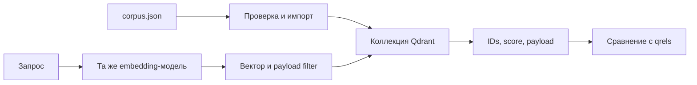

# 13. Qdrant и основы векторного поиска

[Программа](../../README.md) · [Задания](#задания) · [Подготовка](#подготовка-к-заданиям)

## Какую задачу решает поиск

У сервиса появилась база инструкций о выкладке моделей. Пользователь спрашивает «как вернуть старую модель», а документ называется «Rollback». Поиск точного слова может его пропустить. Нужно превратить запрос и документы в сопоставимые числовые представления, получить кандидатов и проверить, действительно ли выдача помогает пользователю.

**Векторный поиск** ранжирует объекты по близости их векторов. Qdrant хранит эти векторы, метаданные и индекс для поиска. Сам по себе он не объясняет текст и не гарантирует релевантность ответа. **Релевантный документ** — документ, признанный подходящим для конкретного запроса независимой разметкой. Близость векторов — только вычисляемый сигнал для такого решения.

Здесь начинается отдельный предметный сценарий: модель стоимости жилья не нужна. После [модуля HTTP/API](../03-service-ci/README.md) пригодятся JSON, HTTP-статусы и проверка входа. Исходные данные уже лежат в `labs/search/corpus.json`: восемь документов с `id`, `text`, `topic`, `vector`. В `queries.json` рядом находятся четыре запроса и их релевантные IDs. Для локального стенда закреплены Qdrant 1.13.6 и client 1.13.3. Установка — в [подготовке](#подготовка-к-заданиям).

## Подготовка к заданиям

Все команды выполняются из корня курса. Для чистых функций достаточно [основной среды](../../SETUP.md#основная-среда). Для настоящего Qdrant SDK создай отдельное окружение Python 3.12 с базовыми зависимостями и пакетом курса:

```bash
python3.12 -m venv .venv-qdrant
source .venv-qdrant/bin/activate
python -m pip install -r labs/housing/requirements.txt
python -m pip install --no-deps -e labs/housing
python -m pip install -r labs/qdrant/requirements.txt
```

В requirements закреплён `qdrant-client==1.13.3`. Для CPU encoder третьего задания в этом отдельном окружении дополнительно установи `fastembed==0.6.1`. Первый запуск encoder скачивает веса. Проверка манифеста не требует ни encoder, ни сети.

| Вход или файл | Назначение |
|---|---|
| [corpus.json](../../labs/search/corpus.json) | Восемь документов. `id` — устойчивое целое, `text` — текст, `topic` — категория, `vector` — ручной 4D-вектор |
| [queries.json](../../labs/search/queries.json) | Четыре запроса. `vector` подаётся в поиск, `relevant` содержит независимые IDs для оценки |
| [compose.yaml](../../labs/qdrant/compose.yaml) | Qdrant `v1.13.6`, HTTP на `127.0.0.1:6333`, gRPC на `6334`, память контейнера 768m |
| `qdrant-data` | Именованный volume для `/qdrant/storage`. Данные переживают остановку контейнера |

Для серверной части нужны Docker daemon и Compose. Останови другие тяжёлые стенды, проверь свободные порты, затем запусти:

```bash
docker compose -f labs/qdrant/compose.yaml up -d
curl --fail http://127.0.0.1:6333/collections
```

Ожидается успешный HTTP-ответ со списком коллекций. Это проверка доступности сервера, ещё не загрузки корпуса. Нужную `course-docs` создаёт твоя реализация первого задания.

## Задания

| Задание | Что выполнить | Файлы и среда |
|---|---|---|
| [01. Загрузка и фильтрация](tasks/01-plumbing/README.md) | Проверить документы, загрузить устойчивые IDs, выполнить SDK-поиск с фильтром | [solution.py](tasks/01-plumbing/solution.py) · [Тесты](tasks/01-plumbing/test_task.py). CPU, сервер для live-проверок |
| [02. Recall, precision и MRR](tasks/02-evaluation/README.md) | Сравнить ранжированные IDs с независимой разметкой | [solution.py](tasks/02-evaluation/solution.py) · [Тесты](tasks/02-evaluation/test_task.py). CPU без сервера |
| [03. Версия embeddings](tasks/03-embeddings/README.md) | Проверить манифест и получить настоящие CPU embeddings для отдельного индекса | [solution.py](tasks/03-embeddings/solution.py) · [Тесты](tasks/03-embeddings/test_task.py). CPU |

Начни с тестов функций, затем проверь SDK и сервер. Записывающий тест первого задания использует метрики второго, поэтому реализуй их до запуска этого теста.

```bash
make task TASK=13-qdrant/01-plumbing
make task TASK=13-qdrant/02-evaluation
make task TASK=13-qdrant/03-embeddings
```

До реализации учебных функций ожидается `NotImplementedError`. `make test` проверяет готовую обвязку курса. Отдельные флаги SDK и серверных проверок описаны в первом задании. Пропуск проверки не подтверждает работу SDK или сервера.

## Остановка стенда

```bash
docker compose -f labs/qdrant/compose.yaml down
deactivate
```

Остановка сохраняет volume. Для восстановления нужны исходный корпус, qrels и версия encoder. `down -v` удаляет данные и не требуется для обычного завершения.

## От текста к embedding и расстоянию

**Embedding** — вектор, который модель вычисляет из объекта, например текста. Размерность — число координат. В настоящей модели смысл распределён по множеству координат. Одной координате обычно нельзя дать имя «безопасность». Документы и запросы должны проходить совместимые модель и preprocessing — подготовку текста до вычисления вектора.

В учебном корпусе размерность 4, векторы созданы вручную. Оси условно разделяют release, pipeline, monitoring и security. Это проверка связности загрузки, поиска и проверки результатов. Она не проверяет понимание языка моделью.

Cosine similarity сравнивает направления: `dot(a,b) / (norm(a) * norm(b))`. Для запроса `q=[0,0,0,1]` документ 7 имеет вектор `[0,0,0,1]`, поэтому similarity равна 1. У документа 8 вектор `[0.1,0,0.1,0.8]`: скалярное произведение равно 0.8, норма — `sqrt(0.66)`, cosine ≈ 0.9847. Документ 5 `[0,0,1,0]` даёт 0. Поэтому security-документы попадают выше monitoring. Значение 0.9847 не означает вероятность релевантности 98.47%.

У нулевого вектора нет направления: знаменатель равен нулю. NaN и infinity также нельзя использовать для осмысленного ранжирования. В упражнении такие значения отклоняются до сетевого запроса. Для нормализованных до длины 1 векторов cosine совпадает с dot product. **Euclidean distance** измеряет расстояние между точками и учитывает масштаб: `[1,0]` и `[10,0]` имеют cosine=1, но расстояние 9. Метрику выбирают по условиям обучения embedding-модели.

Одинаковая размерность не делает две модели совместимыми: координаты принадлежат разным пространствам. Если сменить модель только для запросов, HTTP может отвечать успешно, но качество упадёт. При смене модели переиндексируются и документы, и запросы.

## Коллекция и путь данных

**Коллекция** задаёт схему векторов: размерность и distance. **Point** — объект Qdrant с устойчивым `id`, `vector` и **payload**, то есть дополнительными полями. Здесь payload содержит исходный `text` и `topic`, например `security`. Вектор нужен для ранжирования, текст — для показа результата, topic — для ограничения области поиска.



Для первого упражнения embedding-модель в схеме заменена готовым `vector` из файла. Индексирующий Python-процесс читает JSON, проверяет документы и отправляет points серверу. Сервер сохраняет их в volume. Клиент поиска отправляет вектор и получает список points. Текст не нужно заново доставать из модели.

По аналогии с backend `id` похож на primary key, payload — на дополнительные поля записи. `upsert` создаёт отсутствующий ID или заменяет существующий. Повторный импорт с теми же IDs сохраняет восемь points. Случайные IDs создадут дубли. Но коллекция не является реляционной таблицей с JOIN и внешними ключами, а upsert не доказывает идентичность всего корпуса: удалённые из файла документы сами не исчезнут.

Compose привязывает `6333` для HTTP и `6334` для gRPC к loopback. `qdrant-data:/qdrant/storage` сохраняет данные вне жизненного цикла контейнера. `mem_limit: 768m` ограничивает память учебного процесса, а не число поддерживаемых векторов. Путь `localhost` из контейнера относится к нему самому: при размещении клиента в другом контейнере нужен адрес сервиса в общей сети.

## Запрос и фильтрация

В client 1.13.3 метод `query_points` возвращает объект ответа. Список результатов находится в `.points`. Следующий запрос выполняется после реализации загрузки первого задания и создания `course-docs`:

```python
from qdrant_client import QdrantClient, models

client = QdrantClient(url="http://127.0.0.1:6333")
answer = client.query_points(
    collection_name="course-docs",
    query=[0.0, 0.0, 0.0, 1.0],
    query_filter=models.Filter(must=[models.FieldCondition(
        key="topic", match=models.MatchValue(value="security")
    )]),
    limit=2,
    with_payload=True,
)
print([(point.id, point.payload["topic"]) for point in answer.points])
```

`collection_name` выбирает индекс, `query` задаёт вектор той же размерности, `limit` — максимум результатов. `must` означает обязательное условие, `MatchValue` — точное совпадение topic, `with_payload` просит вернуть метаданные. Ожидаемый набор ID — `{7,8}` с topic=security. Сравнение набора не зависит от порядка при равных оценках. Метод и объект результата описаны в [исходниках client 1.13.3](https://github.com/qdrant/qdrant-client/blob/v1.13.3/qdrant_client/qdrant_client.py).

Фильтр должен участвовать в поиске. Если сначала взять top-2 всего корпуса, а потом убрать неподходящие topic, выдача может остаться пустой, хотя подходящие документы находились на третьем и четвёртом местах. Это похоже на неверное применение LIMIT до WHERE в прикладной логике. Фильтр topic в учебном примере не является полноценной системой авторизации: права определяет доверенный сервер, а не произвольный параметр клиента.

## Exact и approximate search

**Exact search** сравнивает запрос со всеми доступными векторами. **ANN**, approximate nearest neighbors, ищет близких соседей приближённо, сокращая вычисления. HNSW — граф, по которому поиск переходит между близкими векторами. Настройки построения и поиска меняют память, задержку и шанс пропустить ближайшего соседа.

Восемь точек не показывают выигрыш ANN на большом корпусе. Чтобы измерить **ANN recall**, сравни IDs приближённого top-k с точным top-k на тех же векторах. Это проверка алгоритма поиска. **Relevance recall** сравнивает выдачу с человеческой разметкой: даже точный ближайший вектор может плохо отвечать на вопрос.

## Качество выдачи и разобранные метрики

**Qrels** — разметка `query → relevant document IDs`. В `queries.json` это поле `relevant`. Для запроса с relevant `[1,2]` и выдачей `[9,2]` при k=2 найден один подходящий документ из двух: Recall@2=1/2. Precision@2=1/2 — доля подходящих документов среди двух запрошенных позиций. Первая релевантная позиция — вторая, reciprocal rank=1/2. **MRR** обычно означает среднее reciprocal rank по запросам. Учебная функция возвращает вклад одного запроса под ключом `mrr`, затем его можно усреднить.

Для `[1,1,2]` при k=2 рассматриваются именно первые две позиции: найден только один уникальный релевантный ID, recall=0.5, precision=0.5, reciprocal rank=1. Нельзя сначала удалить дубль и затем взять k: это незаметно добавит третью позицию. Если разметка пустая, контракт функции возвращает нули. В настоящем benchmark такие запросы надо различать с запросами, где алгоритм пропустил известные ответы.

На четырёх ручных запросах Recall@2=1 ожидается по построению корпуса. Для оценки модели расширь корпус и независимо разметь запросы. Не назначай релевантными документы потому, что их вернул текущий алгоритм. Отдели запросы для подбора параметров от финальных: иначе качество измеряется на данных настройки. **nDCG** дополнительно учитывает степень релевантности и позицию. Она не входит в контракт этого задания.

## Настоящие embeddings и версия индекса

В третьем задании используется FastEmbed 0.6.1 и `BAAI/bge-small-en-v1.5` на CPU. Это английская модель. Выбор языка корпуса влияет на качество. Сверяй обработку запроса с [model card](https://huggingface.co/BAAI/bge-small-en-v1.5), включая query instruction, если применяешь рекомендуемый retrieval-режим. Инструкцию и нормализацию сохраняй как настройки эксперимента. Размерность определяй по выходному массиву, а не по ожиданию имени модели.

**Revision** — идентификатор конкретного snapshot модели. `main` и `latest` могут измениться. Манифест упражнения связывает model_id, revision, dimension, count и SHA-256 исходных байтов корпуса. Он описывает происхождение, но не доказывает качество. Сохраняй также фактический cache snapshot и настройки preprocessing: model ID в JSON сам не закрепляет скачанные веса.

Для новой размерности создай отдельную коллекцию, загрузи новые embeddings и проверь её до переключения потребителей. Alias — устойчивое имя, направляющее запросы в выбранную коллекцию, — помогает отделить адрес клиента от имени версии. Даже при неизменной размерности новая модель требует согласованного переключения query encoder и корпуса.

## Ошибки и эксплуатационные границы

| Симптом | Что различить и проверить |
|---|---|
| HTTP 400 при query | Сверить число координат с конфигурацией коллекции. Это не отсутствие результатов |
| HTTP успешен, count растёт после импорта | Проверить устойчивость IDs. Upsert с новым ID не заменяет прежнюю запись |
| Пустая выдача с фильтром | Проверить payload topic и точное значение, затем тот же запрос без фильтра |
| Качество упало без сетевых ошибок | Сверить revision, preprocessing и модель запросов/корпуса, а затем qrels |
| После restart нет данных | Проверить, подключён ли прежний volume и не был ли удалён через down -v |

Индекс без корпуса и процедуры восстановления — неполный backup. Сохраняй корпус, qrels и манифест отдельно от контейнера. Snapshots Qdrant — следующий уровень восстановления состояния коллекции. Остановка через `down` оставляет volume. Тесты функций проверяют форму данных и математику, read-only probe — подготовленный сервер. Локальные sdk-тесты вызывают студенческий загрузчик и query_documents в памяти процесса. Integration/writes тест под двумя флагами MLOPS_RUN_INTEGRATION=1 и MLOPS_RUN_WRITES=1 вызывает те же функции в уникальной коллекции на сервере и удаляет только её. Реальные IDs из query_points поступают в ranking_metrics по независимым qrels. Это подтверждает путь SDK и учебного корпуса. Качество настоящих embeddings требует отдельной оценки.

## Материалы

- [Qdrant quickstart](https://qdrant.tech/documentation/quickstart/) — общий путь collection → upsert → query. Интерфейсы сверяй с client 1.13.3 выше.
- [Payload filtering](https://qdrant.tech/documentation/concepts/filtering/) — условия по метаданным и их сочетания.
- [FastEmbed 0.6.1](https://github.com/qdrant/fastembed/tree/v0.6.1) — код выбранного CPU encoder, отдельно от сервера Qdrant.
