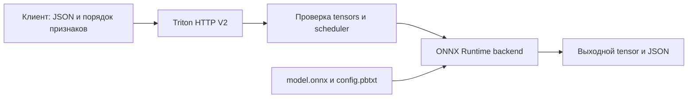

# 15. Triton Inference Server и перенос модели

[Программа](../../README.md) · [Практика](practice.md) · [Подсказки](hints.md)

## Какую задачу решает перенос модели

В [модуле сервиса](../03-service-ci/README.md) Python API загружает Pipeline из `model.joblib` и вызывает predict. Теперь нужно отделить вычислительный граф модели от Python-обвязки, проверить сохранение прогнозов после переноса и отправить запрос специализированному серверу. Успешный экспорт файла не гарантирует ни правильных признаков, ни совпадения чисел.

**Triton Inference Server** — сервер обслуживания моделей NVIDIA. Он принимает HTTP/gRPC и передаёт вычисления выбранному backend. **Backend** здесь — исполнитель графа, например ONNX Runtime или TensorRT, а не весь прикладной сервис. Язык Triton для написания GPU kernels — отдельный проект. Triton Server не заменяет бизнес-валидацию и не обещает ускорения любой маленькой модели.

Нужен собственный обученный Pipeline и bundle `work/artifacts/model.joblib` из [обучения](../01-ml/README.md). Bundle содержит `pipeline` и сведения о признаках/версии; структура описана в [контракте housing](../../labs/housing/README.md). Одна строка — район, восемь числовых признаков — характеристики жилья и населения, выход — прогноз стоимости в единицах 100000 USD. Пример численной проверки ниже не требует готовой модели; настоящий export требует выполненного обучения.

## ONNX и граница preprocessing

**ONNX** — формат графа вычислений: узлы представляют операции, рёбра — tensors. Tensor — многомерный массив с типом элементов и shape, то есть размерами осей. **ONNX Runtime** исполняет такой граф на выбранном устройстве. **skl2onnx** преобразует поддерживаемые sklearn-модели в ONNX; это не универсальный сериализатор любого Python-кода.

**Opset** — версия набора ONNX-операций. В упражнении выбран opset 17, ONNX 1.17.0, skl2onnx 1.18.0, Runtime 1.22.0. Список opsets и поддержка converter/runtime — разные ограничения. Ошибка неподдерживаемого estimator или transformer требует проверки конвертера; смена расширения joblib на onnx ничего не преобразует.

Экспортируй весь поддерживаемый Pipeline: обученная подготовка признаков должна оставаться той же. Если preprocessing остался на клиенте, его реализация становится частью serving-контракта. Расхождение подготовки между train и serving называют **training-serving skew**. Общий граф уменьшает этот риск, но не замечает неверный порядок входных столбцов сам по себе.

Вход `features` имеет dtype float32 и shape `[N,8]`, где N — число районов. Канонический порядок берётся из `housing.features.FEATURES`: MedInc, HouseAge, AveRooms, AveBedrms, Population, AveOccup, Latitude, Longitude. `float32` — 32-битное число с плавающей точкой; оно может округлить исходное Python float. Поэтому конечность нужно сохранять и после преобразования, особенно для слишком больших значений.

Если объект JSON содержит `{"b":2,"a":1}`, а порядок признаков `["a","b"]`, матрица должна быть `[[1,2]]`, а не `[[2,1]]`. Обе имеют shape `[1,2]`, но только первая имеет нужный смысл. Лишний `target` нельзя случайно передать как девятый признак.

## Численная проверка переноса

**Parity** — проверка, что два исполнения дают эквивалентные прогнозы в заданном допуске. Для каждого значения условие такое: `abs(observed-expected) <= atol + rtol*abs(expected)`. Здесь expected — прогноз исходного Pipeline, observed — ONNX Runtime; `rtol=1e-4`, `atol=1e-5`.

Для expected=2.0 допустимое отклонение равно `0.00001+0.0001*2=0.00021`. Observed=2.000001 проходит, observed=2.01 — нет. **Max absolute error** — максимум абсолютных различий по строкам; это удобная диагностика, но сам допуск зависит также от величины expected. Форматы `[N]` и `[N,1]` означают по одному прогнозу на район и могут быть согласованы явно; произвольное broadcasting недопустимо.

После экспорта открой модель через `InferenceSession(..., providers=["CPUExecutionProvider"])`. `get_inputs()` и `get_outputs()` показывают реальные имена, dtype и shape, `run` вычисляет выходы для входной матрицы. Проверь минимум 100 одинаковых строк исходным Pipeline и Runtime, включая крайние допустимые значения. Это проверяет перенос конкретных данных; она не доказывает эквивалентность для всех мыслимых входов.

При расхождении сначала сравни строки и порядок признаков, затем dtype, preprocessing, converter и opset. Не подгоняй допуск под любую ошибку. Ошибка на 10000 USD и ошибка округления float32 требуют разного решения.

## Model repository и путь запроса

**Model repository** — каталог моделей сервера. Для housing он имеет структуру:

```text
work/triton/model_repository/
└── housing/
    ├── config.pbtxt
    └── 1/
        └── model.onnx
```

`housing` задаёт имя в URL, `1` — версию модели для Triton. Это не обязательно версия MLflow: связь между ними задаётся manifest выпуска. Скрипт `tasks/01-onnx/export.py` переносит твои файлы в work; он не выполняет обучение, parity или загрузку сервера.



HTTP-клиент видит контракт tensors, а не Python-метод Pipeline. Аналогия с Go RPC полезна для имён и типов сообщений, но tensor shape не гарантирует предметную корректность: переставленные колонки проходят проверку размеров.

## Разбор config и batch dimension

В предоставленном `config.pbtxt` каждая строка задаёт отдельную часть контракта:

| Поле | Что означает |
|---|---|
| `name: "housing"` | Имя модели; согласуется с каталогом и URL |
| `platform: "onnxruntime_onnx"` | Граф исполняется ONNX Runtime backend |
| `max_batch_size: 32` | Сервер принимает batch до 32; граф должен поддерживать изменяемую первую ось |
| input `features`, `TYPE_FP32`, `dims:[8]` | Имя, тип и восемь признаков одного объекта |
| output `variable`, `TYPE_FP32`, `dims:[1]` | Ожидаемый выход: одно число на объект; имя/форму сверяй с фактическим ONNX |
| `KIND_CPU`, `count:1` | Один экземпляр исполнения на CPU, а не выделение GPU |
| `preferred_batch_size:[4,8]` | Желательные размеры объединения запросов scheduler |
| `max_queue_delay_microseconds:1000` | Допускаемое ожидание сборки batch до 1000 мкс, то есть 1 мс; не предел всей latency |

При `max_batch_size>0` поле dims описывает один объект без batch-оси: dims=[8] даёт реальный input `[N,8]`. Для N=2 нужно 16 значений, а output обычно `[2,1]`. В HTTP V2 `shape` содержит полную форму. Если поставить dims=[-1,8] в такой конфигурации, будет добавлена лишняя ось: произойдёт mismatch. При max_batch_size=0 автоматической batch-оси нет; это другой контракт. Правило — в [архивной конфигурации 25.06](https://docs.nvidia.com/deeplearning/triton-inference-server/archives/triton-inference-server-2560/user-guide/docs/user_guide/model_configuration.html).

**Dynamic batching** объединяет независимые запросы в одно вычисление. При низкой нагрузке ожидание может увеличить latency; при достаточной нагрузке вычисление batch может повысить throughput. Это похоже на пакетную отправку записей в backend, но batching выполняет численные операции вместе и требует совместимой формы tensors. Чтение config не является измерением ускорения.

## HTTP V2 и готовность

Для `features` формы `[1,8]` запрос содержит `inputs` с `name`, `datatype:"FP32"`, `shape:[1,8]`, `data` из восьми чисел. Для `[2,8]` поле data содержит 16 значений построчно. Шаблон с null и пустым data показывает структуру; отправлять его как готовый запрос нельзя.

Student `infer` использует необязательный `tritonclient[http]==2.59.0`: создаёт `InferInput` из той же FP32-матрицы, запрашивает `InferRequestedOutput`, вызывает `InferenceServerClient.infer` и извлекает именованный ndarray через `as_numpy`. CLI читает JSON-строки и печатает model/outputs с shape и данными. Это обычный табличный ONNX inference. Client зависимости отделены в `labs/triton/client-requirements.txt` от Mac ONNX-export зависимостей; окружения описаны в [практике](practice.md). API типов — в [официальной HTTP SDK reference](https://docs.nvidia.com/deeplearning/triton-inference-server/archives/triton-inference-server-2560/user-guide/docs/_reference/tritonclient/tritonclient.http.html).

Разделяй три проверки: `/v2/health/ready` — готовность сервера, `/v2/models/housing/ready` — доступность модели, `/v2/models/housing/infer` — реальное вычисление. HTTP 200 первого endpoint не доказывает правильный output. Метаданные модели доступны в `/v2/models/housing`; config — в `/v2/models/housing/config`.

Compose монтирует `work/triton/model_repository` в `/models:ro`: сервер читает экспорт, а не каталог задания. HTTP работает на 8000, gRPC — 8001, метрики — 8002. Только чтение означает, что сервер не переписывает исходный model repository. После замены комплекта файлов перезапусти сервер и заново проверь модель.

## Как сравнивать latency и throughput

**Latency** — время от начала до завершения одного клиентского запроса. **Throughput** — число завершённых запросов за общее стенное время эксперимента. **Concurrency** — число одновременно ожидаемых ответов. Это разные измерения: при параллельной работе сумма latency может быть больше длительности эксперимента.

В учебном примере задержки 10/20/30 ms измерены за 1 s. Median p50=20 ms. Для линейного p95 позиция в отсортированном массиве равна `(3-1)*0.95=1.9`; интерполяция между 20 и 30 даёт 29 ms. Throughput=3/1=3 requests/s. Если один status=500, error_ratio=1/3. Контракт включает ошибки в latency и число всех запросов; полезный throughput успешных ответов при необходимости считай отдельно и подписывай.

Student `benchmark` измеряет реальные вызовы своей `infer` в последовательной серии: warmup исключается, сырые latency/status и отдельный elapsed_seconds сохраняются CLI вместе с вычисленным `latency_summary`. Это baseline concurrency=1. HTTP SDK client не thread safe: для дальнейшего опыта concurrency=4 не разделяй один client между потоками.

Для сравнения FastAPI/Triton используй ту же модель, строки, batch, hardware и concurrency. Отдели warmup — прогрев до измерений — от минимум 200 измеряемых запросов, повтори concurrency 1 и 4. Сохраняй исходный CSV и общее elapsed_seconds, а не только p95. Метрики сервера не включают весь клиентский путь и не заменяют end-to-end измерение.

## Платформы и диагностика

Локальная CPU-часть — матрица, parity, ONNX Runtime и вычисление метрик. Дополнительный Triton-стенд курса — Linux x86_64 с образом 25.06-py3 и CPU instance. На ARM64 не предполагается совместимость этого образа: сначала проверяется manifest платформ. TensorRT backend и TensorRT-LLM требуют отдельной совместимой NVIDIA-среды; CPU inference с ONNX не является GPU-практикой.

| Симптом | Как локализовать |
|---|---|
| Export не поддерживает оператор | Проверить converter конкретного Pipeline; файл joblib ещё не граф ONNX |
| Модель не ready | Logs загрузки, путь /models/housing/1/model.onnx, фактические имена и dtype |
| Ошибка shape | Разделить dims объекта и полную shape запроса, проверить N×F и длину data |
| Запрос успешен, прогноз неверен | Сравнить порядок признаков, bundle и ONNX hash, затем parity |
| Через HTTP результат отличается от локального ONNX | Сверить, какой файл реально загружен сервером, outputs по имени и входы FP32 |
| Batching не ускорил ответ | Проверить нагрузку, очередь и вычислительную стоимость; обещания по config недостаточно |

## Материалы

- [Triton 25.06 configuration](https://docs.nvidia.com/deeplearning/triton-inference-server/archives/triton-inference-server-2560/user-guide/docs/user_guide/model_configuration.html) — batch, dims и instances выбранного релиза.
- [skl2onnx 1.18.0](https://github.com/onnx/sklearn-onnx/tree/v1.18) — converter и initial_types используемой версии.
- [ONNX Runtime Python](https://onnxruntime.ai/docs/api/python/api_summary.html) — InferenceSession, metadata и run; версия окружения закреплена requirements.
