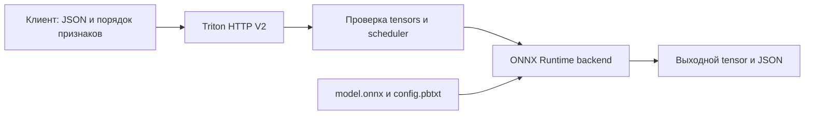

# 15. Triton Inference Server и перенос модели

[Программа](../../README.md) · [Задания](#задания) · [Подготовка](#подготовка-к-заданиям)

## Какую задачу решает перенос модели

В [модуле сервиса](../03-service-ci/README.md) Python API загружает Pipeline из `model.joblib` и вызывает predict. Теперь нужно отделить вычислительный граф модели от Python-обвязки, проверить сохранение прогнозов после переноса и отправить запрос специализированному серверу. Успешный экспорт файла не гарантирует ни правильных признаков, ни совпадения чисел.

**Triton Inference Server** — сервер обслуживания моделей NVIDIA. Он принимает HTTP/gRPC и передаёт вычисления выбранному backend. **Backend** здесь — исполнитель графа, например ONNX Runtime или TensorRT, а не весь прикладной сервис. Язык Triton для написания GPU kernels — отдельный проект. Triton Server не заменяет бизнес-валидацию и не обещает ускорения любой маленькой модели.

Нужен собственный обученный Pipeline и bundle `work/artifacts/model.joblib` из [обучения](../01-ml/README.md). Bundle содержит `pipeline` и сведения о признаках/версии. Структура описана в [контракте housing](../../labs/housing/README.md). Одна строка — район, восемь числовых признаков — характеристики жилья и населения, выход — прогноз стоимости в единицах 100000 USD. Пример численной проверки ниже не требует готовой модели. Настоящий export требует выполненного обучения.

## Подготовка к заданиям

Все команды выполняются из корня курса. Чистые функции матрицы, паритета и метрик работают в [основном Python-окружении](../../SETUP.md#основная-среда). Настоящий экспорт требует собственного bundle `work/artifacts/model.joblib` из [ML-notebook](../01-ml/housing.ipynb). SDK-тест экспорта создаёт маленькую модель во временной папке и не заменяет экспорт твоего bundle.

### Окружение ONNX

Для конвертации создай отдельное окружение Python 3.12. Требования включают базовые зависимости housing:

```bash
python3.12 -m venv .venv-onnx
source .venv-onnx/bin/activate
python -m pip install -r labs/triton/requirements.txt
python -m pip install --no-deps -e labs/housing
```

Здесь закреплены ONNX `1.17.0`, skl2onnx `1.18.0` и ONNX Runtime `1.22.0`. Экспорт и `CPUExecutionProvider` выполняют граф на CPU и не требуют GPU. Полученный ONNX сначала проверяется локально, затем переносится в model repository готовым `export.py` первого задания.

### Окружение HTTP-клиента

Triton HTTP SDK установлен отдельно от окружения экспорта. Создай клиентскую среду с базовыми зависимостями, `tritonclient[http]==2.59.0` и ONNX Runtime для численного сравнения:

```bash
python3.12 -m venv .venv-triton-client
source .venv-triton-client/bin/activate
python -m pip install -r labs/housing/requirements.txt
python -m pip install --no-deps -e labs/housing
python -m pip install -r labs/triton/client-requirements.txt
python -m pip install -r labs/triton/requirements.txt
python -c 'import tritonclient.http; import onnxruntime; print("HTTP client and ORT imported")'
```

У client есть универсальный Python wheel, но совместимость его транзитивных native-зависимостей с конкретными OS/Python проверяется установкой и импортом. Успешный импорт SDK не подтверждает совместимость серверного образа. SDK-тест задания 02 использует настоящие tensor/result types и синтетический ONNX, исполняемый ORT. Подменена только граница транспорта, сетевого Triton в этом тесте нет.

### Дополнительный сервер

[Compose](../../labs/triton/compose.yaml) курса предназначен для совместимого Linux x86_64 стенда. Образ `nvcr.io/nvidia/tritonserver:25.06-py3` исполняет табличную ONNX-модель через CPU instance из config. Соответствие архитектуры среды и образа проверяется отдельно от локального экспорта. TensorRT и TensorRT-LLM требуют отдельной совместимой NVIDIA-среды и к этому ONNX CPU-стенду не относятся.

| Настройка | Что означает |
|---|---|
| `--model-repository=/models` | Сервер загружает модели из `/models` внутри контейнера |
| `../../work/triton/model_repository:/models:ro` | Локальный экспорт подключён только для чтения. Путь считается от Compose-файла |
| `8000`, `8001`, `8002` на loopback | HTTP, gRPC и метрики соответственно |
| `shm_size: 1g` | Shared memory контейнера, не GPU VRAM |
| [config.pbtxt](tasks/01-onnx/config.pbtxt) | Имена tensors, FP32, batch до 32, CPU instance и dynamic batching |

После выполнения первого задания перенеси проверенные файлы и на совместимом серверном стенде запусти:

```bash
python modules/15-triton/tasks/01-onnx/export.py
docker compose -f labs/triton/compose.yaml up -d
curl --fail -i http://127.0.0.1:8000/v2/health/ready
curl --fail -i http://127.0.0.1:8000/v2/models/housing/ready
```

Останови другой процесс на портах 8000–8002 до запуска. Если модель не ready, читай `docker compose -f labs/triton/compose.yaml logs --tail=60`. Пустая папка версии без `model.onnx` не является готовой моделью. Численную проверку HTTP-выхода выполни вторым заданием.

## Задания

| Задание | Что выполнить | Файлы и среда |
|---|---|---|
| [01. Экспорт и паритет](tasks/01-onnx/README.md) | Собрать FP32-матрицу, сравнить прогнозы и экспортировать Pipeline | [solution.py](tasks/01-onnx/solution.py) · [Тесты](tasks/01-onnx/test_task.py). CPU |
| [02. HTTP SDK](tasks/02-server/README.md) | Собрать tensor-запрос и вернуть именованные outputs через SDK | [solution.py](tasks/02-server/solution.py) · [Тесты](tasks/02-server/test_task.py). CPU-клиент, live требует сервера |
| [03. Измерения](tasks/03-benchmark/README.md) | Измерить последовательные вызовы клиента и вычислить статистику | [solution.py](tasks/03-benchmark/solution.py) · [Тесты](tasks/03-benchmark/test_task.py). CPU-клиент, live требует сервера |

```bash
make task TASK=15-triton/01-onnx
make task TASK=15-triton/02-server
make task TASK=15-triton/03-benchmark
```

До реализации функций ожидается `NotImplementedError`. `MLOPS_RUN_SDK=1` включает локальные SDK-проверки заданий 01/02. `MLOPS_RUN_INTEGRATION=1` включает обращения к уже подготовленному Triton, не запускает его. При включении отсутствие нужных зависимостей, модели или сервера считается ошибкой. Без флагов проверки пропущены и не подтверждают live inference. `make test` проверяет готовую обвязку курса.

## Остановка

На серверном стенде останови Compose, в клиентском терминале выйди из отдельного окружения:

```bash
docker compose -f labs/triton/compose.yaml down
deactivate
```

Model repository остаётся в `work/`. Сохрани ONNX, hash, сведения о конвертации и исходные измерения для повторения.

## ONNX и граница preprocessing

После обучения Ridge у тебя есть не только коэффициенты: Pipeline ещё выполняет подготовку признаков. Чтобы другой runtime повторил прогноз, ему нужны те же операции с теми же параметрами. **ONNX** — формат графа вычислений: узлы представляют операции, рёбра — tensors. Tensor — многомерный массив с типом элементов и shape, то есть размерами осей. **ONNX Runtime** исполняет такой граф на выбранном устройстве. **skl2onnx** преобразует поддерживаемые sklearn-модели в ONNX. Это не универсальный сериализатор любого Python-кода.

**Opset** — версия набора ONNX-операций. В упражнении выбран opset 17, ONNX 1.17.0, skl2onnx 1.18.0, Runtime 1.22.0. Список opsets и поддержка converter/runtime — разные ограничения. Ошибка неподдерживаемого estimator или transformer требует проверки конвертера. Смена расширения joblib на onnx ничего не преобразует.

Экспортируй весь поддерживаемый Pipeline: обученная подготовка признаков должна оставаться той же. Если preprocessing остался на клиенте, его реализация становится частью serving-контракта. Расхождение подготовки между train и serving называют **training-serving skew**. Общий граф уменьшает этот риск, но не замечает неверный порядок входных столбцов сам по себе.

Вход `features` имеет dtype float32 и shape `[N,8]`, где N — число районов. Канонический порядок берётся из `housing.features.FEATURES`: MedInc, HouseAge, AveRooms, AveBedrms, Population, AveOccup, Latitude, Longitude. `float32` — 32-битное число с плавающей точкой. Оно может округлить исходное Python float. Поэтому конечность нужно сохранять и после преобразования, особенно для слишком больших значений.

Если объект JSON содержит `{"b":2,"a":1}`, а порядок признаков `["a","b"]`, матрица должна быть `[[1,2]]`, а не `[[2,1]]`. Обе имеют shape `[1,2]`, но только первая имеет нужный смысл. Лишний `target` нельзя случайно передать как девятый признак.

## Численная проверка переноса

Возьмём одни и те же районы и вычислим стоимость дважды: исходным Pipeline и его ONNX-графом. **Parity** — проверка, что два исполнения дают эквивалентные прогнозы в заданном допуске. Для каждого значения условие такое: `abs(observed-expected) <= atol + rtol*abs(expected)`. Здесь expected — прогноз исходного Pipeline, observed — ONNX Runtime. `rtol=1e-4`, `atol=1e-5`.

Для expected=2.0 допустимое отклонение равно `0.00001+0.0001*2=0.00021`. Observed=2.000001 проходит, observed=2.01 — нет. **Max absolute error** — максимум абсолютных различий по строкам. Это удобная диагностика, но сам допуск зависит также от величины expected. Форматы `[N]` и `[N,1]` означают по одному прогнозу на район и могут быть согласованы явно. Произвольное broadcasting недопустимо.

После экспорта открой модель через `InferenceSession(..., providers=["CPUExecutionProvider"])`. `get_inputs()` и `get_outputs()` показывают реальные имена, dtype и shape, `run` вычисляет выходы для входной матрицы. Проверь минимум 100 одинаковых строк исходным Pipeline и Runtime, включая крайние допустимые значения. Это проверяет перенос конкретных данных. Она не доказывает эквивалентность для всех мыслимых входов.

При расхождении сначала сравни строки и порядок признаков, затем dtype, preprocessing, converter и opset. Не подгоняй допуск под любую ошибку. Ошибка на 10000 USD и ошибка округления float32 требуют разного решения.

## Model repository и путь запроса

ONNX-файл уже проверен локально. Теперь серверу нужно указать, где взять граф, какой версией его считать и с какой конфигурацией загрузить. Triton читает эти сведения из **model repository**, каталога моделей. Для housing он имеет структуру:

```text
work/triton/model_repository/
└── housing/
    ├── config.pbtxt
    └── 1/
        └── model.onnx
```

`housing` задаёт имя в URL, `1` — версию модели для Triton. Это не обязательно версия MLflow: связь между ними задаётся manifest выпуска. Скрипт `tasks/01-onnx/export.py` переносит твои файлы в work. Он не выполняет обучение, parity или загрузку сервера.



HTTP-клиент должен знать имя входа `features`, тип FP32 и полный размер `[N,8]`. Python-метод Pipeline по сети не вызывается. Переставленные колонки проходят проверку размеров, поэтому канонический порядок восстанавливается клиентом до отправки.

## Разбор config и batch dimension

В предоставленном `config.pbtxt` каждая строка задаёт отдельную часть контракта:

| Поле | Что означает |
|---|---|
| `name: "housing"` | Имя модели. Согласуется с каталогом и URL |
| `platform: "onnxruntime_onnx"` | Граф исполняется ONNX Runtime backend |
| `max_batch_size: 32` | Сервер принимает batch до 32. Граф должен поддерживать изменяемую первую ось |
| input `features`, `TYPE_FP32`, `dims:[8]` | Имя, тип и восемь признаков одного объекта |
| output `variable`, `TYPE_FP32`, `dims:[1]` | Ожидаемый выход: одно число на объект. Имя/форму сверяй с фактическим ONNX |
| `KIND_CPU`, `count:1` | Один экземпляр исполнения на CPU, а не выделение GPU |
| `preferred_batch_size:[4,8]` | Желательные размеры объединения запросов scheduler |
| `max_queue_delay_microseconds:1000` | Допускаемое ожидание сборки batch до 1000 мкс, то есть 1 мс. Не предел всей latency |

При `max_batch_size>0` поле dims описывает один объект без batch-оси: dims=[8] даёт реальный input `[N,8]`. Для N=2 нужно 16 значений, а output обычно `[2,1]`. В HTTP V2 `shape` содержит полную форму. Если поставить dims=[-1,8] в такой конфигурации, будет добавлена лишняя ось: произойдёт mismatch. При max_batch_size=0 автоматической batch-оси нет. Это другой контракт. Правило — в [архивной конфигурации 25.06](https://docs.nvidia.com/deeplearning/triton-inference-server/archives/triton-inference-server-2560/user-guide/docs/user_guide/model_configuration.html).

Допустим, четыре клиента почти одновременно отправили по одному району. **Dynamic batching** позволяет scheduler объединить эти независимые запросы в одно вычисление. При низкой нагрузке ожидание может увеличить latency. При достаточной нагрузке вычисление batch может повысить throughput. Вместо четырёх матриц `[1,8]` backend может обработать одну `[4,8]`, а сервер распределит прогнозы обратно по запросам. Клиентский batch из нескольких районов и объединение разных запросов scheduler — два разных источника первой оси. Эффект проверяется измерением.

## HTTP V2 и готовность

Для `features` формы `[1,8]` запрос содержит `inputs` с `name`, `datatype:"FP32"`, `shape:[1,8]`, `data` из восьми чисел. Для `[2,8]` поле data содержит 16 значений построчно. Шаблон с null и пустым data показывает структуру. Отправлять его как готовый запрос нельзя.

Твоя `infer` использует необязательный `tritonclient[http]==2.59.0`: создаёт `InferInput` из той же FP32-матрицы, запрашивает `InferRequestedOutput`, вызывает `InferenceServerClient.infer` и извлекает именованный ndarray через `as_numpy`. CLI читает JSON-строки и печатает model/outputs с shape и данными. Это обычный табличный ONNX inference. Client зависимости отделены в `labs/triton/client-requirements.txt` от зависимостей экспорта ONNX. Окружения описаны в [подготовке](#подготовка-к-заданиям). API типов — в [официальной HTTP SDK reference](https://docs.nvidia.com/deeplearning/triton-inference-server/archives/triton-inference-server-2560/user-guide/docs/_reference/tritonclient/tritonclient.http.html).

Разделяй три проверки: `/v2/health/ready` — готовность сервера, `/v2/models/housing/ready` — доступность модели, `/v2/models/housing/infer` — реальное вычисление. HTTP 200 первого endpoint не доказывает правильный output. Метаданные модели доступны в `/v2/models/housing`. Config — в `/v2/models/housing/config`.

Compose монтирует `work/triton/model_repository` в `/models:ro`: сервер читает экспорт, а не каталог задания. HTTP работает на 8000, gRPC — 8001, метрики — 8002. Только чтение означает, что сервер не переписывает исходный model repository. После замены комплекта файлов перезапусти сервер и заново проверь модель.

## Как сравнивать latency и throughput

Сервер возвращает правильные числа. Следующий вопрос — сколько клиент ждёт ответа и сколько запросов система успевает обработать за серию. Для этого измеряются разные свойства нагрузки.

**Latency** — время от начала до завершения одного клиентского запроса. **Throughput** — число завершённых запросов за общую длительность эксперимента. Число одновременно ожидаемых ответов называют **concurrency**. При параллельной работе сумма latency может быть больше длительности эксперимента, поэтому throughput нельзя считать делением количества запросов на эту сумму.

В учебном примере задержки 10/20/30 ms измерены за 1 s. Median p50=20 ms. Для линейного p95 позиция в отсортированном массиве равна `(3-1)*0.95=1.9`. Интерполяция между 20 и 30 даёт 29 ms. Throughput=3/1=3 requests/s. Если один status=500, error_ratio=1/3. Контракт включает ошибки в latency и число всех запросов. Полезный throughput успешных ответов при необходимости считай отдельно и подписывай.

Твоя `benchmark` измеряет реальные вызовы своей `infer` в последовательной серии: warmup исключается, сырые latency/status и отдельный elapsed_seconds сохраняются CLI вместе с вычисленным `latency_summary`. Это baseline concurrency=1. Этот baseline показывает длительность одиночных последовательных вызовов и не измеряет нагрузку нескольких клиентов.

Для сравнения FastAPI/Triton используй ту же модель, строки, batch, hardware и concurrency. Отдели warmup — прогрев до измерений — от минимум 200 измеряемых запросов baseline. Сохраняй исходный CSV и общее elapsed_seconds, а не только p95. Метрики сервера не включают весь клиентский путь и не заменяют end-to-end измерение.

## Платформы и диагностика

Локальная CPU-часть — матрица, parity, ONNX Runtime и вычисление метрик. Дополнительный Triton-стенд курса — Linux x86_64 с образом 25.06-py3 и CPU instance. Совместимость серверного образа определяется его платформами и backend, независимо от успешного локального экспорта. TensorRT backend и TensorRT-LLM требуют отдельной совместимой NVIDIA-среды. CPU inference с ONNX не является GPU-практикой.

| Симптом | Как локализовать |
|---|---|
| Export не поддерживает оператор | Проверить converter конкретного Pipeline. Файл joblib ещё не граф ONNX |
| Модель не ready | Logs загрузки, путь /models/housing/1/model.onnx, фактические имена и dtype |
| Ошибка shape | Разделить dims объекта и полную shape запроса, проверить N×F и длину data |
| Запрос успешен, прогноз неверен | Сравнить порядок признаков, bundle и ONNX hash, затем parity |
| Через HTTP результат отличается от локального ONNX | Сверить, какой файл реально загружен сервером, outputs по имени и входы FP32 |
| Batching не ускорил ответ | Проверить нагрузку, очередь и вычислительную стоимость. Обещания по config недостаточно |

Для классификатора изображений вход мог бы иметь форму `[N,3,224,224]`: N изображений, три цветовых канала, высота и ширина. Тогда нужно согласовать ещё порядок каналов, масштаб пикселей и названия классов выходного массива. Для текстового классификатора входами могут быть целочисленные token IDs и attention mask, а выходом — оценки классов. Это другие tensor-контракты. В заданиях остаётся только Housing `[N,8] → [N,1]`. Авторегрессивная генерация с KV cache рассматривается отдельно в модуле 16.

## Материалы

- [Triton 25.06 configuration](https://docs.nvidia.com/deeplearning/triton-inference-server/archives/triton-inference-server-2560/user-guide/docs/user_guide/model_configuration.html) — batch, dims и instances выбранного релиза.
- [skl2onnx 1.18.0](https://github.com/onnx/sklearn-onnx/tree/v1.18) — converter и initial_types используемой версии.
- [ONNX Runtime Python](https://onnxruntime.ai/docs/api/python/api_summary.html) — InferenceSession, metadata и run. Версия окружения закреплена requirements.
