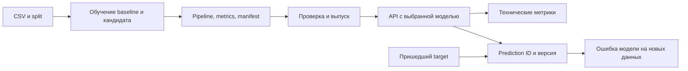

# 17. Подготовка к собеседованиям и защита проекта

[Программа](../../README.md) · [Практика](practice.md) · [Подсказки](hints.md)

## Какую задачу решает модуль

После учебного проекта осталось много разных результатов: Python-код, Docker/Helm-конфигурации, модель, метрики и, возможно, работающие стенды. Другому инженеру пока не очевидно, какую задачу они решают, что именно проверял автор и где заканчивается его опыт. Нужно связать факты в объяснение, которое можно проверить по коду и поведению системы.

Это рекомендательный модуль: здесь нет обязательных отчётов, записей выступлений, файлов для заполнения и тестов. Примеры помогают выбрать форму рассказа и обнаружить пробелы. Подставляй только свои результаты. Запускать дополнительные облачные сервисы или GPU ради формулировки в резюме не требуется.

Полезны результаты [обучения](../01-ml/README.md), [воспроизводимости](../02-reproducibility/README.md), [API](../03-service-ci/README.md), [учёта экспериментов](../04-mlflow/README.md) и [мониторинга](../09-monitoring/README.md). Не все части курса должны быть выполнены, чтобы объяснить уже работающий CPU-проект. Если ClearML использован только offline, а GPU-serving изучен по документации, это отдельные и вполне конкретные границы опыта.

## Предметный сценарий и путь данных

В учебном housing-проекте одна строка — район с числовыми характеристиками. **Признаки** — вход модели; **target** — известная медианная стоимость, с которой сравнивается прогноз. **Baseline** — простая модель для сравнения; кандидат — проверяемая альтернатива. **MAE** — среднее абсолютное отклонение прогнозов от target. Эти понятия стоит назвать до демонстрации инструментов, чтобы собеседник понимал смысл чисел.

Входы обучения — CSV, конфигурация и версия кода. Выходы — Pipeline, метрики, split и manifest происхождения. Pipeline объединяет подготовку признаков с моделью. **Артефакт** — созданный файл, который нужен следующему шагу, например `model.joblib`, читаемый API. **Manifest** — машинная запись, связывающая артефакт с данными, настройками и версиями. Подробные схемы — в [контракте housing](../../labs/housing/README.md).

Короткое объяснение ролей: обучение вычисляет модель, система учёта хранит связь запуска с результатами, механизм поставки выбирает разрешённый артефакт, API обслуживает запросы, мониторинг наблюдает поведение. Один инструмент может покрывать несколько ролей, но наличие его контейнера не доказывает, что роли действительно соединены.

Для Go backend аналогия — путь от исходников через сборку к версии API. Граница аналогии: поведение ML зависит ещё и от snapshot данных, preprocessing и выбора модели. Один commit и успешный healthcheck не доказывают качество прогнозов.

## От утверждения к доказательству

**Воспроизводимость** — возможность повторить результат при зафиксированных условиях. **Происхождение**, provenance, — связь результата с входами и преобразованиями. Hash CSV помогает отличить содержимое данных от похожего имени файла; split определяет, какие строки использовались для оценки. Seed полезен для повторения случайных операций, но не заменяет версии кода и библиотек.

| Утверждение | Что позволяет его проверить | Что остаётся за границей |
|---|---|---|
| «Кандидат лучше baseline» | Одинаковый test, реальные MAE/RMSE и способ выбора кандидата | Качество на другом населении или будущем трафике |
| «Запуск повторяется» | Данные/hash, split, code revision, зависимости и сравнение прогнозов | Побитовая идентичность разных GPU и runtime |
| «Модель готова обслуживать» | Readiness загрузки и настоящий корректный inference | Правильность всех прогнозов и доступность под нагрузкой |
| «Работает rollback» | Переключение артефакта, видимая версия и прогноз после него | Автоматическое исправление повреждённых данных |
| «Inference быстрее» | Один workload, hardware, batch/concurrency, warmup, ошибки и исходные задержки | Ускорение для другой модели или другого устройства |

**SLA** — договорённые обязательства по качеству сервиса; **SLO** — измеримая целевая характеристика, например доля успешных запросов с задержкой ниже порога. Сам факт наличия Prometheus и Grafana не означает ни проверенного SLO, ни production-эксплуатации. Локальный учебный стенд стоит называть именно так.

Численный пример: на одном и том же test baseline даёт MAE=0.50, кандидат=0.40 в единицах 100000 USD. Это средняя абсолютная ошибка 50000 и 40000 USD, снижение на `(0.50-0.40)/0.50=20%`. Это условная арифметика, не результат курса. MAE не означает, что каждый прогноз ошибается ровно на 40000 USD. Test не используется повторно для выбора гиперпараметров: иначе независимость оценки теряется.

## Как построить демонстрацию

Рассказ удобно вести по причинной цепочке: задача → входы и baseline → выбранная модель → выпуск → запрос → наблюдение → отказ и восстановление. Сначала объясни, какую проблему решал, затем покажи минимальный технический путь. Несколько проверяемых взаимодействий дают больше информации, чем перечень всех контейнеров.

Для CPU API можно показать четыре наблюдения: readiness после загрузки, корректный запрос, ошибку схемы и возврат предыдущего артефакта. Тело запроса и endpoint бери из своей реализации сервиса; housing API описан в [модуле 03](../03-service-ci/README.md). Успешный JSON должен содержать прогнозы и идентификатор модели, а ошибочный вход не должен незаметно превращаться в нули. Ошибочный HTTP-статус подтверждает отказ в запросе, но не доказывает, что бизнес-проверка полная.

**Rollback** — возвращение потребителей на предыдущий известный рабочий выпуск. Если model artifact загружается отдельно от image, возврат только контейнерного образа может оставить новую модель. Покажи согласованную пару image/model и фактическую версию после переключения. Для отказа используй только реально проверенный сценарий: например, модель не загрузилась из-за неверного пути. Сигнал, гипотеза, проверка и восстановление должны относиться к одному событию.

Если другой человек пробует README с чистого окружения, он должен видеть конкретные пути, версии и признаки готовности. Место, где автору приходится говорить «это у меня уже было настроено», показывает скрытую зависимость. Это полезная самостоятельная проверка документации, а не обязательная процедура сдачи.

## Как обсуждать архитектурные решения

Для каждого компонента объясняй инженерную причину: что ломалось без него, что он делает, какая более простая альтернатива есть, какие расходы он добавляет и как обнаруживается отказ. Например, cron запускает команду по расписанию. Airflow дополнительно описывает зависимости шагов, историю и повторы; для одной независимой команды эти возможности могут быть не нужны.

**Идемпотентность** означает, что повтор операции с тем же смысловым ключом не создаёт второй эффект. В backend это знакомо по повтору платежа с request ID. В ML-поставке повтор task после сетевой ошибки не должен создать второй выпуск, если первый уже опубликован. Но устойчивый ключ не отменяет проверку результата внешней операции и политику конфликтов.

Архитектурный вопрос часто меняет условия. При нескольких командах надо пересмотреть права, конкурентный выпуск, общее хранилище и базу метаданных. При длинном задержанном target технические метрики доступны сразу, а online MAE — после соединения prediction и target по устойчивому ID/времени и выбранному окну. **Drift** — изменение распределений данных или связей; он может стать сигналом для проверки, но сам по себе не измеряет MAE.

В [вопросах интервью](tasks/02-interview/README.md) примеры показывают порядок рассуждения. Если GPU не запускался, можно объяснить KV cache и различие TTFT/throughput, но результат unit-тестов нельзя назвать нагрузочным GPU-тестом. «Сам не проверял; сверил бы совместимость версии и выполнил такой-то эксперимент» точнее неподтверждённой уверенности.

## Резюме как проверяемое описание вклада

Полезная формула пункта: действие + результат + условия. Например: «Построил учебный CPU pipeline обучения и API для прогнозирования стоимости жилья; сравнил baseline и кандидата на фиксированном test, связал данные и артефакт модели через manifest». Снижение ошибки добавляется только после подстановки собственных чисел.

Для performance-пункта укажи baseline, модель, hardware, batch/concurrency, число запросов, warmup, p95 и ошибки. «Ускорил в 10 раз» без этих условий нельзя отличить от смены модели или размера batch. Если успешность не измерялась, лучше назвать реализованный механизм: «добавил клиентский расчёт TTFT и обработку SSE», а не приписывать ускорение сервера.

Go даёт переносимые навыки: API-контракты, конкурентность, очереди, поставка, эксплуатация. На ML-роли к ним нужны Python, массивы, split и качество данных. Большое число YAML не подтверждает понимание preprocessing, как и хороший MAE не доказывает надёжность доставки модели.

## Как выбрать следующий шаг

Сопоставляй интересующие роли с подтверждениями: код, воспроизводимый запуск, измерение или только чтение. Например, «Pipeline — реализован и проверен», «Kubernetes — запускал учебный Deployment, не администрировал общий кластер», «GPU serving — понимаю устройство, стенда не было». Это помогает выбрать один существенный пробел и не расширять стек ради количества названий.

Объявления о работе зависят от рынка; курс не утверждает, что все его инструменты сейчас обязательны. Для конкретной вакансии полезно отдельно посмотреть реальные требования и выбрать соответствующие части проекта. [Примеры резюме](tasks/03-resume/README.md) не требуют публикации или рассылки: это решение автора.

## Материалы

- [Google Rules of ML](https://developers.google.com/machine-learning/guides/rules-of-ml) — вопросы данных, baseline и training-serving skew для обсуждения решений.
- [FSDL: курс](https://fullstackdeeplearning.com/course/2022/) — lifecycle, testing и deployment; материал для повторения перед разговором, не список обязательных инструментов.
