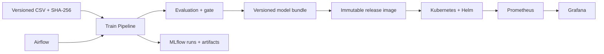

# Итоговый проект: воспроизводимый сервис прогнозирования

[Курс](../../README.md) · [Контракт кода](../../labs/housing/README.md) · [Критерии оценки](rubric.md)

## Задача и ограничения

Система прогнозирует медианную стоимость жилья района по восьми признакам California Housing. Цель проекта — показать управляемый ML-цикл. Исторический датасет не подходит для современных коммерческих оценок без новых данных и проверки применимости.

Итог: другой инженер может получить те же данные, обучить модель, проверить качество, развернуть выбранную версию и восстановить прежнюю после отказа. Основная версия работает локально на CPU. Search и NVIDIA serving — отдельные расширения, не обязательные зависимости API.

## Архитектура



На ноутбуке Airflow, MLflow, Kubernetes и monitoring не обязаны работать одновременно. Сохраняй артефакты между этапами. Для интегрированной демонстрации подними только нужные компоненты и укажи выделенную память.

## Этап 1. Данные и эксперимент

1. Скачай CSV через `python -m housing.data --output work/housing.csv`.
2. Зафиксируй источник, единицы, schema, SHA-256 и правила split 60/20/20.
3. Выполни baseline и выбор кандидата по validation; test оцени после выбора.
4. Сохрани bundle, metrics, manifest и split в `output/` задания кандидата по контракту starter. После проверки выполни `python modules/01-ml/tasks/02-candidate/export.py`, чтобы передать комплект в `work/artifacts/` для следующих этапов. Замена предыдущего результата требует `--replace`.
5. Объясни ограничения random split и результат по группам.

Приёмка: candidate test MAE не больше 0,9 baseline test MAE на одинаковых строках; preprocessing fit только на train. Порог учебный и не является бизнес-SLA. Повторные ручные улучшения по test запрещены: меняй эксперимент на validation, а при исчерпании holdout подготовь новую финальную оценку.

## Этап 2. Контракт и сервис

1. Включи учебные тесты: `RUN_EXERCISES=1 python -m pytest labs/housing/tests -v`.
2. Добавь тесты parity HTTP/Pipeline, испорченного bundle и перестановки входных ключей.
3. Запусти API с переменной окружения `MODEL_PATH`.
4. Проверь 200/422/503 и model_version в ответе.
5. Собери образ, проверь пользователя и отсутствие данных/секретов внутри.

Приёмка: минимум 100 одинаковых строк дают эквивалентные локальные и HTTP-прогнозы; без модели сервис не объявляет readiness.

## Этап 3. Учёт и оркестрация

1. В MLflow выполни минимум три запуска на одном split.
2. Сохрани параметры, метрики, bundle, split и data hash. Выбери конкретную registry version.
3. В Airflow реализуй validate → train → evaluate → publish; starter содержит только начальные границы.
4. Передавай через XCom пути и IDs, а не массивы данных.
5. Определи run_key и проверь повтор без второй смысловой публикации.

Приёмка: можно пройти от release к run, кода/конфигурации и версии данных. Негативная проверка блокирует publish плохого кандидата. Сбой tracking или publish не скрывается успешным статусом.

## Этап 4. Поставка и откат

Из собственного bundle собери immutable image:

```bash
docker build -t housing:course -f labs/housing/Dockerfile .
docker build -t housing:v1 -f labs/kubernetes/Dockerfile.model .
kind load docker-image housing:v1 --name mlops-course
helm --kube-context kind-mlops-course upgrade --install housing labs/helm/housing --set image.tag=v1 --wait --timeout 120s
```

Сохрани release manifest: image tag/digest, model_version, registry version, MLflow run ID, data hash, chart version, values и время выпуска. Подготовь v2 как отдельный image. Проверь откат при неверном bundle/image и восстановление именно v1.

Приёмка: после отката возвращается прежняя model_version, а прогноз на фиксированном batch совпадает с сохранённым v1 в допуске. Не ограничивайся `helm status deployed`.

## Этап 5. Мониторинг и инцидент

В отдельном Compose-стенде покажи RPS, errors, p95 и scrape availability. Выполни два отказа: остановка API и запуск без модели. Для каждого запиши время начала, обнаружения и восстановления. Объясни разницу scrape/ready/quality.

Качество оцени на отложенных labels с явной пометкой симуляции. Drift сравни по признакам reference/current и не называй его автоматическим доказательством ухудшения. Подготовь [runbook](../templates/runbook.md) и [разбор инцидента](../templates/incident.md).

## Этап 6. Передача проекта

README собственной реализации должен содержать:

- задачу, ограничения и архитектуру;
- точные команды подготовки, обучения, проверки и остановки;
- данные, версии, split, baseline и результат;
- выбранную версию поставки и процедуру отката;
- ресурсы, платформы, известные ограничения и непроверенные сценарии;
- отчёты о нагрузке и инциденте, путь к источникам.

Проверь README в новой директории или попроси другого инженера повторить. Исправь все места, где понадобилось устное объяснение. Результаты лабораторных без NVIDIA не превращай в строчку «опыт GPU-serving».

## Что добавить после основной версии

Выбирай по одному: поиск по документации, PostgreSQL/object storage для MLflow, загрузка модели через initContainer, drift/quality job с labels, полноценный Vault auth, GitOps, GPU inference. Go gateway имеет смысл после готового Python lifecycle: добавь timeout, ограничение concurrency и передачу model_version.
